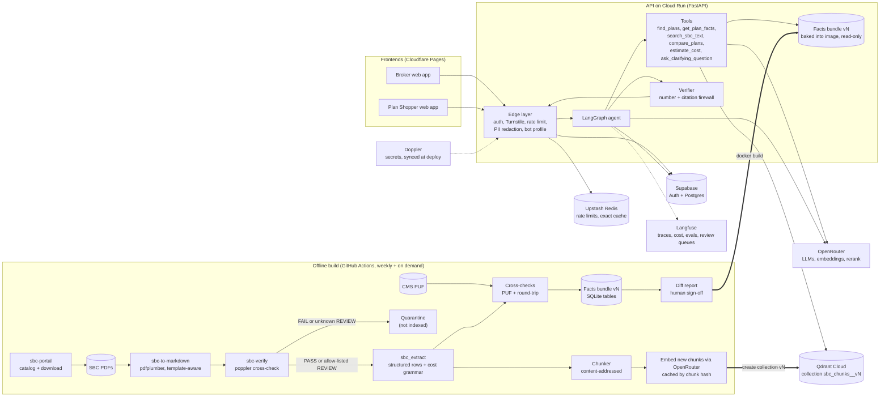

# sbc-agentic-rag

[](https://github.com/syamsruthin/sbc-agentic-rag/actions/workflows/ci.yml)

Agentic RAG chatbots that answer questions about U.S. health plans and compare them, using each plan's
Summary of Benefits and Coverage (SBC). Every number in an answer is the SBC's own wording, cited to the
plan, section and page.

> **Status: early implementation.** The SBC ingestion pipeline works today: 9,690 plan-year-2027 SBCs are
> converted to Markdown and independently verified. The chatbots are being built in phases; see
> [Status and roadmap](#status-and-roadmap). The full design is in [PLAN.md](PLAN.md).

## Two assistants, one core

| | Broker Assistant | Plan Shopper |
|---|---|---|
| Users | Logged-in brokers and HR teams | Anonymous public visitors |
| Plans | All SBCs, every state and market | Active Individual-market plans |
| Style | Dense tables, contract codes, CSV export, up to 6 plans | Plain language, up to 3 plans, never recommends a plan |

Both run the same pipeline on the same data. A bot profile (`config/bots/*.yaml`) sets each one's scope,
tools, tone, limits and retention, and the code enforces it.

## How it works

1. **Edge:** auth (or a bot check for the public app), rate limits, and PII redaction before anything leaves
   the server.
2. **Classify:** a small model works out the intent, plans, services and network tier, and rewrites vague
   questions into a precise request.
3. **Resolve plans in code:** IDs, then UI selection, then earlier turns, then name search. If more than one
   plan matches, it asks; it never guesses.
4. **Route:** simple lookups read exact values from a facts database (fast path). Comparisons, cost
   estimates and coverage checks go through a tool-using agent loop.
5. **Compose:** the model writes prose and refers to values by placeholder. It never types a number.
6. **Verify:** code rejects any number the model typed and checks citations and required SBC notes.
7. **Render:** the exact SBC wording goes in, with citations, a plan header and a disclaimer.

Arithmetic goes through a deterministic calculator, and "not mentioned in the SBC" is never presented as
"not covered".

## Architecture



**Stack:** Python 3.13, uv workspace, LangGraph, FastAPI, Qdrant Cloud, SQLite, OpenRouter (Claude Haiku 5.5,
Sonnet 5.5 and Opus 5.5; Voyage embeddings and rerank), Supabase, Upstash, Langfuse, Doppler, Cloud Run,
Cloudflare Pages. PLAN.md section 4 explains each choice.

## Repository layout

```
config/        base.yaml, bots/{broker,public}.yaml, env/{local,dev,prd}.yaml
packages/      Python workspace packages (imported as sbc_<name>)
  sbc_ingest/    catalog, download, convert, verify SBCs (sbc-portal, sbc-to-markdown, sbc-verify)
  sbc_extract/   Markdown -> structured rows, cost grammar
  sbc_index/     facts bundle + Qdrant collection builder
  core/          domain types, config loader, OpenRouter gateway
  retrieval/     plan resolver, service taxonomy, hybrid search
  tools/         agent tools, cost calculator
  agent/         LangGraph graph, prompts, verifier, renderer
  api/           FastAPI app
apps/          broker/, shopper/, chat-ui/ (React)
evals/         golden datasets, judge calibration, harness
tests/         unit/, integration/, contract/, load/
infra/         Docker, Cloud Run, Supabase migrations, Qdrant collection
docs/          pipeline notes, ADRs, runbook
data/          fetched and generated SBC data (not committed)
```

Module boundaries are enforced by import-linter: `api > agent > (tools | retrieval) > core`, build-time
packages (`sbc_ingest`, `sbc_extract`, `sbc_index`) are never imported at runtime, and `core` depends on
nothing internal.

## Getting started

Prerequisites: [uv](https://docs.astral.sh/uv/) 0.7 or newer and
[pre-commit](https://pre-commit.com/) (`uv tool install pre-commit`). The SBC verifier also needs poppler
(`brew install poppler` or `apt-get install poppler-utils`).

```bash
git clone https://github.com/syamsruthin/sbc-agentic-rag.git
cd sbc-agentic-rag
uv sync                # .venv with Python 3.13 and every workspace package
pre-commit install     # gitleaks, ruff, mypy and import contracts on each commit
cp .env.example .env   # or run commands through `doppler run --`
```

Run the same checks as CI:

```bash
uv run ruff check . && uv run ruff format --check .
uv run mypy
uv run lint-imports
uv run pytest tests/unit
```

To fetch and rebuild the SBC data locally, see [data/README.md](data/README.md). How the pipeline converts
and verifies SBCs is described in [docs/sbc-pipeline.md](docs/sbc-pipeline.md).

## Configuration

Behavior settings live in `config/` and are merged in order: `base.yaml`, then `bots/<bot>.yaml`, then
`env/<env>.yaml`, then `SBC_*` environment variables (for example `SBC_RETRIEVAL__RERANK_ENABLED=false`).
`APP_ENV` picks the environment. Secrets and deploy-time values come only from environment variables
(`.env.example` lists them) and are rejected if they appear in YAML. In `dev` and `prd` a bot refuses to start
if any secret it needs is missing.

## Status and roadmap

| Milestone | Status |
|---|---|
| Repository setup and public-repo hygiene | Done |
| Scaffolding: workspace, config, lint, types, tests, CI | Done (PR #1) |
| Phase 0: extraction, facts bundle, Qdrant loader, golden dataset v0 | Next |
| Phase 1: Broker Assistant MVP (internal alpha) | Planned |
| Phase 2: Broker beta (calculator, multi-turn, rankings) | Planned |
| Phase 3: Plan Shopper (public) | Planned |
| Phase 4: production hardening and GA | Planned |

[TODO.md](TODO.md) has the detailed checklist; PLAN.md section 11 has each phase's acceptance criteria and
eval bar.

## Data and disclaimer

This is an independent project. It is not affiliated with or endorsed by any insurer. SBCs are public
documents that insurers post on their websites; this repository does not include them, only the scripts that
fetch them. Answers summarize SBCs and are not a guarantee of coverage or cost, and not medical, legal, tax or
financial advice. Always check the official plan documents.

## License

[MIT](LICENSE)
