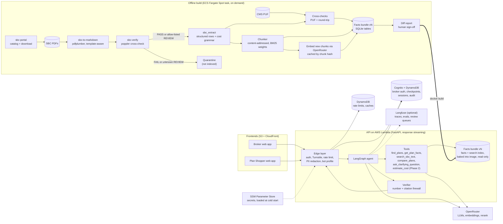

# sbc-agentic-rag

[](https://github.com/syamsruthin/sbc-agentic-rag/actions/workflows/ci.yml)

Agentic RAG chatbots that answer questions about U.S. health plans and compare them, using each plan's
Summary of Benefits and Coverage (SBC). Every number in an answer is the SBC's own wording, cited to the
plan, section and page.

> **Status: built, not yet deployed.** The SBC pipeline (9,692 plan-year-2027 SBCs converted to
> Markdown and independently verified), the facts bundle, the agent, the API and the web apps work today and
> run locally. The first AWS deployment is left; see [Status and roadmap](#status-and-roadmap). The full
> design is in [PLAN.md](PLAN.md).

## Two assistants, one core

| | Broker Assistant | Plan Shopper |
|---|---|---|
| Users | Logged-in brokers and HR teams | Anonymous public visitors |
| Plans | All SBCs, every state and market | Active Individual-market plans |
| Style | Dense tables, contract codes, CSV export, up to 6 plans | Plain language, up to 3 plans, never recommends a plan |

Both run the same pipeline on the same data. A bot profile (`config/bots/*.yaml`) sets each one's scope,
tools, tone, limits and retention, and the code enforces it.

## How it works

1. **Edge:** auth (or a bot check for the public app), rate limits, and PII redaction before anything leaves
   the server.
2. **Classify:** a small model works out the intent, plans, services and network tier, and rewrites vague
   questions into a precise request.
3. **Resolve plans in code:** UI selection, then IDs, then earlier turns, then name search. If more than one
   plan matches, it asks; it never guesses.
4. **Route:** simple lookups read exact values from a facts database (fast path). Comparisons, cost
   estimates and coverage checks go through a tool-using agent loop.
5. **Compose:** the model writes prose and refers to values by placeholder. It never types a number.
6. **Verify:** code rejects any number the model typed and checks citations and required SBC notes.
7. **Render:** the exact SBC wording goes in, with citations, a plan header and a disclaimer.

Arithmetic will go through a deterministic calculator (`estimate_cost`, planned for Phase 2), and "not mentioned in the SBC" is never presented as "not covered".

## Architecture



**Stack:** Python 3.13, uv workspace, LangGraph, FastAPI, SQLite (facts and search index in one file), OpenRouter (Claude Haiku 5.5,
Sonnet 5.5 and Opus 5.5; bge-m3 embeddings and Qwen3 rerank). The deployment is on AWS (PLAN.md revision 3): Lambda
behind CloudFront, S3, DynamoDB, Cognito, SSM Parameter Store, CloudWatch, ECS Fargate for the offline build, and AWS
CDK; Cloudflare Turnstile and optional Langfuse are the external services. PLAN.md section 4 explains each choice, and
[docs/aws/](docs/aws/MIGRATION_PLAN.md) has the deployment analysis, the migration plan and its progress.

## Repository layout

```
config/        base.yaml, bots/{broker,public}.yaml, env/{local,dev,prd}.yaml
packages/      Python workspace packages (imported as sbc_<name>)
  sbc_ingest/    catalog, download, convert, verify SBCs (sbc-portal, sbc-to-markdown, sbc-verify)
  sbc_extract/   Markdown -> structured rows, cost grammar
  sbc_index/     facts bundle builder, with its BM25 and embedding search index
  core/          domain types, config loader, facts and search readers, OpenRouter gateway
  retrieval/     plan resolver, query expansion, text-search pipeline
  tools/         agent tools (the cost calculator comes in Phase 2)
  agent/         LangGraph graph, prompts, verifier, renderer
  aws/           AWS adapters (sbc_aws): SSM secrets, DynamoDB checkpointer and stores, S3 PDF cache
  api/           FastAPI app: SSE chat, auth, guards, plan picker, PDF proxy, admin
apps/          landing/, broker/, shopper/, chat-ui/ (React + Vite npm workspace, AWS WP10; see apps/README.md)
evals/         golden datasets, judge calibration, harness
tests/         unit/, integration/, contract/, load/
infra/         Docker images and compose (docker/), AWS CDK app (cdk/: SbcFoundation + SbcApp stacks),
               the full local stack (local/: compose with AWS stand-ins and the Caddy edge)
scripts/aws/   bootstrap, deploy, frontends, secrets, images, users, demo password, offline build, smoke tests
scripts/local/ start, stop, bootstrap and run the full local stack (docs/local/RUNBOOK.md)
spikes/        throwaway AWS experiments and their scripts (docs/aws/SPIKES.md)
docs/          pipeline, agent graph, tools and answer-path notes; review sheets; ADRs; aws/ deployment track;
               local/ full local stack (branch main_local)
data/          fetched and generated SBC data (not committed)
```

Module boundaries are enforced by import-linter: `api > (agent | aws) > (tools | retrieval) > core`, build-time
packages (`sbc_ingest`, `sbc_extract`, `sbc_index`) are never imported at runtime, and `core` depends on
nothing internal.

## Getting started

Prerequisites: [uv](https://docs.astral.sh/uv/) 0.7 or newer and
[pre-commit](https://pre-commit.com/) (`uv tool install pre-commit`). The SBC verifier also needs poppler
(`brew install poppler` or `apt-get install poppler-utils`).

```bash
git clone https://github.com/syamsruthin/sbc-agentic-rag.git
cd sbc-agentic-rag
uv sync                # .venv with Python 3.13 and every workspace package
pre-commit install     # gitleaks, ruff, mypy and import contracts on each commit
cp .env.example .env   # local values; on AWS the secrets come from SSM Parameter Store
```

Run the same checks as CI:

```bash
uv run ruff check . && uv run ruff format --check .
uv run mypy
uv run lint-imports
uv run pytest tests/unit
```

To fetch and rebuild the SBC data locally, see [data/README.md](data/README.md). How the pipeline converts
and verifies SBCs is described in [docs/sbc-pipeline.md](docs/sbc-pipeline.md).

### Try the agent

With an embedded facts bundle and `OPENROUTER_API_KEY_BROKER` set, ask a question from the terminal:

```bash
FACTS_BUNDLE_PATH=bundles/facts-2027.1.sqlite uv run sbc-ask "What's the deductible on BTCU8?"
```

It prints the answer with its citations, then the path taken, the model calls and their cost. Run it without
a question for an interactive session. How a turn is handled is in [docs/agent-graph.md](docs/agent-graph.md);
the tools and the answer checks are in [docs/agent-tools.md](docs/agent-tools.md) and
[docs/answer-path.md](docs/answer-path.md).

### Run the whole stack locally

The branch `main_local` runs everything on one machine with stand-ins for the AWS services (DynamoDB Local,
S3Mock, moto for Cognito and SSM, Caddy in place of CloudFront), so the API uses the same AWS code paths it uses
on AWS:

```bash
make up      # stand-ins, edge, tables, users
make api     # the API natively with reload (or `make up-image` for the Lambda image)
make web     # build the apps with the local settings
```

Then open http://localhost:8088. Sign-in is real (local users `admin`, `broker` and `demo-broker`; passwords in
`.local/users.env`), and the Plan Shopper checks Turnstile with Cloudflare's test keys.
[docs/local/RUNBOOK.md](docs/local/RUNBOOK.md) has the details and
[docs/local/LOCAL_PLAN.md](docs/local/LOCAL_PLAN.md) the plan and what is built so far. The quicker setups below
still work.

### Run the API locally

```bash
APP_ENV=local FACTS_BUNDLE_PATH=bundles/facts-2027.2.sqlite \
  uv run uvicorn --factory sbc_api.app:create_app --port 8080
curl -s 'localhost:8080/api/healthz?deep=1'
curl -sN -X POST localhost:8080/api/broker/chat -H 'content-type: application/json' \
  -d '{"message": "What'"'"'s the deductible on BTCU8?"}'
```

Locally every request is a developer principal and the stores are in-process; set the `DDB_TABLE_*` variables
(and `AWS_ENDPOINT_URL_DYNAMODB` for DynamoDB Local) to use DynamoDB instead.

### Run the web apps locally

With the API running as above, from `apps/`: `npm install`, then `npm run dev:broker`, `npm run dev:shopper`
and `npm run dev:landing` in three terminals, and open http://localhost:5173. Locally the Broker Assistant
skips sign-in and the Plan Shopper skips Turnstile; [apps/README.md](apps/README.md) has the details.

To run the Lambda image itself on DynamoDB Local:

```bash
uv run python infra/docker/fixture_bundle.py bundles/fixture        # or a folder with a real facts.sqlite
SBC_BUNDLE_DIR=../../bundles/fixture docker compose -f infra/docker/compose.yaml up --build
```

[docs/aws/RUNBOOK.md](docs/aws/RUNBOOK.md) covers the images, the smoke test and the offline build; the AWS
deployment track is in [docs/aws/](docs/aws/MIGRATION_PLAN.md).

## Configuration

Behavior settings live in `config/` and are merged in order: `base.yaml`, then `bots/<bot>.yaml`, then
`env/<env>.yaml`, then `SBC_*` environment variables (for example `SBC_RETRIEVAL__RERANK_ENABLED=false`).
`APP_ENV` picks the environment. Secrets and deploy-time values come only from environment variables
(`.env.example` lists them) and are rejected if they appear in YAML. In `dev` and `prd` a bot refuses to start
if any secret it needs is missing.

## Status and roadmap

| Milestone | Status |
|---|---|
| Repository setup and public-repo hygiene | Done |
| Scaffolding: workspace, config, lint, types, tests, CI | Done (PR #1) |
| Phase 0: extraction, facts bundle with search index, golden dataset | Done: eval bar met and human sign-offs recorded (2026-11-02); taxonomy v2 synonyms left |
| Phase 1: Broker Assistant MVP (internal alpha) | In progress: tools, answer path, agent graph, the generation eval harness and the API (SSE chat, auth, guards, plan picker, PDF proxy) and the web apps done; deployment, the full gating run and the model bake-off left |
| Phase 2: Broker beta (calculator, multi-turn, rankings) | Planned |
| Phase 3: Plan Shopper (public) | Planned |
| Phase 4: production hardening and GA | Planned |
| Local track (branch `main_local`): the whole app on one machine with AWS stand-ins | L1 and L3–L7 done (stack, scripts, bootstrap, secrets from the local Parameter Store, real sign-in, Turnstile test keys, the apps behind the edge, request-ID lookup, Langfuse traces, record/replay of model calls); L2, L8 and L9 left, see [docs/local/LOCAL_PLAN.md](docs/local/LOCAL_PLAN.md) |
| AWS deployment track (branch `main_AWS`, the long-lived AWS branch; not merged into `main`) | WP0–WP12 done in code (config, AWS adapters, bundle PDF sources, API, auth, guards, PDF proxy, containers, CDK stacks, frontends, deploy and data-build workflows, observability with optional Langfuse); first deploy, WP13 and WP14 left |

[TODO.md](TODO.md) has the detailed checklist; PLAN.md section 11 has each phase's acceptance criteria and
eval bar. The AWS track's progress is in [docs/aws/TASKS_DONE.md](docs/aws/TASKS_DONE.md) and
[docs/aws/TODO.md](docs/aws/TODO.md).

## Data and disclaimer

This is an independent project. It is not affiliated with or endorsed by any insurer. SBCs are public
documents that insurers post on their websites; this repository does not include them, only the scripts that
fetch them. Answers summarize SBCs and are not a guarantee of coverage or cost, and not medical, legal, tax or
financial advice. Always check the official plan documents.

## License

[MIT](LICENSE)
