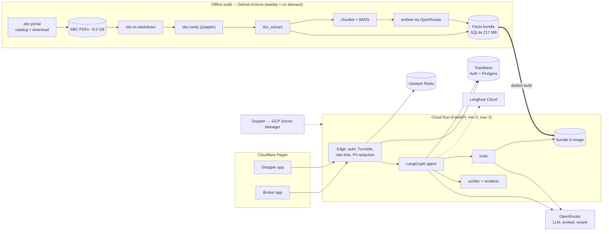
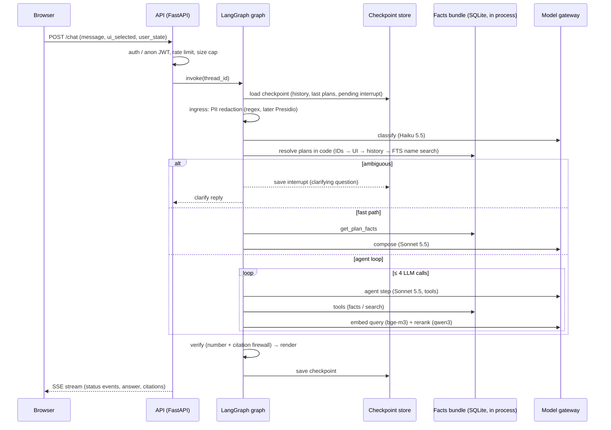
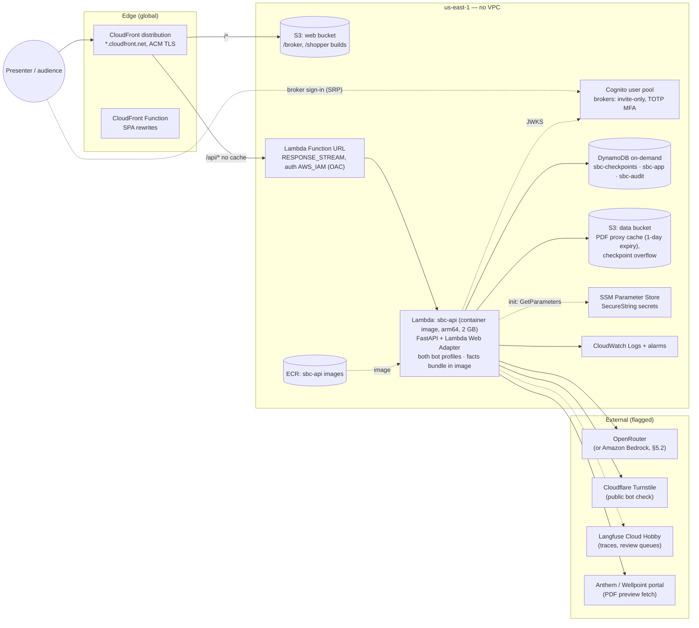
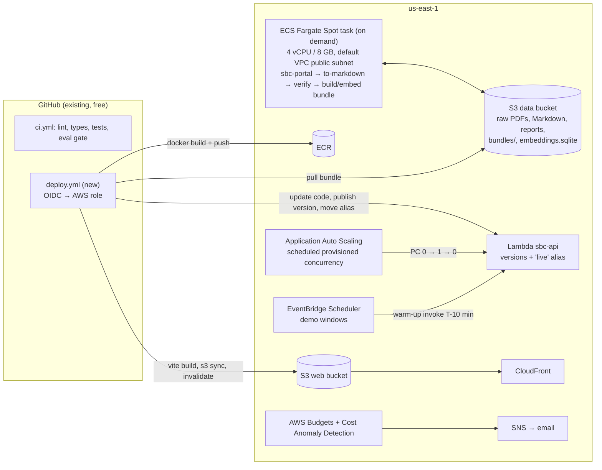
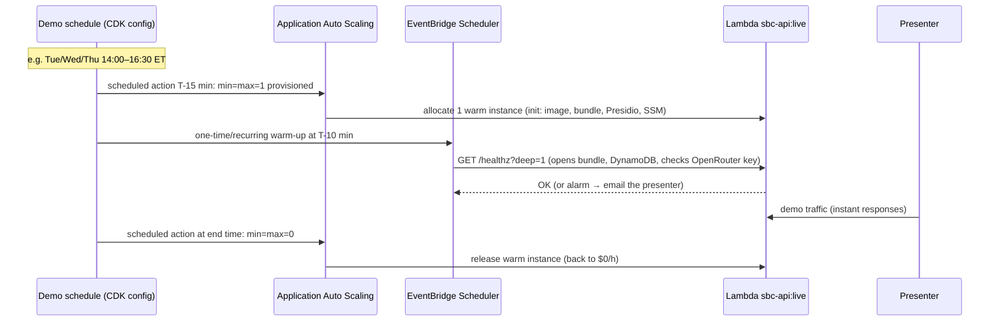
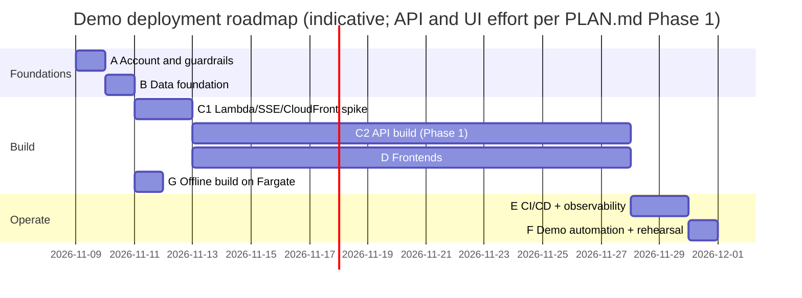
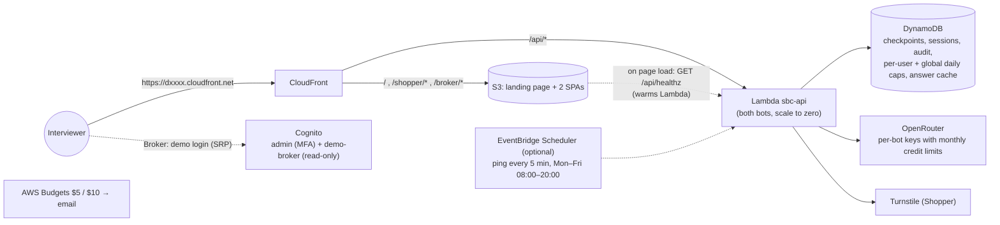

# sbc-agentic-rag on AWS: demo-optimized deployment analysis

**Repository:** `syamsruthin/sbc-agentic-rag`, branch `main` at `e7ec0e7` (2026-11-03)
**Region priced:** `us-east-1` (N. Virginia)
**Purpose:** discovery and architecture analysis only. No code was changed and nothing was deployed.
**Decisions taken from your answers:**

- Design for the **target application in PLAN.md**: API, both bots, both frontends, auth, database and the offline build. Each piece is marked as built or not built yet.
- **Both bots** are live in the demo: the Broker Assistant (login) and the Plan Shopper (anonymous).
- **LLM provider:** OpenRouter and Amazon Bedrock are both analyzed, with a recommendation.
- **Database:** Postgres on AWS and DynamoDB are both analyzed, with a recommendation.
- **SaaS dependencies:** AWS-native wherever that is cheap. A free external tool is kept only where the AWS equivalent costs money or a lot of work, and each one is flagged.
- **AWS account:** new, created after 15 July 2025, so it is on the credit-based Free plan.
- **Added later:** this is a **personal portfolio project**. It must run for **5–6 months** (possibly longer), with **both bots** reachable by interviewers at the **default `*.cloudfront.net` URL**.

> **Read §17 first.** It is the final recommendation for the portfolio use case ("portfolio mode"). Sections 1–16 are the general demo analysis it builds on. §18 covers whether the free tier is enough for 6 months, and §19 compares DigitalOcean.

---

## Contents

1. [The answer in one page](#1-the-answer-in-one-page)
2. [Existing application architecture](#2-existing-application-architecture)
3. [Proposed demo-optimized AWS architecture](#3-proposed-demo-optimized-aws-architecture)
4. [Component-to-AWS-service mapping](#4-component-to-aws-service-mapping)
5. [Decision analyses: database, LLM provider, compute](#5-decision-analyses)
6. [Migration requirements and gap analysis](#6-migration-requirements-and-gap-analysis)
7. [Detailed AWS infrastructure configuration](#7-detailed-aws-infrastructure-configuration)
8. [Service-by-service cost estimation](#8-service-by-service-cost-estimation)
9. [The three cost scenarios](#9-the-three-cost-scenarios)
10. [Demo usage costs: per session, per day, per month](#10-demo-usage-costs)
11. [Start/stop strategy and automation](#11-startstop-strategy-and-automation)
12. [Hidden costs and idle charges](#12-hidden-costs-and-idle-charges)
13. [Recommended lowest-cost architecture](#13-recommended-lowest-cost-architecture)
14. [Migration complexity, dependencies and risks](#14-migration-complexity-dependencies-and-risks)
15. [Phased migration and deployment roadmap](#15-phased-migration-and-deployment-roadmap)
16. [Pricing assumptions and sources](#16-pricing-assumptions-and-sources)
17. [Portfolio mode: final recommendation for a public interviewer URL](#17-portfolio-mode-final-recommendation)
18. [Is the AWS free tier enough for 5–6 months?](#18-is-the-aws-free-tier-enough-for-56-months)
19. [DigitalOcean comparison](#19-digitalocean-comparison)

---

## 1. The answer in one page

**The cheapest practical way to run the whole application on AWS for demos is a fully serverless, no-VPC design:**

- **One container-image Lambda function** runs the FastAPI app for both bots. It streams SSE responses through a Function URL and needs no load balancer.
- **CloudFront** serves both React apps from S3 and sends `/api/*` to the Lambda on the same domain.
- **DynamoDB** (on-demand) holds the LangGraph checkpoints, sessions, feedback, the audit log, kill switches, rate limits and the answer cache.
- **Cognito** handles broker login, with invite-only sign-up and TOTP MFA.
- **SSM Parameter Store** holds the secrets.
- **CloudWatch** handles logs and alarms.
- The **facts bundle**, a 217 MB SQLite file holding the facts and the search index, stays baked into the image, exactly as designed.
- The **offline SBC build** runs as an on-demand ECS Fargate Spot task that reads and writes S3.

Nothing in this design is billed by the hour while idle, except optional Lambda provisioned concurrency, which a schedule turns on only during demos. There is no NAT Gateway, no load balancer, no public IPv4 address, no always-on database and no Secrets Manager.

| | AWS infrastructure / month | LLM tokens / month (OpenRouter) | Total / month |
|---|---|---|---|
| **Recommended: on-demand** (scheduled warm instance during demos, typical 4 demos per week) | **≈ $2.00** | ≈ $14.60 | **≈ $16.60** |
| Ultra-low-cost (no warm instance; cold starts tolerated) | ≈ $0.40 | ≈ $14.60 | ≈ $15.00 |
| Always-on (warm instance 24/7) | ≈ $18.90 | ≈ $14.60 | ≈ $33.50 |

- **Per typical demo session** (2.5 hours, about 60 questions): about **$0.07 of AWS** plus about **$0.86 of LLM tokens**, so **≈ $0.95**.
- **A day with no demo** costs about **$0.02** of storage.
- **New-account credits** ($100, and up to $200) cover all of the AWS part for the 6-month Free-plan window. LLM tokens are still paid to OpenRouter.

**The cost is dominated by LLM tokens, not infrastructure.** The single biggest saving lever is the planned model bake-off: if Haiku 5.5 passes on the fast path or everywhere, LLM cost per session drops by 30–90%.

**Two decisions, with my recommendations:**

1. **Database: DynamoDB, not Postgres, for the demo** (§5.1).
   - Any Postgres on AWS puts the Lambda inside a VPC. The Lambda then needs paid internet egress (NAT) to reach OpenRouter, the Anthem portal, Cognito and Langfuse.
   - That costs $7–$80 a month and adds the most moving parts.
   - The official `langgraph-checkpoint-aws` package already provides a DynamoDB checkpointer.
   - The API and the database schema aren't written yet, so choosing DynamoDB now is a design choice, not a rewrite.
2. **LLM provider: stay on OpenRouter for the demo, and plan Bedrock for production** (§5.2).
   - On OpenRouter, the current code and the eval results (recall@5 0.920 with bge-m3 plus qwen3 rerank) carry over unchanged, at the same cost.
   - Bedrock serves the same Claude models, but not bge-m3 or qwen3-rerank. Moving means changing the embedding and rerank models, re-embedding the corpus and re-running the retrieval gates.
   - Bedrock is still the right home before GA, because PLAN.md lists the HIPAA BAA question as a launch blocker. If everything must be on AWS for the demo itself, the Bedrock variant costs about the same and is fully specified here.

---

## 2. Existing application architecture

### 2.1 What is on `main` today (validated in code)

| Area | Package / path | State on `main` | Runtime needs |
|---|---|---|---|
| SBC catalog and download | `packages/sbc_ingest` (`sbc-portal`) | **Built** | Outbound HTTPS to `sbc.anthem.com/dps`, `sbc.wellpoint.com/dps`, CMS PUF |
| PDF to Markdown | `sbc_ingest.to_markdown` (`pdfplumber`) | **Built** | CPU; about 55 min on 4 CPUs for 9,692 PDFs |
| Independent verifier | `sbc_ingest.verify` (`pdftotext`) | **Built** | **poppler-utils** binary; about 55 min on 4 CPUs |
| Extraction and cost grammar | `packages/sbc_extract` | **Built** | CPU only |
| Facts bundle and search index | `packages/sbc_index` (`sbc-build-bundle`, `sbc-embed-bundle`) | **Built** | SQLite; embeddings via OpenRouter `baai/bge-m3` (cached by chunk hash) |
| Domain, config, readers, gateway | `packages/core` | **Built** | `httpx`, `numpy`, `pydantic-settings`; SQLite opened `?mode=ro` (`facts.py:48`, `search.py:97`) |
| Plan resolver, text search | `packages/retrieval` | **Built** | In-process over the bundle; embedding and rerank via OpenRouter |
| Agent tools | `packages/tools` | **Built** (5 tools; `rank_plans`, `estimate_cost` and `glossary_lookup` are Phase 2) | In-process |
| LangGraph turn graph, verifier, renderer | `packages/agent` | **Built**: `build_graph(deps, checkpointer)`, interrupt-based clarification | Takes any `BaseCheckpointSaver`; the CLI uses `InMemorySaver` |
| PII redaction | `sbc_agent.redact` | **Regex only**; Presidio + spaCy NER is planned | Local CPU (Presidio adds roughly 150–250 MB to the image) |
| Dev CLI | `sbc-ask` | **Built** | Terminal only |
| FastAPI app (SSE, auth, rate limits, admin, audit, `GET /sbc/{plan_key}.pdf`) | `packages/api` | **Not built**: empty package | — |
| Broker and Shopper web apps, shared `chat-ui` | `apps/*` | **Not built**: `.gitkeep` only | React + Vite + TS (planned) |
| Operational DB schema, checkpoints | `infra/supabase/migrations` | **Not built** | Supabase Postgres (planned) |
| Container, deploy config | `infra/docker`, `infra/cloudrun` | **Not built** | Cloud Run (planned) |
| Langfuse tracing, Sentry | — | **Not built** | — |
| CI | `.github/workflows/ci.yml` | **Built**: lint, mypy, unit tests, gitleaks, deterministic eval gate | GitHub-hosted runners |

**Configuration** (`packages/core/src/sbc_core/config.py`):

- The YAML layers are merged in order: `config/base.yaml`, then `bots/{broker,public}.yaml`, then `env/{local,dev,prd}.yaml`, then `SBC_*` environment variables. Secrets are rejected if they appear in YAML.
- `EnvSettings.missing_for()` makes `dev` and `prd` refuse to start without the following:
  - `OPENROUTER_API_KEY_<BOT>`, `DATABASE_URL`, `UPSTASH_REDIS_REST_URL`/`TOKEN` and `LANGFUSE_*`;
  - for the broker, `SUPABASE_URL` and `SUPABASE_JWT_SECRET`;
  - for the public bot, `TURNSTILE_SECRET_KEY` and `SESSION_JWT_SECRET`.
- This list must change for AWS (§6.5).

**Measured facts that drive sizing** (from TODO.md and PLAN.md):

- **Bundle:** `2027.1` is 217 MB. It holds 9,690 plans and 30,498 unique chunks with 1024-dimension float16 vectors.
- **Search:** each search scores about 61 chunks per plan. Broker discovery scans the whole 30K-chunk corpus in tens of milliseconds.
- **Live LLM cost:** about **$0.003 per fast-path turn** and **$0.02–0.04 per agent-loop turn**.
- **Raw corpus:** about 6.55 GB of PDFs and about 6.4 GB for the whole `data/` tree.

### 2.2 Target architecture as designed (PLAN.md §3.1, §4, §9)

### 2.3 How one chat turn flows (`sbc_agent.graph`)

What this means for AWS:

- **The per-turn work is I/O-bound on the model gateway.** The CPU work (SQLite lookups, numpy scoring of a few hundred vectors, regex) takes milliseconds. A small serverless function is enough.
- **There is no shared in-memory state.** The bundle is read-only and identical in every instance. The only cross-request state is the **checkpoint**, which LangGraph needs so a clarifying question can resume on a later request. On any stateless platform, the checkpointer must be a database; `InMemorySaver` breaks as soon as a second instance serves the follow-up.
- **Every outbound call is public-internet HTTPS:** OpenRouter, the Anthem portal (for the PDF proxy), Turnstile, Langfuse and Cognito JWKS. Putting the API in a private VPC is what makes AWS expensive here (§12).

---

## 3. Proposed demo-optimized AWS architecture

### 3.1 Runtime (what serves a demo)

### 3.2 Build, deploy and demo control

**Design principles behind it:**

1. **No VPC for the API.** The Lambda keeps AWS's default internet egress, which costs nothing per hour. Everything it talks to is either a public AWS API (DynamoDB, S3, SSM, Cognito) or a public SaaS endpoint.
2. **One function for both bots.** PLAN.md selects the bot profile by route and checks it against the token claim. Routes are `/api/broker/...` and `/api/public/...`. One function means one warm instance, one image and one deploy.
3. **Same origin for the apps and the API.** CloudFront path routing removes CORS preflights and gives one URL to share in a demo.
4. **Everything is pay-per-use.** The only hourly charge is provisioned concurrency, and a schedule turns it on only in demo windows.
5. **Keep the bundle-in-image design.** It already avoids any search service. It also matches Lambda's 10 GB container limit and its image caching.

---

## 4. Component-to-AWS-service mapping

M = mandatory for a full end-to-end demo · O = optional (nice to have, or production-only)

| # | Application component | Today / planned | AWS target (recommended) | M/O | Change type | Notes |
|---|---|---|---|---|---|---|
| 1 | FastAPI API, SSE streaming, both bot profiles | Planned (Cloud Run) | **Lambda** (container image, arm64) + **Lambda Web Adapter** + **Function URL** (response streaming) | M | Build (not yet written) + Lambda packaging | Rejected alternatives: Fargate + ALB (≈ $40/mo idle), App Runner (closed to new customers since 30 Apr 2026), ECS Express Mode (creates an ALB) |
| 2 | Facts bundle + search index (SQLite, read-only) | Built | **Baked into the Lambda image** (copy at build from S3) | M | None | Check that the bundle isn't in WAL journal mode, or open it with `immutable=1` (§6.3) |
| 3 | LangGraph checkpoints (clarification interrupts, multi-turn) | `InMemorySaver` in CLI; `PostgresSaver` planned | **DynamoDB** via `langgraph-checkpoint-aws` `DynamoDBSaver`, with large checkpoints offloaded to S3 | M | Config/code: choose the saver | Alternative: Aurora Serverless v2 with PostgresSaver (§5.1) |
| 4 | Sessions, feedback, kill switches | Planned (Supabase Postgres) | **DynamoDB** table `sbc-app` | M | Build | Kill switches cached 60 s in process, as planned |
| 5 | Audit log (append-only, insert-only role) | Planned | **DynamoDB** table `sbc-audit`; the IAM role gets `PutItem` only | M | Build | IAM gives the insert-only guarantee without DB roles |
| 6 | Retention deletes (30 / 365 days) | Planned (daily job) | **DynamoDB TTL** attribute (deletes are free) | M | Build | No scheduled job needed |
| 7 | Rate limits (sliding window), exact-answer cache, query-embedding cache | Planned (Upstash Redis) | **DynamoDB** `sbc-app` (atomic counters, TTL) | M | Build an adapter | ElastiCache Serverless was rejected: at least ≈ $6/mo idle |
| 8 | Broker auth (invite-only, TOTP MFA, 12 h session, `role` claim) | Planned (Supabase Auth) | **Amazon Cognito** user pool (Lite or Essentials; free up to 10K MAU) + a group `broker` / `admin` | M | Build (JWT verify via JWKS) | TODO.md already plans JWKS verification instead of a shared secret |
| 9 | Public anonymous session JWT | Planned | **Unchanged**, signed by the API with `SESSION_JWT_SECRET` from SSM | M | None | — |
| 10 | Public bot check | Planned (Cloudflare Turnstile) | **Keep Cloudflare Turnstile** (external, free) | M | None | ⚑ External. AWS WAF CAPTCHA would need a web ACL (≥ $6/mo) |
| 11 | PII redaction | Regex built; Presidio planned | **In the Lambda image** | M | None | Presidio + spaCy add image size and cold-start time (§14) |
| 12 | LLMs (Haiku classify, Sonnet agent/compose), embeddings (bge-m3), rerank (qwen3) | Built (OpenRouter gateway) | **Demo: keep OpenRouter.** **Production: Amazon Bedrock** (Claude Haiku/Sonnet 5.5, Titan v2 or Cohere embeddings, Amazon or Cohere rerank) | M | Bedrock path: new gateway + re-embed + re-eval | ⚑ OpenRouter is external (§5.2) |
| 13 | Offline LLM judge (Opus 5.5) and evals | Partly built (retrieval and generation harnesses; the judge isn't built) | Runs from a laptop or GitHub Actions against OpenRouter/Bedrock | O | None | Not needed for a live demo; one-off gate run ≈ $10–30 |
| 14 | SBC PDF proxy `GET /sbc/{plan_key}.pdf` (1,383 preview-only SBCs) | Planned | **Same Lambda**; brief cache in **S3** (expires after 1 day) or `/tmp` | M | Build | Outbound to the Anthem portal from AWS IP ranges (risk §14) |
| 15 | Broker and Shopper SPAs | Planned (Cloudflare Pages) | **S3** (private, OAC) + **CloudFront** (default domain) | M | Build + `VITE_*` changes | Optional custom domain: Route 53 $0.50/mo + ACM (free) |
| 16 | Secrets (OpenRouter keys, session secret, Turnstile secret, Langfuse keys) | Doppler → GCP Secret Manager (planned) | **SSM Parameter Store** SecureString (standard tier, AWS-managed key: free) | M | Small code: load at init | Doppler can stay the source of truth through its AWS Parameter Store sync (O) |
| 17 | Container registry | Artifact Registry (planned) | **ECR** private repo, lifecycle keeps 3 images | M | None | ≈ $0.10/GB-month |
| 18 | Offline SBC build (catalog, download, convert, verify, extract, bundle, embed) | Built (runs locally); GitHub Actions weekly planned | **ECS Fargate Spot** one-off task (4 vCPU / 8 GB, 50 GB ephemeral storage) + **S3** data bucket | M (to rebuild data) | Dockerfile for the build image (+ poppler) | For the demo it runs **once**; the weekly refresh is optional |
| 19 | Corpus storage (PDFs, Markdown, reports, bundles, embedding cache) | Local disk / GCS (planned) | **S3** (Standard; PDFs can go to Glacier Instant Retrieval) | M | None | About 7.5 GB |
| 20 | CI (lint, types, tests, eval gate) | Built (GitHub Actions) | **Keep GitHub Actions** | M | None | ⚑ External, free. CodeBuild is possible but unnecessary |
| 21 | CD (image build, deploy, canary, rollback) | Planned (Cloud Run revisions) | GitHub Actions + **OIDC IAM role**; **Lambda versions and a weighted alias** for canary and rollback | M | Build workflow | Alias shift is the same idea as Cloud Run traffic splitting |
| 22 | Tracing, cost dashboards, annotation and review queues | Planned (Langfuse Cloud) | **Keep Langfuse Cloud Hobby** (external, free) + structured JSON logs in **CloudWatch** | O for demo | None | ⚑ External. Self-hosting Langfuse v3 on AWS needs Postgres, ClickHouse, Redis and S3 (≈ $60–150/mo) |
| 23 | Exceptions | Planned (Sentry) | **CloudWatch Logs** metric filter on `ERROR` + alarm → SNS email | O | Small | Sentry free can stay if preferred |
| 24 | Infra metrics, alerts, uptime | Planned (Cloud Monitoring) | **CloudWatch** metrics and alarms (10 free), **AWS Budgets**, **Cost Anomaly Detection** | M (budgets) / O (alarms) | IaC | Avoid 24/7 Synthetics canaries (§12) |
| 25 | Backups | Planned (nightly `pg_dump` to GCS) | DynamoDB **on-demand backup** before demos, or PITR (≈ $0.20/GB-mo) | O | IaC | Bundles are rebuildable and versioned in S3 |
| 26 | Demo start/stop | — | **Application Auto Scaling** scheduled actions + **EventBridge Scheduler** warm-up | O (recommended) | IaC | §11 |

---

## 5. Decision analyses

### 5.1 Operational database: DynamoDB vs Postgres on AWS

What has to be stored: LangGraph checkpoints (a few KB to tens of KB per step), sessions, feedback, the audit log, kill switches and, now, rate limits and caches. Total size for a demo is **well under 1 GB**.

| Option | Idle cost | Demo-hour cost | Code impact | Networking impact | Cold behavior | Verdict |
|---|---|---|---|---|---|---|
| **A. DynamoDB on-demand** (+ S3 offload for big checkpoints) | ≈ $0 (storage inside the 25 GB always-free allowance) | Fractions of a cent per session | Use `DynamoDBSaver` from `langgraph-checkpoint-aws`; write a small repository layer for the app tables. The API isn't written yet, so this is not a rewrite | **None.** Public AWS API over HTTPS with IAM; the Lambda stays outside any VPC | None; always ready | **Recommended for the demo** |
| B. Aurora Serverless v2 PostgreSQL, min 0 ACU (auto-pause) | Storage ≈ $0.10/GB-mo; $0 compute while paused | $0.12 per ACU-hour (≈ $0.06–0.12/h at 0.5–1 ACU) | Matches PLAN.md: `PostgresSaver`, SQL migrations, row-level security | Needs a **VPC**. A Lambda inside it loses internet access, so it needs a **NAT Gateway ($32.85/mo + $0.045/GB)** or a NAT instance (≈ $3 + $3.65 public IPv4/mo, or scheduled). Alternatives: the RDS Data API (HTTPS, no VPC, but `PostgresSaver` doesn't use it), or a public Aurora endpoint ($3.65/mo IPv4, port 5432 exposed) | **First connection after a pause takes ≈ 15–30 s** (must be pre-warmed before demos) | Use if Postgres parity matters more than cost. ≈ $4–8/mo with a scheduled NAT instance, ≈ $35+/mo with a NAT Gateway |
| C. RDS PostgreSQL `db.t4g.micro`, single-AZ, 20 GB gp3 | Storage $2.30/mo while stopped; instance $0.016/h while running | $0.016/h | Same as B | Same VPC/NAT problem as B | Stopping is manual or scheduled. **RDS restarts a stopped instance after 7 days**, so it must be stopped again | Cheaper than Aurora only if left running ($11.68/mo + storage); worse for the stop/start pattern |
| D. Keep Supabase (external) | $0 (free; pauses after inactivity) | $0 | None vs PLAN.md | Lambda outside a VPC reaches it fine | Free projects pause after about a week of inactivity | Doesn't meet "all services on AWS" |

**Why A wins for this demo:**

- It is the only option with **no idle charge, no networking cost, no pre-warm and no extra moving parts**.
- What it gives up is Postgres row-level security and SQL convenience. The API enforces per-broker access anyway (partition key = user ID), and the audit log becomes append-only through an IAM policy that allows only `PutItem`.

**Re-evaluate for production:** if the team wants SQL analytics over conversations, Aurora with a NAT Gateway, or Data API access, is the path. The rest of the AWS design doesn't change.

### 5.2 Model provider: OpenRouter vs Amazon Bedrock

| | **OpenRouter (keep)** | **Amazon Bedrock** |
|---|---|---|
| Chat models | `anthropic/claude-haiku-5.5`, `anthropic/claude-sonnet-5.5` (+ fallbacks) | Same Claude models (Haiku 5.5 on Bedrock since 7 Oct 2026). Use a cross-region inference profile in `us-east-1` |
| Embeddings | `baai/bge-m3` (1024-d, ZDR) – **corpus already embedded** | **bge-m3 is not offered.** Use Titan Text Embeddings V2 (1024-d, ≈ $0.02/M tokens) or Cohere Embed v4. **Re-embedding all 30,498 chunks is required** (a few cents) |
| Rerank | `qwen/qwen3-reranker-8b` (ZDR, ≈ $0.0005 per 20-doc rerank) | Amazon Rerank 1.0 (≈ $1 per 1K queries) or Cohere Rerank 3.5 ($2 per 1K queries, ≤ 100 docs per query) – about **2–4× the per-search cost**, still ≈ $0.001–0.002 |
| Code change | **None** | New gateway behind the same `llm` interface: the `Converse` API with tool use via boto3, IAM auth instead of a key, a cost table (Bedrock doesn't return a dollar cost the way OpenRouter does), `cachePoint` prompt caching, fallbacks in code. Change the bundle's embedding model check |
| Eval impact | Phase 0 retrieval results stay valid (recall@5 0.920 full setup) | **Retrieval gates must be re-run** (plan filter 100%, recall@5 ≥ 0.90, service mapping ≥ 95%); rerank lift re-measured |
| Data policy | ZDR routing per request (`provider.zdr = true`) | Bedrock doesn't store or train on prompts; **HIPAA-eligible with an AWS BAA** (resolves PLAN.md §1.4.2) |
| Billing | Separate OpenRouter credits (prepaid; a purchase fee applies) | On the AWS bill; budgets and alarms in one place. **Check whether new-account credits cover Anthropic models** (they're billed through AWS Marketplace), and whether the Free plan allows them (§14) |
| Cost per demo session | ≈ $0.86 (typical) | ≈ $0.90–0.95 (similar token prices; some sources list a ≈ 10% regional premium; rerank costs more) |
| Effort | 0 days | ≈ 3–5 engineer-days, including re-embed and eval reruns |

**Recommendation:**

- **For the demo, keep OpenRouter.** It is already built, already evaluated and costs the same.
- **Plan the Bedrock move before GA,** driven by the BAA requirement.
- The gateway is already isolated in `sbc_core.llm`, so this is a contained change.
- If the demo audience must see "100% AWS", do the Bedrock work in Phase C of the roadmap; the rest of this design is unchanged.

### 5.3 Compute: why Lambda

| Option | Idle cost / mo | Streams SSE | Scale to zero | Notes |
|---|---|---|---|---|
| **Lambda container + Web Adapter + Function URL** | **$0** (optional scheduled warm instance) | Yes (`RESPONSE_STREAM`, up to 15 min) | Yes | One request per instance; 10 GB image limit; free tier 1M requests + 400K GB-s/month (always free) |
| ECS Fargate 0.5 vCPU / 1 GB + ALB | ≈ $14.40 (task) + ≈ $16.40 (ALB) + ≈ $7–11 (public IPv4s) ≈ **$38–42** | Yes | Only by scaling the service to 0 (then the demo needs a start step and ~1 min) | Familiar container model, but paying for idle |
| ECS Express Mode | ALB + task, similar to Fargate | Yes | No | AWS's suggested App Runner replacement; not cheaper |
| App Runner | ≈ $2.50–10 (provisioned memory) | — | Pauses, but not to $0 | **Closed to new customers since 30 Apr 2026**, so a new account can't use it |
| EC2 `t4g.small` | ≈ $12.30 + IPv4 $3.65 + EBS | Yes | By stopping it | Self-managed OS; no advantage here |

**Lambda sizing:**

- **Architecture:** arm64. All runtime dependencies (`numpy`, `pydantic`, `httpx`, `langgraph`, Presidio/spaCy) ship arm64 wheels, and arm64 is about 20% cheaper.
- **Memory:** 2,048 MB. That gives about 1.15 vCPU for faster cold starts and covers SQLite page cache, numpy and spaCy.
- **Timeout:** 60 s. The turn budget is 25 s; the PDF proxy needs headroom.
- **Ephemeral `/tmp`:** 1,024 MB, for the PDF cache and the bundle copy if one is needed.

---

## 6. Migration requirements and gap analysis

### 6.1 Runs on AWS with no code change

| Component | Why it moves as is |
|---|---|
| `sbc_core` facts reader and `SqliteSearchIndex` | Read-only SQLite file opened by path (`FACTS_BUNDLE_PATH`); in-process numpy scoring |
| `sbc_retrieval` resolver and `TextSearcher` | Pure Python over the bundle + gateway |
| `sbc_tools` (5 tools), `sbc_agent` graph, verifier, renderer, fallback | `build_graph(deps, checkpointer)` already takes any LangGraph checkpointer |
| `sbc_core.llm` OpenRouter gateway | Plain HTTPS out of Lambda; retries and usage callbacks unchanged |
| Config layering, bot profiles, `config_hash` | `APP_ENV`, `SBC_*` → Lambda environment variables |
| Offline packages (`sbc_ingest`, `sbc_extract`, `sbc_index`) | Run unchanged in a Linux container (+ `poppler-utils`); paths point at a working directory synced with S3 |
| CI workflow | Unchanged on GitHub Actions |

### 6.2 Needs configuration or small code changes

| Item | Change |
|---|---|
| `EnvSettings` required variables (`config.py:207`) | Replace `DATABASE_URL`, `UPSTASH_*` and `SUPABASE_*` with AWS settings: `DDB_TABLE_APP`, `DDB_TABLE_AUDIT`, `DDB_TABLE_CHECKPOINTS`, `S3_DATA_BUCKET`, `COGNITO_USER_POOL_ID`, `COGNITO_APP_CLIENT_ID`, `COGNITO_ISSUER` |
| Secrets loading | Read SecureString parameters under `/sbc/<env>/` at Lambda init (boto3 or the Parameters and Secrets Lambda Extension); keep the "fail fast if missing" check |
| `FACTS_BUNDLE_PATH` | Point at the bundle path inside the image, e.g. `/opt/bundle/facts-2027.1.sqlite` |
| `.env.example`, `README` | Document the AWS variables (Supabase and Upstash removed) |
| Frontend env (`VITE_*`) | `VITE_API_BASE_URL=/api`; `VITE_COGNITO_USER_POOL_ID`, `VITE_COGNITO_CLIENT_ID` instead of `VITE_SUPABASE_*`; keep `VITE_TURNSTILE_SITE_KEY` |
| Prompt and trace metadata | Add the Lambda request ID to the trace correlation (replaces the Cloud Run request header) |

### 6.3 Needs architectural modification (or AWS-specific build choices)

| Area | Modification | Effort |
|---|---|---|
| API runtime | FastAPI behind the **Lambda Web Adapter** (`AWS_LWA_INVOKE_MODE=response_stream`, readiness check on `/healthz`). One process serves both bot profiles by route | Medium (packaging; the API itself is new work) |
| Checkpointer | `DynamoDBSaver` (`langgraph-checkpoint-aws`) with S3 offload, instead of `PostgresSaver` | Low |
| Operational data model | Key design for `sbc-app` (sessions, feedback, kill switches, rate windows, cache) and `sbc-audit` instead of SQL tables and migrations | Medium |
| Rate limiting and caches | DynamoDB conditional atomic counters per window + TTL, instead of Upstash sliding windows | Low–Medium |
| Auth | Cognito instead of Supabase Auth: invite via `AdminCreateUser` (self sign-up off), TOTP MFA required, groups → `role` claim, API verifies RS256 JWTs against the pool's JWKS | Medium |
| CloudFront → Function URL | With **Origin Access Control**, every POST must carry `x-amz-content-sha256` (the SHA-256 of the body) because Lambda doesn't accept unsigned payloads. The frontend computes it with `crypto.subtle` before each POST. Alternative: Function URL with auth `NONE` plus a secret origin header that the app checks | Low |
| Read-only image filesystem | SQLite in `?mode=ro` on a read-only filesystem works only if the bundle uses rollback journaling (not WAL). Check `PRAGMA journal_mode`, or open with `?mode=ro&immutable=1`, or copy it to `/tmp` at init | Low |
| Cold-start budget | A container image of about 0.6–0.9 GB (with Presidio/spaCy), SQLite open and config load. Estimated 3–10 s cold (unmeasured). Mitigated by scheduled provisioned concurrency (§11) | Low |
| Deploy and rollback | Lambda versions + `live` alias with weighted routing (10% canary) instead of Cloud Run revisions | Low |
| CI/CD identity | GitHub OIDC → IAM role instead of GCP Workload Identity Federation | Low |
| Offline build | Containerize the pipeline (Python 3.13 + uv + poppler); S3 sync in and out; run as an ECS task | Low–Medium |
| (Bedrock path only) | New Bedrock gateway, re-embed the bundle, re-run the retrieval and generation gates | Medium |

### 6.4 External dependencies and integrations

| Dependency | Used for | Kept? | Why / what to watch |
|---|---|---|---|
| OpenRouter | All model calls (demo) | ⚑ Yes | Already built and evaluated; per-bot keys with credit limits are the LLM cost cap |
| Cloudflare Turnstile | Public bot's session-start check | ⚑ Yes | Free, works on a `cloudfront.net` domain; AWS WAF CAPTCHA costs ≥ $6/mo |
| Langfuse Cloud Hobby | Traces, cost, review queues, datasets | ⚑ Yes (optional for the demo) | No AWS-native equivalent for annotation queues; 50K units/month free |
| Anthem / Wellpoint portals | Ingest, plus the live PDF proxy | Yes (source of truth) | Public portals; possible rate limiting or blocking of cloud IPs |
| CMS PUF download | Ingest cross-check | Yes | Public |
| GitHub Actions | CI/CD | ⚑ Yes | Free; deploys via OIDC |
| Doppler | Secrets source of truth | Optional | Can sync to Parameter Store; otherwise drop it and use Parameter Store directly |
| Sentry | Exceptions | Dropped (optional) | CloudWatch metric filter + alarm instead |

### 6.5 Environment variables, secrets, IAM and networking

**Lambda environment (non-secret):**

| Variable | Example |
|---|---|
| `APP_ENV` | `dev` (demo) |
| `LOG_LEVEL` | `INFO` |
| `FACTS_BUNDLE_PATH` | `/opt/bundle/facts-2027.1.sqlite` |
| `OPENROUTER_BASE_URL` | `https://openrouter.ai/api/v1` |
| `LANGFUSE_HOST` | `https://cloud.langfuse.com` |
| `DDB_TABLE_APP` / `DDB_TABLE_AUDIT` / `DDB_TABLE_CHECKPOINTS` | `sbc-demo-app` / `sbc-demo-audit` / `sbc-demo-checkpoints` |
| `S3_DATA_BUCKET` | `sbc-demo-data-<account>` |
| `COGNITO_USER_POOL_ID`, `COGNITO_APP_CLIENT_ID` | from the pool |
| `SSM_PREFIX` | `/sbc/dev/` |
| `AWS_LWA_INVOKE_MODE` | `response_stream` |
| `AWS_LWA_READINESS_CHECK_PATH` | `/healthz` |
| `PORT` | `8080` |

**SSM Parameter Store, SecureString, standard tier:**

- `/sbc/dev/OPENROUTER_API_KEY_BROKER`
- `/sbc/dev/OPENROUTER_API_KEY_PUBLIC`
- `/sbc/dev/SESSION_JWT_SECRET`
- `/sbc/dev/TURNSTILE_SECRET_KEY`
- `/sbc/dev/LANGFUSE_PUBLIC_KEY`
- `/sbc/dev/LANGFUSE_SECRET_KEY`

The Supabase keys and `SUPABASE_JWT_SECRET` go away: Cognito JWTs are verified with public JWKS.

**IAM roles (least privilege):**

| Role | Trusted by | Permissions |
|---|---|---|
| `sbc-api-exec` | Lambda | `logs:CreateLogStream/PutLogEvents`. `dynamodb:GetItem/PutItem/UpdateItem/Query/DeleteItem/BatchWriteItem` on the app and checkpoint tables. **`dynamodb:PutItem` only** on the audit table. `s3:GetObject/PutObject` on `pdf-cache/*` and `checkpoints/*`. `ssm:GetParametersByPath` on `/sbc/dev/*` and `kms:Decrypt` through the `aws/ssm` key. *(Bedrock path: `bedrock:InvokeModel`, `bedrock:InvokeModelWithResponseStream`, `bedrock:Rerank` on the chosen model ARNs.)* |
| `sbc-github-deploy` | GitHub OIDC (`repo:syamsruthin/sbc-agentic-rag:ref:refs/heads/main` + environment) | `ecr:*` push to one repo; ~~`lambda:UpdateFunctionCode/PublishVersion/UpdateAlias/GetFunction`~~ (as built, WP11: `sts:AssumeRole` on the CDK bootstrap roles instead, since CloudFormation owns the alias); `s3:Sync` on the web bucket; `s3:GetObject` on `bundles/*`; `cloudfront:CreateInvalidation` |
| `sbc-build-task` | ECS tasks | `s3:ListBucket/GetObject/PutObject` on the data bucket; `ssm:GetParameter` for the embedding key |
| `sbc-ecs-execution` | ECS | Pull from ECR, write logs (AWS-managed policy) |
| `sbc-scheduler` | EventBridge Scheduler | `lambda:InvokeFunction` on the warm-up target |
| People | IAM Identity Center | Admin with MFA; no long-lived access keys |

**Networking:**

- **API:** no VPC, so there is no NAT, no subnets and no security groups to maintain.
- **Offline build task:** runs in the account's **default VPC public subnet** with `assignPublicIp=ENABLED`. That needs no NAT; the public IPv4 is billed only while the task runs (≈ 3 h → $0.015).
- **Gateway endpoints:** S3 and DynamoDB gateway endpoints are free and only matter if the build ever moves to a private subnet.

---

## 7. Detailed AWS infrastructure configuration

Infrastructure as code: **AWS CDK (Python)** fits a Python team best, in one stack, `SbcDemoStack`. AWS SAM is a reasonable alternative for a Lambda-centric stack. Everything below is the minimum viable configuration.

### 7.1 Lambda `sbc-api`

| Setting | Value | Why |
|---|---|---|
| Package | Container image from ECR, base `python:3.13-slim` + `COPY --from=public.ecr.aws/awsguru/aws-lambda-adapter:<pinned> /lambda-adapter /opt/extensions/` | Keeps the planned Dockerfile (PLAN.md §9.2); the adapter turns HTTP into Lambda events |
| Image contents | `uv sync --frozen --no-dev` for the runtime packages only (`sbc_api`, `sbc_agent`, `sbc_tools`, `sbc_retrieval`, `sbc_core`), the `config/` directory and the bundle at `/opt/bundle/` | Build-time packages are never imported at runtime (import-linter contract) |
| Architecture | arm64 | ≈ 20% cheaper per GB-second |
| Memory / ephemeral | 2,048 MB / 1,024 MB | CPU for cold start; `/tmp` for PDF cache |
| Timeout | 60 s | 25 s turn budget + PDF proxy |
| Function URL | Invoke mode `RESPONSE_STREAM`; auth `AWS_IAM` behind CloudFront OAC | SSE through CloudFront without API Gateway |
| Concurrency | No reserved concurrency (see §14 on new-account quotas); cost capped by app rate limits + OpenRouter key limits + budget circuit breaker | Reserved concurrency needs ≥ 100 unreserved in the account |
| Provisioned concurrency | `live` alias: **0 normally, 1 during demo windows** (scheduled, §11) | Removes cold starts only when it matters |
| Versions / alias | `live` alias; deploys publish a version, smoke-test it, then move the alias (optional 10% weighted canary) | Rollback in seconds |
| Logs | JSON logs; log group retention **14 days** | The default "never expire" slowly accrues storage cost |
| Optional | SnapStart for container images (new in 2026; Python 3.12+ on supported base images). **Not recommended here:** it bills snapshot caching per GB-s for as long as the version is active (≈ $8/mo for 2 GB), more than scheduled provisioned concurrency, and it can't be combined with provisioned concurrency | Cost |

### 7.2 CloudFront distribution

| Behavior (path) | Origin | Cache policy | Origin request policy | Other |
|---|---|---|---|---|
| `/api/*` | Lambda Function URL (OAC, SigV4, always sign) | `CachingDisabled` | `AllViewerExceptHostHeader` (as built in WP9: an allow-list including `X-Sbc-Authorization`, because signing replaces `Authorization`, and `CloudFront-Viewer-Address`) | Methods GET/HEAD/OPTIONS/PUT/POST/PATCH/DELETE; origin response timeout 60 s (SSE status events keep the stream alive) |
| `/broker/*` | S3 web bucket (OAC) | `CachingOptimized` | — | CloudFront Function rewrites routes to `/broker/index.html` |
| `/shopper/*` (and `/` → redirect) | S3 web bucket (OAC) | `CachingOptimized` | — | Same rewrite |

- **Domain:** the default `dxxxx.cloudfront.net`, with TLS included. A custom domain is optional: Route 53 hosted zone $0.50/mo plus a free ACM certificate in `us-east-1`.
- **Pricing class:** `PriceClass_100` (North America and Europe).
- **Pricing plan:** pay-as-you-go with the always-free allowance (1 TB out, 10M requests, 2M CloudFront Function invocations per month). The newer flat-rate "Free" plan isn't available to Free-plan accounts, and pay-as-you-go is $0 here anyway.
- **Response headers policy:** CSP, HSTS, `X-Content-Type-Options`, per PLAN.md §8.
- **WAF:** not attached for the demo. A web ACL costs $5 a month plus $1 per rule; attach one for production.

### 7.3 S3 buckets

| Bucket | Contents | Settings |
|---|---|---|
| `sbc-demo-web-<acct>` | `broker/`, `shopper/` builds (≈ 5–10 MB) | Block Public Access on; OAC bucket policy; versioning off |
| `sbc-demo-data-<acct>` | `raw/sbc/2027/...` PDFs (6.55 GB), `markdown/` (≈ 0.2 GB), `reports/`, `bundles/facts-<v>.sqlite` (keep last 3), `bundles/embeddings.sqlite`, `pdf-cache/` (API), `checkpoints/` (DynamoDBSaver offload) | SSE-S3; lifecycle: `pdf-cache/` expires after 1 day, `raw/` → Glacier Instant Retrieval after 30 days (optional), old bundles expire after 90 days |

### 7.4 DynamoDB tables (on-demand, SSE with the AWS-owned key)

| Table | Keys | Items | TTL |
|---|---|---|---|
| `sbc-demo-checkpoints` | As created by `DynamoDBSaver` (thread/namespace/checkpoint ID) | LangGraph checkpoints and pending writes; payloads > 350 KB go to S3 | `expires_at` (30 days public, 365 days broker) |
| `sbc-demo-app` | `PK`, `SK` (single-table) | `SESSION#<id>`; `FEEDBACK#<session>`; `KILL#<bot>` and `QUARANTINE#<plan_key>`; `RATE#<bot>#<subject>#<window>` (atomic counter); `CACHE#<hash>` (exact answer, 24 h); `QEMB#<model>#<hash>` (query embedding) | `expires_at` |
| `sbc-demo-audit` | `PK = DAY#<yyyy-mm-dd>`, `SK = <ts>#<request_id>` | Actor hash, bot, plan keys, tools, verifier result, answer hash, bundle/model/prompt versions | `expires_at` (2 years) |

PITR is off for the demo. Take an on-demand backup before important demos (cents).

### 7.5 Cognito

- **User pool:** `sbc-demo-brokers`, Lite tier (or Essentials). The free tier covers up to 10K MAU on both.
- **Sign-up:** self sign-up disabled; users are invited by an admin (`AdminCreateUser`).
- **MFA:** required, TOTP (software token).
- **App client:** public SPA client with SRP auth and no client secret. Access token valid 1 h; refresh token valid 12 h, matching the PLAN.md session length.
- **Groups:** `broker` and `admin`. The API maps the `cognito:groups` claim to `role`.
- **Hosted UI:** optional. The broker app can use Amplify Auth or a small OIDC client.

### 7.6 Offline build (ECS Fargate Spot, on demand)

- **Task definition:** `sbc-build`, 4 vCPU and 8 GB, Linux/arm64, 50 GB ephemeral storage.
- **Image:** `python:3.13-slim` + `poppler-utils` + `uv sync --frozen`.
- **Command:**
  *(As built in WP8, the steps are `infra/docker/build-pipeline.sh`, with a content-based `s3_sync.py` instead of the AWS CLI; see RUNBOOK.md §3.)*
  1. `aws s3 sync s3://…/data/ ./data/`
  2. `sbc-portal catalog && sbc-portal download && sbc-portal manifest`
  3. `sbc-to-markdown && sbc-verify`
  4. `sbc-build-bundle --release --version <v>`
  5. `sbc-embed-bundle`
  6. retrieval eval on golden 0.2.0
  7. `aws s3 sync` back
- **Trigger:** manual (`aws ecs run-task`, or a GitHub Actions `workflow_dispatch`). The weekly EventBridge schedule stays **disabled** for the demo period.
- **Simplest first deployment:** upload the **existing locally built bundle `2027.1`** (217 MB) and `embeddings.sqlite` to S3, and run the Fargate build only when the data needs refreshing.

### 7.7 Observability, cost and security guardrails

**CloudWatch:**

- 14-day log retention.
- Metric filters for `level=ERROR`, `plan_filter_violation` (P1) and `verifier_block`.
- Alarms (within the 10 free):
  - Lambda `Errors` > 0 over 5 min;
  - `Throttles` > 0;
  - p95 `Duration` > 20 s;
  - the plan-filter violation filter > 0;
  - DynamoDB `SystemErrors`.
- All alarms notify SNS → email.

**Cost guardrails:**

- **AWS Budgets:** monthly cost budget of $10 with alerts at 50/80/100% (actual) and 100% (forecast). Budgets are free.
- **Cost Anomaly Detection:** free; daily email summary.
- **Budget circuit breaker (optional):** SNS → a tiny Lambda that sets the API function's reserved concurrency to 0 when the budget passes 150%. This is a hard stop for runaway AWS spend.
- **LLM spend:** capped by a **credit limit on each OpenRouter key** (broker and public), plus the per-turn dollar ceilings already in `config/bots/*.yaml` ($0.12 and $0.05).

**Security:**

- **CloudTrail:** the default event history (90 days of management events) is free. No paid trail is needed for the demo.
- **Do not enable** GuardDuty, Security Hub or AWS Config for the demo unless the organization requires them. They bill continuously.

---

## 8. Service-by-service cost estimation

Prices are `us-east-1` list prices (§16). **Typical demo month** = 4 demo days per week ≈ 17 sessions × 2.5 h ≈ 43 demo hours, ≈ 62 chat turns per session (≈ 25 per hour), 60% fast path / 40% agent loop.

| Service | Role | Minimum viable config | Pricing model | Hourly (when active) | Monthly (typical demo month) | Charges while idle? | How to cut idle cost |
|---|---|---|---|---|---|---|---|
| **Lambda** (requests + duration) | API for both bots | arm64, 2 GB, 60 s | $0.20 per 1M requests; $0.0000133334 per GB-s (arm); **always free: 1M requests + 400K GB-s/month** | ≈ $0.007/h at list (25 turns × 2 GB × 10 s) | **$0** (≈ 21K GB-s, far below 400K) | No | — |
| **Lambda provisioned concurrency** (optional) | No cold starts in demos | 1 × 2 GB on `live`, scheduled | ≈ $0.0000033334 per GB-s (arm) | **≈ $0.024/h** | ≈ $1.25 (43 h + 15-min pre-warm per session) | Only if left on | Scheduled scale to 0 (§11); 24/7 would be ≈ $17.50 |
| **CloudFront** | Apps + API on one domain | 1 distribution, PriceClass_100 | Per GB out + per 10K requests; **always free: 1 TB, 10M requests, 2M CF Function invocations** | $0 | **$0** | No | — |
| **S3** (web) | SPA assets | ≈ 10 MB | $0.023/GB-mo + requests | — | ≈ $0.00 | Storage only | — |
| **S3** (data) | PDFs, Markdown, bundles, caches | ≈ 7.5 GB Standard | $0.023/GB-mo | — | ≈ $0.17 (≈ $0.05 if `raw/` is in Glacier IR at $0.004/GB-mo) | **Yes** (storage) | Move PDFs to Glacier IR, or delete them and re-download for a rebuild |
| **DynamoDB** | Checkpoints, app data, audit | 3 tables, on-demand | ≈ $0.625 per 1M write request units, $0.125 per 1M read units; 25 GB storage always free | ≈ $0.002/h | ≈ $0.05 (≈ 70 WRU and 20 RRU per turn) | Storage only (free < 25 GB) | TTL keeps tables small |
| **ECR** | API + build images | 1–2 repos; keep 3 images | $0.10/GB-mo | — | ≈ $0.15–0.25 (≈ 0.8 GB × 2–3) | **Yes** (storage) | Lifecycle: keep last 2 |
| **ECS Fargate Spot** | Offline SBC build | 4 vCPU / 8 GB arm, on demand | Per vCPU-h and GB-h (Spot ≈ 60–70% off) | ≈ $0.06/h (Spot) or ≈ $0.16/h (on-demand) | ≈ $0.15–0.30 (one full ≈ 2.5 h build + a few incremental runs) | No | Run only when data changes |
| Public IPv4 (build task) | Egress for the build without NAT | Only while the task runs | $0.005/h | $0.005/h | ≈ $0.02 | No | — |
| **Cognito** | Broker login + MFA | Lite/Essentials user pool | Per MAU; **10K MAU free** (both tiers, no expiry) | $0 | **$0** | No | — |
| **SSM Parameter Store** | Secrets | 6 standard SecureStrings, AWS-managed key | Standard tier free; standard throughput free | $0 | **$0** | No | — |
| **KMS** | Encryption | AWS-managed keys only | $0 for AWS-managed keys; 20K requests/month free | $0 | **$0** | No | Avoid customer-managed keys ($1/key/mo) |
| **CloudWatch Logs** | Logs | 14-day retention | $0.50/GB ingest, $0.03/GB-mo; **5 GB free** | — | **$0** (≈ 0.1–0.3 GB) | Storage only | Short retention; INFO level |
| **CloudWatch alarms / metrics** | Alerts | ≤ 10 standard alarms | 10 alarms free; $0.10/alarm after | — | **$0** | Yes if > 10 | Stay ≤ 10 |
| **EventBridge Scheduler / Application Auto Scaling** | Demo start/stop | ≈ 4–6 schedules | Scheduler: 14M invocations/month free; App Auto Scaling free | $0 | **$0** | No | — |
| **SNS** | Alert email | 1 topic | 1K emails/month free | $0 | **$0** | No | — |
| **AWS Budgets / Cost Anomaly Detection** | Cost guardrails | 1–2 budgets | Free (budget actions: first 2 free) | $0 | **$0** | No | — |
| **Data transfer out** | Responses, PDF proxy | — | 100 GB/month free to the internet; origin → CloudFront free | $0 | **$0** | No | — |
| Route 53 (optional) | Custom domain | 1 hosted zone | $0.50/zone-mo | — | $0.50 if used | **Yes** | Use the `cloudfront.net` domain for demos |
| **Subtotal, AWS** | | | | **≈ $0.03/h in a demo** | **≈ $2.00** | | |
| **OpenRouter tokens** | LLM, embeddings, rerank | Per PLAN.md config | Per token (Sonnet 5.5 $2/$10 per M; Haiku 5.5 $0.10/$0.50 per M; bge-m3 $0.01/M; qwen3-rerank ≈ $0.20/M) | ≈ $0.35/h (25 turns × $0.0138) | **≈ $14.60** | No | Model bake-off: Haiku on the fast path or everywhere; prompt caching; exact-answer cache |
| Langfuse Cloud Hobby (external) | Traces | Hobby | Free ≤ 50K units/mo | $0 | $0 | No | — |
| Cloudflare Turnstile (external) | Bot check | Free | Free | $0 | $0 | No | — |

**Free-tier eligibility (new account, Free plan):**

- **Always Free; doesn't consume credits or count against the 6 months:** Lambda (1M requests, 400K GB-s), DynamoDB (25 GB), CloudFront (1 TB, 10M requests), CloudWatch (5 GB logs, 10 alarms), SNS, Cognito (10K MAU), SSM Parameter Store (standard), EventBridge Scheduler (14M), KMS (20K requests).
- **Not free; billed against the $100–200 credits:** provisioned concurrency, S3 storage beyond 5 GB-equivalent allowances, ECR storage, Fargate, the public IPv4 for the build.
- **The whole AWS bill above (≈ $2 a month) fits easily inside the credits.**
- **Caveat:** the Free plan ends after **6 months or when credits run out**, and then the account is **closed unless upgraded** to the Paid plan. Unused credits stay valid after upgrading (12 months from sign-up). Some services aren't available on the Free plan (§14).

---

## 9. The three cost scenarios

All three run **the same complete application**: both bots, auth, database, the PDF proxy, the offline build on demand, monitoring and every workflow. They differ only in idle behavior and warm capacity. LLM token costs are identical across scenarios, because they depend on how many questions are asked, not on uptime.

### 9.1 Scenario definitions

| | 1. Always-on | 2. On-demand (**recommended**) | 3. Ultra-low-cost |
|---|---|---|---|
| API compute | Lambda + **provisioned concurrency 1, 24/7** (no cold start ever) | Lambda scale-to-zero + **provisioned concurrency 1 only in scheduled demo windows** (+ 15 min pre-warm) | Lambda scale-to-zero, **no provisioned concurrency**; a free warm-up ping at T-10 min and every 5 min during the window; occasional 3–10 s cold start accepted |
| Database | DynamoDB on-demand + PITR on | DynamoDB on-demand | DynamoDB on-demand |
| Monitoring | Alarms + Route 53 health check on `/api/healthz` ($0.50) | Alarms | Alarms (free ones only) |
| Corpus storage | All in S3 Standard | All in S3 Standard | PDFs in Glacier IR (or not kept; re-downloadable from the public portals) |
| Offline build | Weekly incremental schedule enabled | On demand | On demand |
| Images kept in ECR | 3 | 3 | 1–2 |

### 9.2 Monthly AWS cost by scenario (typical demo month)

| Line item | 1. Always-on | 2. On-demand | 3. Ultra-low |
|---|---|---|---|
| Lambda provisioned concurrency (2 GB, arm) | $17.52 | $1.25 | $0.00 |
| Lambda requests + duration | $0.00 | $0.00 | $0.00 |
| DynamoDB (requests; storage free) | $0.05 | $0.05 | $0.05 |
| DynamoDB PITR (≈ 0.2 GB) | $0.04 | — | — |
| S3 (web + data) | $0.17 | $0.17 | $0.05 |
| ECR | $0.24 | $0.24 | $0.10 |
| Fargate Spot builds + IPv4 | $0.40 (weekly) | $0.25 | $0.20 |
| Route 53 health check | $0.50 | — | — |
| CloudFront, Cognito, SSM, CloudWatch, Scheduler, SNS, Budgets | $0.00 | $0.00 | $0.00 |
| **AWS total / month** | **≈ $18.90** | **≈ $1.96** | **≈ $0.40** |
| AWS hourly-equivalent (÷ 730 h) | ≈ $0.026/h | ≈ $0.003/h | ≈ $0.0005/h |
| OpenRouter tokens (typical month) | ≈ $14.60 | ≈ $14.60 | ≈ $14.60 |
| **All-in / month** | **≈ $33.50** | **≈ $16.60** | **≈ $15.00** |
| Out-of-pocket AWS while Free-plan credits last | $0 | $0 | $0 |

### 9.3 For comparison: Postgres and container variants

What changes if PLAN.md's Postgres is kept, or if a conventional container host is used:

| Variant (replaces one part of Scenario 2) | Extra AWS / month | Extra operations |
|---|---|---|
| Aurora Serverless v2 PG (min 0 ACU) + **NAT Gateway** | + ≈ $33–36 (NAT $32.85 + ≈ 43 h × 0.5–1 ACU ≈ $2.60–5.20 + storage) | VPC, subnets, Lambda-in-VPC, NAT; pre-warm Aurora 15–30 s before demos |
| Aurora Serverless v2 PG + **NAT instance (`t4g.nano`) scheduled to demo hours** | + ≈ $4–8 (NAT instance and IPv4 ≈ $0.40, EBS $0.64, ACU $2.60–5.20, storage) | Self-managed NAT instance; two more things to start and stop |
| RDS `db.t4g.micro` + NAT Gateway, always on | + ≈ $47 | Same VPC work; 7-day auto-restart if stopped |
| Fargate 0.5 vCPU / 1 GB + ALB instead of Lambda (always on) | + ≈ $38–42 | Service, ALB, target groups, IPv4s |

These show why the recommended design avoids VPCs and load balancers: **each of them costs more per month than the whole recommended AWS bill.**

---

## 10. Demo usage costs

### 10.1 Assumptions

- **Demo frequency:** 3–5 days per week (× 4.33 weeks), 2–3 hours per demo, one session per demo day.
- **Questions:** ≈ 25 chat turns per demo hour. That is a presenter-driven pace with explanations; it includes clarifying questions, comparisons and a few PDF opens.
- **Turn mix:** 60% fast path at ≈ $0.003 and 40% agent loop at ≈ $0.03 (the midpoint of the measured $0.02–0.04), so **≈ $0.0138 per turn** on the current models.
- **Cost sensitivity:**
  - Haiku 5.5 on the fast path *and* in the agent loop, if the bake-off passes: ≈ $0.0015–0.003 per turn.
  - All agent turns at $0.04: ≈ $0.026 per turn.
- **Outside demo hours:** no traffic; no background processing apart from an occasional manual data build.

### 10.2 Per session and per day (recommended Scenario 2)

| | Light (2 h, 50 turns) | Typical (2.5 h, ≈ 62 turns) | Heavy (3 h, 75 turns) |
|---|---|---|---|
| Provisioned concurrency (window + 15 min) | $0.054 | $0.066 | $0.078 |
| Lambda duration/requests | $0 (free tier) — $0.013 at list | $0 — $0.017 at list | $0 — $0.020 at list |
| DynamoDB requests | $0.002 | $0.003 | $0.004 |
| CloudFront / S3 / logs | $0 | $0 | $0 |
| **AWS per session** | **≈ $0.06** | **≈ $0.07** | **≈ $0.08** |
| LLM tokens (OpenRouter, current models) | $0.69 | $0.86 | $1.04 |
| LLM tokens, worst case (all agent turns at $0.04) | $2.00 | $2.50 | $3.00 |
| LLM tokens if Haiku passes everywhere | ≈ $0.10 | ≈ $0.12 | ≈ $0.15 |
| **All-in per session (current models)** | **≈ $0.75** | **≈ $0.93** | **≈ $1.12** |
| Fixed daily cost (storage), every day | ≈ $0.02 | ≈ $0.02 | ≈ $0.02 |
| **Per demo day** | **≈ $0.77** | **≈ $0.95** | **≈ $1.14** |
| **Per non-demo day** | **≈ $0.02** | **≈ $0.02** | **≈ $0.02** |

### 10.3 Per month

| Demo pattern | Sessions / month | Demo hours | AWS | LLM (current models) | **Total** |
|---|---|---|---|---|---|
| Light: 3 days/week × 2 h | 13 | 26 | ≈ $1.40 | ≈ $9.00 | **≈ $10.40** |
| Typical: 4 days/week × 2.5 h | 17 | 43 | ≈ $1.96 | ≈ $14.60 | **≈ $16.60** |
| Heavy: 5 days/week × 3 h | 22 | 65 | ≈ $2.50 | ≈ $22.90 | **≈ $25.40** |

**One-off costs** (not monthly):

- **Re-embedding:** only if the corpus changes or the Bedrock path is chosen; ≈ $0.01–0.10.
- **A full data rebuild on Fargate Spot:** ≈ $0.20.
- **One Phase 1 gating eval run** (353 items, answers + judge): roughly **$10–30** in LLM tokens.
- **Rehearsal sessions:** cost the same as demos.

---

## 11. Start/stop strategy and automation

### 11.1 Which services scale down, which bill when idle

| Service | Scale-to-zero / on-demand | Bills while idle? | What the strategy does |
|---|---|---|---|
| Lambda (on-demand) | Yes, natively | No | Nothing to stop |
| Lambda provisioned concurrency | Scheduled 0 ↔ 1 | **Yes, while > 0** | App Auto Scaling scheduled actions |
| CloudFront, S3 (web) | Always available, pay per request | No (except tiny storage) | Nothing |
| DynamoDB on-demand | Yes | Storage only (free < 25 GB) | Nothing |
| Cognito, SSM, Scheduler, SNS, Budgets | Yes | No | Nothing |
| ECS build task | Runs only when started | No | Started manually or by a workflow |
| S3 (data), ECR | n/a | **Yes**, storage (≈ $0.40/mo) | Lifecycle rules |
| CloudWatch Logs | n/a | Storage (cents) | 14-day retention |
| *(Postgres variant)* Aurora / RDS / NAT | Aurora auto-pauses; RDS and NAT need start/stop | **Yes** (storage; NAT Gateway hourly) | Would need extra schedules, which is why it isn't recommended |

**Can the whole environment be started and stopped through one simple mechanism?**

- **Yes,** and there is very little to stop: only provisioned concurrency has an hourly price.
- The environment is effectively **always deployed and always reachable**.
- "Start" means *warm it up so the first question is instant*. "Stop" means *drop the warm instance*.

### 11.2 Recommended mechanism: a demo calendar in IaC, plus a manual override

1. **Scheduled, no manual steps.** The demo windows are a list in the CDK config, such as `["cron(45 13 ? * TUE,WED,THU *)", ...]`, with the time zone set. Each window creates two Application Auto Scaling scheduled actions on the `live` alias: provisioned concurrency up to 1 at T-15 min and down to 0 at the end. Both are free.
2. **Readiness check.** EventBridge Scheduler calls `/healthz?deep=1` at T-10 min. A failure triggers an alarm email, so a broken key or bad deploy is caught before the audience arrives.
3. **Ad-hoc demos.** A one-line script or `make` target, `scripts/demo.sh up|down`, calls `put-provisioned-concurrency-config` and `delete-provisioned-concurrency-config` on the alias. A GitHub Actions `workflow_dispatch` "Demo up / Demo down" button does the same from a phone. A forgotten "up" costs only ≈ $0.58 a day, and the next scheduled "down" resets it.
4. **Safety nets:**
   - The AWS budget alerts at $5 and $10.
   - The optional circuit breaker sets reserved concurrency to 0 above the budget.
   - OpenRouter key credit limits cap LLM spend.
   - The app's own per-bot rate limits and per-turn dollar ceilings stay on.
5. **Ultra-low-cost mode** (Scenario 3): drop step 1 and keep step 2 as a warm-up ping every 5 minutes during the window. That costs nothing, but a second concurrent request can still hit a cold start.

### 11.3 Automation that avoids unnecessary spend

| Automation | Effect |
|---|---|
| Scheduled provisioned concurrency | Pays for warmth only in demo windows (≈ $1.25/mo instead of ≈ $17.50) |
| ECR lifecycle (keep 3) | Old images don't pile up |
| S3 lifecycle (`pdf-cache/` 1 day, old bundles 90 days, PDFs → Glacier IR) | Storage stays at cents |
| DynamoDB TTL | Retention enforced for free; tables stay tiny |
| CloudWatch log retention 14 days | No unbounded log storage |
| Weekly data build **disabled** during demos | No surprise Fargate runs |
| Budgets + anomaly detection + the circuit breaker | Catches surprises within a day |
| OpenRouter per-key credit limits | Caps the dominant cost line |

---

## 12. Hidden costs and idle charges

Services that charge **even when the application isn't being used**, and how this design avoids each one:

| Hidden cost | Price | How it sneaks in | Avoided by |
|---|---|---|---|
| **NAT Gateway** | $0.045/h (≈ $32.85/mo) + $0.045/GB | Putting Lambda in a VPC to reach RDS/Aurora, then needing internet for OpenRouter | No VPC for the API; DynamoDB over its public endpoint |
| **Public IPv4 addresses** | $0.005/h each (≈ $3.65/mo) | ALBs (1 per AZ), public RDS, EC2/Fargate with public IPs, NAT | No ALB, no public DB; only the short-lived build task |
| **Application Load Balancer** | ≈ $16.40/mo + LCUs | Fargate/ECS designs, ECS Express Mode | Lambda Function URL (free) |
| **Secrets Manager** | $0.40 per secret/mo + API calls | Default choice for secrets (6 secrets ≈ $2.40/mo) | Parameter Store standard SecureString (free) |
| **Customer-managed KMS keys** | $1/key/mo | "Encrypt with my own key" defaults | AWS-managed keys |
| **Provisioned concurrency left on** | ≈ $0.58/day for 1 × 2 GB | Forgotten after a demo | Scheduled scale-down at the end of every window |
| **Lambda SnapStart (Python)** | Snapshot cache billed per GB-s while active (≈ $8/mo for 2 GB) | Turned on to "fix cold starts" | Not used; scheduled provisioned concurrency is cheaper |
| **RDS stopped instance** | Storage continues; **auto-restarts after 7 days** | Postgres variant | DynamoDB |
| **Aurora Serverless v2 min ACU > 0** | 0.5 ACU = $43.80/mo | Forgetting to set min 0 / auto-pause | DynamoDB (if Aurora is chosen: min 0 ACU, auto-pause 5–15 min) |
| **ElastiCache Serverless** | ≈ $6+/mo minimum | Upstash replacement | DynamoDB counters and cache |
| **CloudWatch Synthetics canaries** | $0.0012/run (every 5 min ≈ $10.40/mo) | Uptime checks running 24/7 | Scheduler warm-up/health check only in demo windows; optional Route 53 health check ($0.50) |
| **CloudWatch Logs never expire** | $0.03/GB-mo forever | Default log group retention | 14-day retention |
| **CloudWatch dashboards** | $3/mo each beyond 3 | Building ops dashboards | ≤ 3 dashboards |
| **AWS WAF** | $5/web ACL + $1/rule + $0.60/M requests | Protecting CloudFront | Not for the demo; Turnstile + app rate limits |
| **Route 53 hosted zone** | $0.50/mo | Custom domain | Default `cloudfront.net` domain |
| **ECR / S3 growth** | $0.10 and $0.023 per GB-mo | Every deploy pushes ≈ 0.8 GB; every rebuild writes a bundle | Lifecycle rules |
| **GuardDuty / Security Hub / Config** | Continuous per-event or per-item billing | Enabled by default in some org setups | Leave off for the demo |
| **Free plan expiry** | Account **closed** after 6 months unless upgraded | New-account Free plan | Upgrade to the Paid plan before the demo period (credits carry over) |
| **OpenRouter credit fee** | Purchase fee on prepaid credits (≈ 5–6%; check current terms) | Buying OpenRouter credits | Buy what the demo needs; per-key limits |
| **Bedrock rerank granularity** (Bedrock path) | Billed per query of ≤ 100 documents | Larger rerank batches | Keep `rerank_candidates: 20` |

---

## 13. Recommended lowest-cost architecture

**Recommended: Scenario 2 (on-demand), serverless, no VPC. ≈ $2 a month AWS + ≈ $15 a month LLM for a typical demo month; ≈ $0.95 per demo session; ≈ $0.02 per idle day.**

| Layer | Choice |
|---|---|
| Frontend | S3 (private) + CloudFront (default domain, OAC, SPA rewrite function) |
| API | One Lambda container (arm64, 2 GB) running FastAPI through the Lambda Web Adapter; Function URL with response streaming behind CloudFront `/api/*` |
| Data | Facts bundle baked into the image; DynamoDB on-demand for checkpoints (`DynamoDBSaver` + S3 offload), app data, audit, rate limits and caches |
| Auth | Cognito (brokers); API-signed anonymous JWT + Cloudflare Turnstile (public) |
| Models | OpenRouter for the demo (unchanged); Bedrock migration planned for GA (BAA) |
| Secrets | SSM Parameter Store SecureString |
| Build | ECS Fargate Spot task on demand; S3 for the corpus and bundles; ECR for images; GitHub Actions for CI/CD via OIDC |
| Ops | CloudWatch (14-day logs, ≤ 10 alarms), Budgets, Cost Anomaly Detection, optional Langfuse Cloud Hobby |
| Start/stop | Scheduled provisioned concurrency + warm-up health check; `demo up/down` script as the override |

**Mandatory vs optional:**

- **Mandatory:** everything in the table except Langfuse.
- **Optional:** Langfuse, the provisioned-concurrency schedule (drop it for Scenario 3), custom domain, PITR or backups, WAF, the weekly rebuild schedule, the budget circuit breaker (recommended but optional).

---

## 14. Migration complexity, dependencies and risks

### 14.1 Complexity by component

| Component | Complexity | Main work | Depends on |
|---|---|---|---|
| Facts bundle in image | Low | Copy from S3 at image build; read-only SQLite check | Bundle `2027.1` in S3 |
| Agent, tools, retrieval | Low | None (wire the DynamoDB checkpointer) | — |
| FastAPI app on Lambda | **High** (new code, which Phase 1 needed anyway) | Routes, SSE, auth middleware, rate limits, audit, PDF proxy, admin; LWA packaging | Cognito, DynamoDB |
| DynamoDB data layer | Medium | Key design, repository code, TTL, `DynamoDBSaver` | — |
| Cognito auth | Medium | Pool, invite flow, MFA, JWKS verification, frontend sign-in | — |
| Frontends | **High** (new code) | Two SPAs + `chat-ui`; SSE client; body-hash header for OAC | API |
| CloudFront + S3 | Low | IaC | — |
| Offline build on Fargate | Low–Medium | Build image with poppler, S3 sync wrapper | S3 |
| CI/CD (OIDC, deploy, alias) | Low–Medium | New workflow | ECR, Lambda |
| Start/stop + guardrails | Low | IaC schedules, budgets, alarms | Lambda alias |
| Bedrock (optional) | Medium | Gateway, re-embed, re-eval | Model access |

### 14.2 Risks and mitigations

| # | Risk | Likelihood | Impact | Mitigation |
|---|---|---|---|---|
| 1 | **The API and frontends don't exist yet.** The AWS migration really means building them AWS-first | Certain | High (schedule) | Fix the AWS choices (DynamoDB, Cognito, Lambda) **before** writing `packages/api`, to avoid building Supabase/Upstash code and then rewriting it |
| 2 | **Cold start** of a 0.6–0.9 GB image + Presidio/spaCy + SQLite open exceeds the 8 s target | Medium | Medium (first answer slow) | Scheduled provisioned concurrency; load spaCy lazily or at init outside the request path; measure in Phase F |
| 3 | **SSE through CloudFront → Function URL** buffering or timeouts | Low–Medium | Medium | LWA response streaming is documented for SSE; send status events at least every 10 s; origin response timeout 60 s; test early (Phase C spike) |
| 4 | **OAC POST signing** (`x-amz-content-sha256`) breaks chat POSTs | Medium if missed | High | Compute the body hash in the SPA, or use auth `NONE` + a secret origin header |
| 5 | **SQLite on the read-only image filesystem** fails (WAL mode needs `-shm`) | Low–Medium | High (no data) | Check `journal_mode`; `immutable=1`, or copy to `/tmp` at init |
| 6 | **Lambda runs one request per instance;** parallel requests (chat + PDF + second tab) start extra cold instances | Medium | Low–Medium | Provisioned concurrency 2 for multi-presenter demos (+ $0.024/h) |
| 7 | **New-account limits:** Lambda concurrency quota may start low; reserved concurrency needs ≥ 100 unreserved | Medium | Medium | Check Service Quotas in week 1; request an increase; don't depend on reserved concurrency for cost control |
| 8 | **Free plan restrictions and expiry:** some services are unavailable on the Free plan (possibly Marketplace-billed Bedrock models); auto-closure after 6 months | Medium | High (account closure) | **Upgrade to the Paid plan** before the demo period; credits remain usable |
| 9 | **Anthem portal blocks or rate-limits AWS IP ranges** for the PDF proxy or ingest | Low–Medium | Medium | S3 cache of fetched PDFs; keep the downloader's modest concurrency; fallback link to the public portal page |
| 10 | **OpenRouter outage or ZDR provider gap** (rerank relies on one ZDR provider) | Low–Medium | Medium | Already designed: fallbacks, BM25-only, RRF-only, deterministic mode |
| 11 | **Bedrock path changes retrieval quality** (Titan or Cohere instead of bge-m3; a different reranker) | Medium | Medium | Treat it as a model change: re-run the Phase 0 retrieval gates and the Phase 1 bake-off before switching |
| 12 | **DynamoDB checkpoint size or write amplification** on long sessions | Low | Low | S3 offload in `DynamoDBSaver`; TTL; checkpoint only the serializable state (already the design) |
| 13 | **PHI/BAA:** OpenRouter has no BAA | Known | High for GA, low for a demo | The demo uses public SBC data and no real users; redaction stays on; Bedrock + an AWS BAA before GA |
| 14 | **Cost surprises** from leftovers (provisioned concurrency left on, logs, canaries) | Low | Low | Schedules, retention, budgets and the anomaly alerts in §11.3 |
| 15 | **External SaaS kept** (OpenRouter, Turnstile, Langfuse, GitHub) | Accepted | Low | Flagged in §6.4; each has an AWS path if required later |

---

## 15. Phased migration and deployment roadmap

Effort assumes ≈ 1–1.5 engineers.

| Phase | Duration | Deliverables | Exit criteria |
|---|---|---|---|
| **A. Account and guardrails** | 0.5 day | Upgrade the Free plan → Paid (keep credits); IAM Identity Center admin with MFA; Budgets ($5/$10) + Cost Anomaly Detection + SNS email; check Service Quotas (Lambda concurrency); GitHub OIDC provider + deploy role | Budget alert email received; OIDC role assumable from a test workflow |
| **B. Data foundation** | 0.5–1 day | S3 data bucket; upload bundle `2027.1` + `embeddings.sqlite` (+ PDFs/Markdown optional); ECR repos with lifecycle; Parameter Store secrets; DynamoDB tables with TTL; Cognito pool (invite-only, TOTP) | Bundle checksum verified in S3; a test broker can sign in with MFA |
| **C. API on Lambda (spike, then build)** | 1–2 days spike; then the Phase 1 API build (≈ 2–3 weeks per PLAN.md) | **Spike first:** FastAPI `/healthz` + `/api/broker/chat` streaming a canned SSE through LWA, Function URL and CloudFront with OAC POST hashing, with the bundle in the image. Then the real API: auth (Cognito JWKS + anon JWT + Turnstile), DynamoDB rate limits and caches, `DynamoDBSaver`, audit, kill switches, `GET /sbc/{plan_key}.pdf`. Settings changes (§6.2). Lambda Dockerfile | `sbc-ask`-equivalent answers come back over SSE in the browser; a clarification resumes on a second request (checkpoint persisted); the PDF proxy streams a preview-only SBC |
| **D. Frontends** | Per PLAN.md Phase 1/3 | Broker and Shopper SPAs + `chat-ui`; S3 + CloudFront deploy; Cognito sign-in in the broker app; Turnstile in the shopper app | Both bots usable end to end at the CloudFront URL |
| **E. CI/CD and observability** | 1–2 days | `deploy.yml`: build image (bundle from S3), push, publish version, smoke test, move the `live` alias; SPA sync + invalidation; log retention, metric filters, alarms; optional Langfuse keys | A main merge deploys in under 10 min; rollback = alias move |
| **F. Demo automation and rehearsal** | 1 day | Scheduled provisioned concurrency + warm-up health check; `demo up/down` script and workflow; measured cold start and turn latency; a scripted demo set (lookup, comparison, coverage check, clarification, out-of-scope refusal, PDF citation, both bots); a run of a golden subset against the deployed URL | First answer < 4 s in a window; full demo script passes; a cost report after one week matches §10 |
| **G. Offline build on AWS** (can run in parallel with C–F) | 1 day | Build image (poppler); ECS task definition (Fargate Spot, 50 GB); a `workflow_dispatch` to run it; S3 sync | One full rebuild reproduces bundle `2027.1`-equivalent counts and gates |
| **H. Later (not for the demo)** | — | Bedrock gateway + re-embed + re-eval (BAA); WAF; custom domain; PITR/backups; Postgres/Aurora if SQL analytics are needed; production HA and scaling | Separate production-readiness review |

---

## 16. Pricing assumptions and sources

- **Region `us-east-1`; list prices as of November 2026; USD; taxes excluded.** Where sources disagreed (noted in the text), the official AWS figure or the conservative figure was used. Re-check on the AWS Pricing Calculator before committing.
- **Lambda:** arm64 $0.0000133334/GB-s, $0.20 per 1M requests; provisioned concurrency arm64 ≈ $0.0000033334/GB-s; always free 1M requests + 400K GB-s per month.
- **DynamoDB on-demand:** ≈ $0.625 per 1M write request units, $0.125 per 1M read request units (after the November 2024 price cut; some third-party pages still show older prices); 25 GB storage always free.
- **Aurora Serverless v2:** $0.12 per ACU-hour; scales to 0 ACU with auto-pause (resume ≈ 15–30 s, depending on the source); storage $0.10/GB-month.
- **Other AWS rates:**
  - RDS `db.t4g.micro` $0.016/h; gp3 $0.115/GB-month.
  - NAT Gateway $0.045/h + $0.045/GB.
  - Public IPv4 $0.005/h.
  - ALB ≈ $0.0225/h + LCU.
  - Fargate arm64 ≈ $0.03238/vCPU-h + $0.00356/GB-h (Spot cheaper).
  - S3 Standard $0.023/GB-month; Glacier IR $0.004/GB-month.
  - ECR $0.10/GB-month.
  - CloudWatch Logs $0.50/GB ingest, $0.03/GB-month, 5 GB free; 10 alarms free; Synthetics $0.0012/run.
  - Secrets Manager $0.40/secret-month.
  - KMS customer-managed key $1/month.
  - Route 53 $0.50/hosted zone.
  - WAF $5/web ACL + $1/rule.
- **CloudFront:** the always-free allowance (1 TB out, 10M requests, 2M CloudFront Function invocations per month). The flat-rate Free plan (1M requests, 100 GB) isn't available to Free Tier accounts.
- **Cognito:** 10K MAU per month free on the Lite and Essentials tiers, with no 12-month expiry.
- **New-account Free plan** (accounts created after 15 July 2025): $100 credits at sign-up plus up to $100 more earned. It lasts 6 months or until the credits run out; the account closes unless upgraded; some services are restricted. Always-free offers continue.
- **OpenRouter** (PLAN.md §3.6, 2026-11-01):
  - Haiku 5.5: $0.10 / $0.50 per M tokens (cache read $0.01).
  - Sonnet 5.5: $2 / $10 per M tokens (cache read $0.10).
  - bge-m3: $0.01/M; qwen3-rerank ≈ $0.20/M.
  - Measured live: ≈ $0.003 per fast-path turn, $0.02–0.04 per agent turn (TODO.md, Phase 1).
- **Bedrock** (third-party listings; check the AWS page):
  - Sonnet 5.5: $2–2.20 / $10–11 per M tokens.
  - Haiku 5.5: $0.10 / $0.50 per M tokens up to 100K-token prompts (5× above that; the turn budget caps input at 30K tokens).
  - Titan Text Embeddings V2: $0.02/M.
  - Cohere Rerank 3.5: $2 per 1K queries; Amazon Rerank 1.0 ≈ $1 per 1K queries.
- **App Runner:** closed to new customers since 30 April 2026; AWS points to ECS Express Mode.

**Sources consulted:**

- [AWS Free Tier update: up to $200 in credits (AWS News Blog)](https://aws.amazon.com/blogs/aws/aws-free-tier-update-new-customers-can-get-started-and-explore-aws-with-up-to-200-in-credits)
- [AWS Free Tier documentation](https://docs.aws.amazon.com/awsaccountbilling/latest/aboutv2/free-tier.md)
- [Aurora Serverless v2 scaling to zero (AWS docs)](https://docs.aws.amazon.com/ja_jp/AmazonRDS/latest/AuroraUserGuide/aurora-serverless-v2-auto-pause.html)
- [Introducing scaling to 0 capacity with Aurora Serverless v2 (AWS Database Blog)](https://aws.amazon.com/blogs/database/introducing-scaling-to-0-capacity-with-amazon-aurora-serverless-v2/)
- [Lambda Web Adapter: response streaming](https://awslabs.github.io/aws-lambda-web-adapter/configuration/response-streaming.html)
- [LWA FastAPI response-streaming example](https://github.com/awslabs/aws-lambda-web-adapter/blob/main/examples/fastapi-response-streaming)
- [Restrict access to a Lambda function URL origin (CloudFront docs)](https://docs.aws.amazon.com/AmazonCloudFront/latest/DeveloperGuide/private-content-restricting-access-to-lambda.html)
- [LangGraph DynamoDB checkpoint (DynamoDB developer guide)](https://docs.aws.amazon.com/amazondynamodb/latest/developerguide/ddb-langgraph-checkpoint.md)
- [Lambda SnapStart for container images (AWS What's New)](https://aws.amazon.com/about-aws/whats-new/2026/07/aws-lambda-snapstart-container/)
- [App Runner availability change (AWS docs)](https://docs.aws.amazon.com/ja_jp/apprunner/latest/dg/apprunner-availability-change.html)
- [CloudFront pricing](https://aws.amazon.com/cloudfront/pricing/) and [flat-rate plans](https://docs.aws.amazon.com/PricingPlanManager/latest/UserGuide/plans.html)
- [Amazon Cognito pricing](https://aws.amazon.com/cognito/pricing/)
- [Amazon Bedrock pricing](https://aws.amazon.com/bedrock/pricing/)
- [Titan Text Embeddings V2 launch post](https://aws.amazon.com/blogs/machine-learning/get-started-with-amazon-titan-text-embeddings-v2-a-new-state-of-the-art-embeddings-model-on-amazon-bedrock/)
- [Claude Haiku 5.5 on Amazon Bedrock (Classmethod)](https://dev.classmethod.jp/en/articles/bedrock-claude-haiku-5-5/)
- [Claude Sonnet 5.5 Bedrock pricing (TypingMind)](https://custom.typingmind.com/tools/estimate-llm-usage-costs/amazon-bedrock/us-anthropic-claude-sonnet-5-5)
- [DynamoDB on-demand pricing](https://aws.amazon.com/dynamodb/pricing/on-demand)

---

## 17. Portfolio mode: final recommendation

**Context:** a personal project built for end-to-end experience.

- **Users:** interviewers, who may open the URL at any time.
- **Bots:** both live. The Plan Shopper is anonymous; the Broker Assistant is reached through a shared demo login.
- **URL:** the default `https://dxxxxxxxx.cloudfront.net`. No custom domain.
- **Lifetime:** at least 5–6 months, and cheap enough to leave running longer.

### 17.1 What changes from the demo analysis

| Topic | Demo analysis (§1–16) | Portfolio mode |
|---|---|---|
| Traffic | Scheduled demos, ≈ 60 questions each | Random interviewer visits (≈ 5–20 a month, ≈ 10 questions each) + your own testing |
| Warm capacity | Provisioned concurrency in scheduled windows | **None.** Warm on page load + an optional free business-hours warmer (§17.3) |
| Cost driver | Demo hours | Your development and testing during the build; afterwards, almost nothing |
| Main risk | Paying for idle resources | **A public URL being shared or abused.** Hard caps on LLM spend (§17.4) |
| Broker access | Invited brokers | **A shared, read-only demo broker login** for interviewers + your own admin login |
| Scenario | 2. On-demand | **3. Ultra-low-cost**, plus the portfolio additions below |

The architecture in §3 and §13 stays the same: CloudFront + S3, one Lambda serving both bots, DynamoDB, Cognito, Parameter Store, CloudWatch, Fargate Spot for rebuilds, and OpenRouter for models. Only the operating settings and a few app features change.

### 17.2 Architecture in portfolio mode

### 17.3 Making cold starts invisible, for free

Lambda scales to zero, so the first request after a quiet period pays a cold start (estimated 3–10 s; measure it). Three free measures, in order of value:

1. **Warm on page load.**
   - The landing page and both SPAs call `GET /api/healthz` as soon as they load. This is a GET, so no body hash is needed through the CloudFront signing step (OAC).
   - The interviewer spends 10–20 s reading the intro, signing in or picking a plan, so the Lambda is usually warm before the first question.
   - `healthz` should open the bundle and load Presidio/spaCy, so the full init happens there.
2. **Stream progress immediately.** The SSE stream sends a status event ("Looking up BTCU8's deductible…") within the first second. An answer that is cold but visibly working feels fine.
3. **Optional business-hours warmer.**
   - An EventBridge Scheduler rule pings `/healthz` every 5 minutes, Monday–Friday 08:00–20:00 in your time zone.
   - That is ≈ 3,100 invocations and ≈ 600 GB-s a month, well inside the Lambda Always Free allowance, so it costs **$0**.
   - It keeps one instance warm most of the time when interviewers are likely to look. A second simultaneous request can still cold-start.

Provisioned concurrency is **not** used in portfolio mode. Keeping it on 24/7 would be ≈ $17.50 a month for a benefit the measures above mostly provide for free.

### 17.4 Protecting a public URL (abuse and cost caps)

Because the link may be forwarded, every bot has hard limits. Treat them as part of the deliverable.

| Layer | Control | Setting (suggested) |
|---|---|---|
| **LLM spend (hard cap)** | OpenRouter per-key monthly credit limit | Public key **$10/month**, broker key **$15/month**. This is the cap that actually protects your wallet; when a key hits its limit, the app falls back to deterministic mode or a polite message |
| Per-turn ceiling | Already in `config/bots/*.yaml` | `max_cost_per_turn_usd`: public $0.05, broker $0.12 |
| Public bot | Turnstile at session start + `rate_limits` in `public.yaml` | 10/min, 60/day per session, 200/day per IP (already configured) |
| Demo broker user | Per-user limits | Lower than real brokers: e.g. 15/min, **100/day** for the `demo-broker` user (one config override) |
| **Global daily cap** | A DynamoDB counter `RATE#global#<yyyy-mm-dd>` checked before every LLM turn | e.g. **300 LLM turns/day** across both bots, then "Demo limit reached for today; try tomorrow" |
| Cheap repeats | Exact-answer cache (24 h) + "Try these" sample-question chips | Most interviewers click the samples, so those answers are served from cache at ≈ $0 |
| AWS spend | AWS Budgets + Cost Anomaly Detection | Alerts at $5 and $10/month (email) |
| Kill switch | Existing kill-switch design (DynamoDB, 60 s cache) | Turn off LLM answers per bot in under a minute without a deploy |
| Payload / size | Existing 2,000-character cap, input redaction | Unchanged |

### 17.5 Demo broker login for interviewers

- **Cognito user pool MFA set to "Optional"** (the pool setting must allow MFA-less users):
  - **Your admin account:** TOTP enrolled and set as preferred, so you're always challenged. It is in the `admin` group.
  - **`demo-broker` account:** no MFA, `broker` group only (read-only; no admin endpoints, no kill switches).
- **The demo user can't change its own password or attributes.** Remove the `aws.cognito.signin.user.admin` scope from the app client. That scope is what lets a token holder call `ChangePassword`, `UpdateUserAttributes` and similar self-service APIs, so without it an interviewer can't lock others out.
- **The credentials are shown on the landing page** (decided). The §17.4 caps limit the risk. They're served from `/landing/demo.json`, so `rotate-demo-password.sh` can change them without a rebuild (MIGRATION_PLAN.md, decision D2).
- **Presidio NER is deferred until after launch** (decided). The existing regex redaction stays as the PII layer, which keeps the image smaller and the cold start shorter (MIGRATION_PLAN.md, decision D3).
- **Brokers' own history is separated by user ID.** All interviewers share the demo user, so they see one shared history. Either show only the current browser session's threads (thread IDs kept client-side), or clear the demo user's history nightly with a short TTL (e.g. 1 day for the demo user).

### 17.6 Interviewer-facing extras (cheap, high signal)

| Page or feature | Content |
|---|---|
| Landing page `/` | One paragraph on what the app does; two buttons: "Try Plan Shopper" (no login) and "Try Broker Assistant" (demo login shown or "credentials on request"); disclaimer |
| "Try these" chips | 4–6 sample questions per bot, including a lookup, a comparison, a coverage check, a clarification and an out-of-scope refusal |
| "How it works" page | The architecture diagram (§3.1, §17.2), the turn flow (§2.3), the number firewall, links to PLAN.md and the repo |
| "Quality and cost" page | Golden-set and retrieval eval results (e.g. plan filter 100%, recall@5 0.920), cost per question, monthly AWS cost (≈ $0.40) |
| README | Live URL, demo-login instructions, an architecture image and a "Deployed on AWS" section |
| Trace link (optional) | Per-answer "path / model calls / cost" footer, like `sbc-ask` already prints, behind a "show details" toggle |

### 17.7 Configuration deltas from §7

- **Lambda:** no provisioned concurrency; no scheduled scaling actions. Everything else as in §7.1.
- **EventBridge Scheduler:** one optional business-hours warmer (§17.3), instead of the demo-window schedules.
- **CloudFront:**
  - add a `/` behavior for the landing page in the web bucket;
  - keep the default `*.cloudfront.net` domain;
  - no Route 53 and no ACM certificate needed (the default domain includes TLS).
- **Cognito:** MFA "Optional" at pool level; admin TOTP; a `demo-broker` user; app client without the `aws.cognito.signin.user.admin` scope.
- **App config (`config/env/dev.yaml` or `SBC_*` overrides):** demo-user rate limits, the global daily cap, the demo-user history TTL.
- **OpenRouter:** set credit limits on both keys before publishing the URL.
- **Offline build:** run once to produce the bundle (or upload the existing `2027.1`). The weekly refresh stays off.
- **Alarms:** keep the free ones (errors, throttles, plan-filter violation), plus a CloudWatch metric filter for "global daily cap reached".

### 17.8 Cost in portfolio mode

| Item | Building and testing (≈ months 1–2) | Live portfolio (≈ months 3–6) | After 6 months |
|---|---|---|---|
| Lambda, DynamoDB, CloudFront, Cognito, CloudWatch, Scheduler, Parameter Store | $0 (Always Free) | $0 (Always Free) | $0 (Always Free) |
| S3 (corpus + web), ECR | ≈ $0.30/mo | ≈ $0.30/mo | ≈ $0.30/mo |
| Fargate Spot rebuilds | ≈ $0.20–0.50 total | $0 | $0 |
| Optional business-hours warmer | $0 | $0 | $0 |
| **AWS subtotal** | **≈ $0.50–1/mo** (paid by credits) | **≈ $0.30–0.40/mo** (paid by credits) | **≈ $0.30–0.50/mo** (out of pocket after credits expire, 12 months after sign-up) |
| LLM tokens: your testing + a one-off eval run (≈ $10–30) | ≈ $10–30/mo | ≈ $2–5/mo | ≈ $2–5/mo |
| LLM tokens: interviewers (5–20 visits × ≈ 10 questions × ≈ $0.014) | — | ≈ $0.70–2.80/mo | same |
| **Hard ceiling on LLM spend** | OpenRouter key limits ($25/mo combined) | same | same |

**Total over 6 months:** AWS ≈ **$0 out of pocket** (≈ $3 of the $100 credit used). LLM ≈ **$30–80**, mostly your own testing while building.

If the Phase 1 bake-off shows Haiku 5.5 passes on the fast path or everywhere, the LLM line falls by 30–90%.

### 17.9 Updated roadmap (portfolio mode)

| Step | Change vs §15 |
|---|---|
| A. Account and guardrails | Same, and **upgrade to the Paid plan** early (§18). Set the OpenRouter key credit limits now |
| B. Data foundation | Same; also create the `demo-broker` Cognito user |
| C. API on Lambda | Add: the global daily cap, demo-user limits and history TTL, a deep `/healthz` that loads everything |
| D. Frontends | Add: the landing page, "Try these" chips, warm-on-load call, "How it works" and "Quality and cost" pages |
| E. CI/CD and observability | Same; add the "cap reached" metric filter |
| F. Readiness | Replace "demo automation" with: measure cold start; enable the optional business-hours warmer; test each cap by deliberately hitting it; a final "click-through as an interviewer" check on both bots; put the live URL in the README |
| G. Offline build | Same (run once) |

---

## 18. Is the AWS free tier enough for 5–6 months?

**For AWS infrastructure: yes. For LLM tokens: no** (those are paid to OpenRouter).

| Point | Detail | What to do |
|---|---|---|
| Always Free services | Lambda (1M requests, 400K GB-s), DynamoDB (25 GB), CloudFront (1 TB, 10M requests), Cognito (10K MAU), CloudWatch (5 GB logs, 10 alarms), SNS, EventBridge Scheduler, Parameter Store (standard) don't expire and don't use credits | Nothing; most of the stack lives here |
| Credits | $100 at sign-up + up to $100 more earned by trying a few services (check the current list; delete anything created for them right away) | Portfolio mode uses ≈ $3 of them in 6 months |
| **Free plan length** | Ends after **6 months from account creation** (not from the first demo) or when the credits run out. The account is then **closed**: data can be recovered for 90 days only by upgrading, then it is erased | **Upgrade to the Paid plan before the 6 months end** (ideally at the start). Unused credits keep paying the bills until 12 months after sign-up; the account no longer auto-closes |
| Free plan restrictions | Some services and Marketplace offers aren't available on the Free plan | Another reason to upgrade early |
| Credit pitfalls | Creating or joining an AWS Organization, or setting up Control Tower, **expires the credits immediately** | Keep it a standalone account |
| Bedrock credits | AWS doesn't document that Free-plan credits cover Claude on Bedrock (sold through AWS Marketplace), and some users report access errors for Anthropic models on Free-plan accounts | Don't count on credits for LLM tokens; OpenRouter stays the LLM path |
| After the Paid upgrade | Charges beyond credits go to your card | Budgets at $5 and $10 (already in the plan) |

---

## 19. DigitalOcean comparison

DigitalOcean can host the whole app, but not in a serverless way:

- **DigitalOcean Functions can't host the API.** Its limits are a 48 MB package and 1 GB of memory, and the facts bundle alone is 217 MB.
- **App Platform containers bill 24/7.**
- **A powered-off Droplet is still billed;** you only stop paying by snapshotting and destroying it.

The cheapest workable setup is **one Droplet** (≈ $12/month, 2 GB) running Docker Compose: the API, Postgres (PLAN.md's design unchanged) and Redis. The frontends go on App Platform free static sites. Broker auth stays on Supabase, because DigitalOcean has no managed auth service.

| Over 6 months | AWS (portfolio mode) | DigitalOcean (one Droplet) |
|---|---|---|
| Infrastructure | ≈ $3 | ≈ $72–86 |
| New-account credit | $100+, usable 12 months after sign-up (Paid plan) | $200, **valid only for the first 60 days** |
| Infrastructure out of pocket | **≈ $0** | ≈ $48–58 |
| LLM tokens | Same on both | Same on both |
| Idle cost | ≈ $0 | Full price |
| Cold starts | Hidden by warm-on-load (§17.3) | None (always on) |
| Operations | Managed; nothing to patch | You patch the OS, run Docker, handle TLS and backups, and secure a public VM |
| Setup effort | Higher (≈ 2–3 extra days: IAM, CloudFront signing, Lambda packaging, Cognito) | Lower |
| Interview and learning value | Serverless, IaC, OIDC CI/CD, cost engineering, a production path (Bedrock for the HIPAA BAA) | Docker and Linux operations |

**Recommendation: AWS.**

- It costs nothing to keep online for the whole period and after.
- It needs no server maintenance.
- It gives the broader end-to-end cloud experience to discuss in interviews.

DigitalOcean is the better choice only if setup speed and no cold starts matter more to you than ≈ $50 and the AWS learning value.

**Additional sources (§18–19):**

- AWS: [Free Tier plans](https://docs.aws.amazon.com/awsaccountbilling/latest/aboutv2/free-tier-plans.html), [Free Tier FAQs](https://aws.amazon.com/free/faqs/), [Free Tier Terms](https://aws.amazon.com/free/terms), [Free Tier on the account plan](https://docs.aws.amazon.com/accounts/latest/reference/bcm-lite-free-tier.html)
- Bedrock credits: [Agent Builders HQ on AWS credits and Claude on Bedrock](https://agentbuildershq.com/blog/aws-free-credits-claude-bedrock)
- DigitalOcean: [App Platform pricing](https://docs.digitalocean.com/products/app-platform/details/pricing/), [Functions limits](https://docs.digitalocean.com/products/functions/details/limits/), [PostgreSQL pricing](https://docs.digitalocean.com/products/databases/postgresql/details/pricing/), [inference pricing](https://docs.digitalocean.com/products/inference/details/pricing), [$200/60-day credit (community)](https://digitalocean.com/community/questions/signup-and-get-200-in-credit-for-your-first-60-days)
