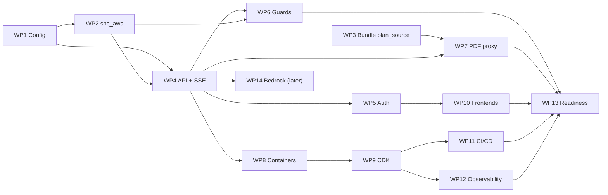

# AWS migration plan: code changes, step by step

**Branch:** `main_AWS`, created from `main` at `e7ec0e7`. It is the long-lived main branch of the AWS implementation and is **not merged into `main`** (decided 2026-11-05; the PR to `main`, #14, was closed unmerged). Work packages are committed straight to `main_AWS`; CI runs on every push to it.
**Status:** WP0–WP9 are done on `main_AWS`, and WP10–WP12 in code (each work package below has its own status note); the first real deploy, WP13 and WP14 are left. Progress is tracked in [TASKS_DONE.md](TASKS_DONE.md) and [TODO.md](TODO.md).
**Companion document:** [DEPLOYMENT_ANALYSIS.md](DEPLOYMENT_ANALYSIS.md) covers the architecture, the costs and the reasons behind each choice. §17 there ("portfolio mode") is the target operating model.

This plan turns that analysis into ordered work packages. For each one it says which files change, what goes in them, how it is tested and when it is done.

---

## Contents

1. [Scope and decisions](#1-scope-and-decisions)
2. [Current code and how AWS affects it](#2-current-code-and-how-aws-affects-it)
3. [Target repository layout](#3-target-repository-layout)
4. [Module boundaries (import-linter)](#4-module-boundaries-import-linter)
5. [Work packages](#5-work-packages)
6. [Specifications](#6-specifications)
7. [Testing strategy](#7-testing-strategy)
8. [Local development without AWS](#8-local-development-without-aws)
9. [First deployment runbook](#9-first-deployment-runbook)
10. [Rollback and teardown](#10-rollback-and-teardown)
11. [Deviations from PLAN.md to approve](#11-deviations-from-planmd-to-approve)
12. [Risks and open questions](#12-risks-and-open-questions)
13. [Sequencing and effort](#13-sequencing-and-effort)
14. [Definition of done](#14-definition-of-done)

---

## 1. Scope and decisions

**Goal:** run the whole application on AWS for a personal portfolio project.

- The public **Plan Shopper** and the **Broker Assistant** are both live. Interviewers reach the broker bot through a shared demo login.
- The URL is the default `*.cloudfront.net` one, and it stays available for at least 5–6 months at close to $0 of AWS cost.

| Area | Decision |
|---|---|
| API compute | One **AWS Lambda** function from a container image (arm64, 2 GB). It runs FastAPI through the **Lambda Web Adapter** and is reached through a **Function URL** with response streaming. One function serves both bots, by route |
| Edge and frontend | **CloudFront** (default domain) + **S3** (private, reached through Origin Access Control) for the landing page and the two SPAs; `/api/*` goes to the Function URL |
| Facts bundle | Unchanged design: the SQLite file is **baked into the API image** and opened read-only |
| Operational data | **DynamoDB** on-demand. **LangGraph checkpoints** go through `DynamoDBSaver` (`langgraph-checkpoint-aws`), with large items offloaded to S3 |
| Rate limits and caches | DynamoDB counters and items with TTL (instead of Upstash) |
| Broker auth | **Amazon Cognito** user pool (instead of Supabase Auth); the API verifies tokens through the pool's JWKS |
| Public auth | Unchanged: an anonymous session JWT signed by the API, after a **Cloudflare Turnstile** check (kept as an external service) |
| Secrets | **SSM Parameter Store** SecureString (instead of Doppler and GCP Secret Manager) |
| Models | **OpenRouter, unchanged.** **Amazon Bedrock** is a later, optional work package (WP14) |
| Offline build | **ECS Fargate Spot** task on demand, reading and writing an S3 data bucket |
| Infrastructure as code | **AWS CDK (Python)** in `infra/cdk/` |
| CI/CD | GitHub Actions (kept); deploys assume an AWS IAM role through **GitHub OIDC** |
| Observability | CloudWatch Logs, metric filters, alarms, AWS Budgets. Langfuse Cloud is optional |
| Region | `us-east-1` |

**Out of scope:** production high availability, autoscaling for heavy traffic, WAF, a custom domain, and running Postgres or Aurora (all in DEPLOYMENT_ANALYSIS.md §5.1 and §13).

---

## 2. Current code and how AWS affects it

Verified on `main` at `e7ec0e7`.

| Path | What it does today | AWS impact | Work package |
|---|---|---|---|
| `packages/core/src/sbc_core/config.py` | YAML layering, `BotProfile` (`auth: Literal["supabase", "anonymous"]`, and the broker must be `supabase`), `EnvSettings` with Supabase, Upstash and Langfuse fields, and `missing_for()` | **Change:** auth `cognito`; replace the Supabase and Upstash fields with AWS ones; new required-variable list; new portfolio limits | WP1 |
| `config/bots/broker.yaml` | `auth: supabase` | **Change** to `auth: cognito` | WP1 |
| `config/env/{local,dev,prd}.yaml` | Empty overrides | **Add** the portfolio limits (dev) | WP1 |
| `.env.example` | Supabase, Upstash, Doppler variables | **Rewrite** for AWS | WP1 |
| `tests/unit/test_config.py` | Asserts `SUPABASE_JWT_SECRET` is required for the broker and that the broker needs supabase auth (`test_broker_requires_supabase_auth`) | **Update** these tests | WP1 |
| `packages/core/src/sbc_core/facts.py`, `search.py` | `sqlite3.connect("…?mode=ro")` | **Small change:** add `immutable=1` (no locking on the read-only image filesystem). The bundle builder doesn't use WAL (it ends with `VACUUM` in the default rollback journal), so `mode=ro` already works; `immutable=1` skips lock calls and makes the guarantee explicit | WP1 |
| `packages/core/src/sbc_core/llm.py` | OpenRouter gateway (`httpx`, sync) | None (works from Lambda). WP14 adds a Bedrock alternative | — / WP14 |
| `packages/retrieval/src/sbc_retrieval/text_search.py` | `TextSearcher(index, settings, embed_query=…, rerank=…)`; `with_gateway()` is typed to `OpenRouterClient` | None for the main track. WP6 wraps `embed_query` with a cache; WP14 adds a gateway protocol | WP6, WP14 |
| `packages/agent/src/sbc_agent/graph.py` | `build_graph(deps, checkpointer)`, `Agent.ask/choose` returning one `Reply` | **Additive:** `Agent.stream(...)`, yielding progress events for SSE | WP4 |
| `packages/agent/src/sbc_agent/cli.py` | `InMemorySaver`, local bundle | None (stays the offline dev tool) | — |
| `packages/api/src/sbc_api/` | Empty | **Build** the FastAPI app here | WP4–WP7 |
| `packages/sbc_index/src/sbc_index/bundle.py` | `plan` table without the portal preview fields or PDF sha256 | **Change:** add a `plan_source` table so the PDF proxy can rebuild the portal's preview request and check the hash | WP3 |
| `packages/sbc_ingest/src/sbc_ingest/portal.py` | `_preview_post()` builds the `previewDocument` form (frozen original module) | **Not changed.** The API gets its own small preview client (runtime code must not import `sbc_ingest`) | WP7 |
| `apps/`, `infra/` | `.gitkeep` only | **Build** the frontends, Dockerfiles and the CDK app | WP8–WP10 |
| `.github/workflows/ci.yml` | Lint, mypy, tests, gitleaks, eval gate | **Extend** with `sbc_aws` tests, `cdk synth`, the image smoke test, the deploy job, and a frontend build | WP8, WP9, WP11 |
| `pyproject.toml` | Workspace, import-linter contracts | **Change:** add `sbc_aws` to the workspace and the contracts | WP2 |
| `PLAN.md`, `TODO.md`, `README.md`, `docs/agent-graph.md` | GCP, Supabase and Upstash design | **Update after approval** (§11) | WP13 |

**Missing data found while planning:**

- The bundle's `plan` table has `source_url` and `source_pdf`, but **not** the fields the portal's `previewDocument` form needs: `portal`, `market_unit`, `plan_type`, `coverage_period`, `network`, `language`, `plan_status`, `doc_sys_id`, `dps_unique_id`, `brand` and `source_system`.
- It also lacks the PDF's `sha256`.
- PLAN.md §3.7 requires both, so the PDF proxy can't be built without WP3. This is true on any cloud, not just AWS.

---

## 3. Target repository layout

New or changed paths only. Unchanged packages are omitted.

```text
packages/
  core/src/sbc_core/
    config.py                 # WP1: auth=cognito, AWS env fields, portfolio limits
    facts.py, search.py       # WP1: open with ?mode=ro&immutable=1
    interfaces.py             # WP3: FactsReader.pdf_source(); WP14: EmbeddingModel/Reranker protocols
  agent/src/sbc_agent/
    graph.py                  # WP4: Agent.stream() for SSE progress events
  aws/                        # WP2: NEW workspace package, imported as sbc_aws
    pyproject.toml            # deps: boto3, langgraph-checkpoint-aws
    src/sbc_aws/
      __init__.py
      secrets.py              # SSM Parameter Store → os.environ at cold start
      ddb.py                  # table handles, key helpers, TTL helpers
      checkpoint.py           # DynamoDBSaver factory (+ S3 offload)
      ratelimit.py            # fixed-window counters, global daily cap
      cache.py                # exact-answer cache, query-embedding cache
      audit.py                # append-only audit writer
      killswitch.py           # kill switches + quarantine, 60 s in-process cache
      sessions.py             # thread index per user/session, feedback
      pdfcache.py             # S3 cache for proxied SBC PDFs
      bedrock.py              # WP14 (later): Bedrock chat/embed/rerank gateway
  api/src/sbc_api/            # WP4–WP7: the FastAPI app
    app.py                    # create_app(): wiring for both bots
    deps.py                   # builds readers, gateways, agents, stores from Settings
    ports.py                  # Protocols: RateLimiter, AnswerCache, AuditSink, KillSwitches, SessionStore, PdfCache
    memory.py                 # in-memory implementations of every port (local + tests)
    sse.py                    # SSE encoding, heartbeat, event schema
    auth/
      cognito.py              # RS256 JWT verification via JWKS (cached)
      anon.py                 # HS256 anonymous session tokens
      turnstile.py            # Cloudflare siteverify client
      principal.py            # Principal(bot, user_id, groups, is_demo) + FastAPI dependencies
    routes/
      health.py               # /api/healthz (shallow + deep)
      session.py              # /api/public/session
      chat.py                 # /api/{bot}/chat, /api/{bot}/chat/choose (SSE)
      plans.py                # /api/{bot}/plans/search, /api/{bot}/plans/{plan_key}
      sbc_pdf.py              # /api/sbc/{plan_key}.pdf
      feedback.py             # /api/{bot}/feedback
      threads.py              # /api/broker/threads
      admin.py                # /api/admin/kill-switch, /api/admin/quarantine
    portal_preview.py         # minimal previewDocument client (mirrors sbc_ingest's form)
    logging.py                # JSON logs with request ID, bot, path, cost
apps/                         # WP10 (as built: one npm workspace)
  chat-ui/                    # shared: API client, SSE over fetch, chat panel, sources, plan picker, feedback
  broker/                     # Broker SPA (Cognito sign-in)
  shopper/                    # Plan Shopper SPA (Turnstile)
  landing/                    # portfolio landing + "How it works" + "Quality and cost" pages
  package.json, package-lock.json, scripts/assemble.mjs   # builds → apps/site/ (/, /broker/, /shopper/)
infra/
  docker/
    api.Dockerfile            # WP8: python:3.13-slim + uv + Lambda Web Adapter + bundle
    build.Dockerfile          # WP8: python:3.13-slim + uv + poppler-utils (offline pipeline)
    compose.yaml              # WP8: local API + DynamoDB Local
  cdk/                        # WP9: separate uv project (not a workspace member)
    pyproject.toml, uv.lock, cdk.json, app.py
    sbc_infra/
      config.py               # account, region, names, demo windows, limits
      stack.py                # SbcFoundation + SbcApp (as built, WP9)
      constructs/{data,auth,api,web,build,ops,cicd}.py
    tests/test_stack.py       # aws_cdk.assertions template tests
scripts/aws/                  # WP9/WP13: helper scripts (bash, aws CLI)
  bootstrap.sh                # cdk bootstrap + OIDC check
  put-secrets.sh              # writes SSM SecureStrings from your shell (no values in git)
  upload-bundle.sh            # bundles/facts-<v>.sqlite → s3://…/bundles/<v>/, embeddings.sqlite → bundles/cache/
  seed-users.sh               # admin + demo-broker Cognito users
  rotate-demo-password.sh     # new demo password → Cognito + /landing/demo.json + invalidation
  deploy-web.sh               # WP10: build apps/ with the stack outputs, s3 sync, invalidate
  run-build.sh                # aws ecs run-task for the offline pipeline
.github/workflows/
  ci.yml                      # WP11: + sbc_aws tests (moto), cdk synth + tests, frontend build
  deploy-aws.yml              # WP11: OIDC → build image, push, cdk deploy SbcApp, smoke test, frontends (WP10)
  build-data.yml              # WP11: workflow_dispatch → run the Fargate offline build
docs/aws/
  DEPLOYMENT_ANALYSIS.md, MIGRATION_PLAN.md (this file), RUNBOOK.md (WP13)
```

**Why a separate `sbc_aws` package:**

- It keeps `boto3` and the AWS SDK out of `sbc_core`, which stays dependency-light and cloud-neutral.
- Every AWS-specific choice lives in one replaceable package. The app talks to it only through the protocols in `sbc_api/ports.py`.
- `infra/cdk` is a **separate uv project**, so CDK's large dependency tree doesn't end up in the runtime lock or the Lambda image.

---

## 4. Module boundaries (import-linter)

Add `sbc_aws` to `root_packages` and to the workspace sources, then extend the contracts in `pyproject.toml`:

```toml
[[tool.importlinter.contracts]]
name = "Runtime layers: api > (agent | aws) > (tools | retrieval) > core"
type = "layers"
layers = ["sbc_api", "sbc_agent | sbc_aws", "sbc_tools | sbc_retrieval", "sbc_core"]

[[tool.importlinter.contracts]]
name = "AWS adapters depend only on core"
type = "forbidden"
source_modules = ["sbc_aws"]
forbidden_modules = ["sbc_agent", "sbc_tools", "sbc_retrieval", "sbc_api"]

[[tool.importlinter.contracts]]
name = "Domain code never imports AWS adapters"
type = "forbidden"
source_modules = ["sbc_agent", "sbc_tools", "sbc_retrieval", "sbc_core"]
forbidden_modules = ["sbc_aws"]
```

The existing "runtime code never imports build-time packages" contract gains `sbc_aws` in `source_modules`.

`sbc_aws` adapters satisfy the `sbc_api.ports` protocols **structurally**, so `sbc_aws` never imports `sbc_api`. mypy checks the match where `sbc_api.deps` assigns an adapter to a port.

---

## 5. Work packages

Each work package is one pull request into `main_AWS`. The order follows the dependencies (§13). "Done when" is the acceptance check.

### WP0: Branch and documents *(this commit)*

- `docs/aws/DEPLOYMENT_ANALYSIS.md` and `docs/aws/MIGRATION_PLAN.md`.
- **Done when** the branch is pushed and the plan is reviewed.

### WP1: Configuration for AWS

> **Status: done** on `main_AWS`. All checks are green: ruff, mypy, import-linter, 305 unit tests and the eval gate. `sbc-ask` loads the new config and the bundle; a live answer still needs an OpenRouter key. As built, `portfolio` is off unless an environment file sets it (only `config/env/dev.yaml` does), and `demo_rate_limits` defaults to 15 per minute and 100 per day.

**Files:** `packages/core/src/sbc_core/config.py`, `config/bots/broker.yaml`, `config/env/dev.yaml`, `.env.example`, `tests/unit/test_config.py`, `packages/core/src/sbc_core/facts.py`, `packages/core/src/sbc_core/search.py`.

**`BotProfile`:**

- `auth: Literal["cognito", "anonymous"]`.
- The validator message becomes "the broker bot must use cognito auth".
- `broker.yaml` gets `auth: cognito`.

**New `Portfolio` section** in `AppConfig`, optional, defaulting to "off". All of it lives in YAML (none of it is secret):

```yaml
# config/env/dev.yaml
portfolio:
  global_daily_llm_turns: 300        # across both bots; then a "demo limit reached" message
  demo_user_ids: []                   # Cognito sub(s) of demo-broker; filled per deployment via SBC_PORTFOLIO__DEMO_USER_IDS
  demo_rate_limits: {per_minute: 15, per_day: 100}
  demo_history_ttl_hours: 24
```

**`EnvSettings` changes:**

- **Remove** `supabase_url`, `supabase_anon_key`, `supabase_service_role_key`, `supabase_jwt_secret`, `database_url`, `upstash_redis_rest_url` and `upstash_redis_rest_token`. No code reads them yet.
- **Add:**
  - `aws_region` (default `us-east-1`)
  - `ssm_prefix` (e.g. `/sbc/dev/`)
  - `ddb_table_app`, `ddb_table_audit`, `ddb_table_checkpoints`
  - `s3_data_bucket`
  - `cognito_user_pool_id`, `cognito_app_client_id`
  - `public_base_url` (the CloudFront URL, for CORS and absolute links)
- **Keep:** the OpenRouter keys, `turnstile_secret_key`, `session_jwt_secret`, `langfuse_*`, `sentry_dsn` (unused), `facts_bundle_path`.
- **New `missing_for(bot)`:**
  - every bot needs `openrouter_api_key_<bot>`, `ddb_table_app`, `ddb_table_audit`, `ddb_table_checkpoints` and `s3_data_bucket`;
  - the broker also needs `cognito_user_pool_id` and `cognito_app_client_id`;
  - the public bot also needs `turnstile_secret_key` and `session_jwt_secret`.
- **Langfuse becomes optional.** Langfuse Cloud is optional in portfolio mode, so the `langfuse_*` keys are no longer required. Tracing is enabled only when both keys are set.

**SQLite opening:** `f"{path.resolve().as_uri()}?mode=ro&immutable=1"` in both readers.

**`.env.example`:** rewritten with the AWS variables, grouped as App / OpenRouter / Bundle / AWS / Public bot / Observability / Frontend (`VITE_API_BASE_URL=/api`, `VITE_COGNITO_USER_POOL_ID`, `VITE_COGNITO_CLIENT_ID`, `VITE_TURNSTILE_SITE_KEY`).

**Tests:**

- Update `test_dev_settings_fail_fast_and_name_only_missing_variables`: expect `COGNITO_USER_POOL_ID` instead of `SUPABASE_JWT_SECRET`, and `LANGFUSE_*` no longer required.
- Rename `test_broker_requires_supabase_auth` to `…_cognito_auth`.
- Add a test that the `portfolio` section validates and that its `SBC_PORTFOLIO__…` overrides work.

**Done when** `uv run pytest tests/unit`, `mypy`, `ruff` and `lint-imports` are green, and `sbc-ask` still works locally.

### WP2: `sbc_aws` adapters package

> **Status: done** on `main_AWS`.
>
> - **What's in the package:** `ddb`, `schema`, `secrets`, `checkpoint`, `ratelimit`, `cache`, `audit`, `killswitch`, `sessions` and `pdfcache`, typed with `boto3-stubs` and under strict mypy. The package is wired into the workspace and into two new import-linter contracts (7 contracts kept).
> - **Tests:** 37 moto tests in `tests/unit/aws/`, run in CI with no AWS account. They include the checkpoint resume across two saver instances.
> - **Integration tests:** 2 tests in `tests/integration/test_aws_dynamodb_local.py`, run against DynamoDB Local. 100 concurrent hits on a limit of 25 let exactly 25 through, and 120 concurrent turns on a cap of 40 let exactly 40 through.
> - **Changes from the sketch below:**
>   - Thread index items use `SK = THREAD#<thread_id>` with an `updated_at` attribute (sorted in code), so refreshing a thread doesn't create duplicates.
>   - `schema.create_tables()` is the single definition of the table keys and TTL attributes, for DynamoDB Local, the tests and (as a reference) the CDK stack.
>   - Caches treat DynamoDB errors as misses. Rate limits and the global cap raise them, so the cost protection never fails open.

**Files:** `packages/aws/**`, root `pyproject.toml` (workspace member, `[tool.uv.sources]`, import-linter, mypy strict override for `sbc_aws.*`), `uv.lock`, `tests/unit/aws/*`.

**Dependencies:** `boto3`, `langgraph-checkpoint-aws==1.2.6` (confirmed by spike 1 with the locked `langgraph` 1.2.19: `DynamoDBSaver(table_name, session=..., endpoint_url=..., ttl_seconds=..., s3_offload_config=...)`, table keys `PK`/`SK`, TTL attribute `ttl`), `sbc-core`. Dev dependencies: `moto[dynamodb,s3,ssm]`.

| Module | API (sketch) | Notes |
|---|---|---|
| `secrets.py` | `load_ssm_parameters(prefix: str, *, client=None, overwrite=False) -> list[str]` | `GetParametersByPath(Recursive, WithDecryption)` with paging. Sets `os.environ[NAME]` for each leaf name (`/sbc/dev/OPENROUTER_API_KEY_BROKER` → `OPENROUTER_API_KEY_BROKER`). Returns the names set, never the values. Called once at cold start, **before** `EnvSettings()`, so `config.py` stays cloud-neutral |
| `ddb.py` | `Tables(app, audit, checkpoints)`, `ttl_in(seconds) -> int`, key builders (`pk_session(id)` …) | One `boto3.resource("dynamodb")` per process |
| `checkpoint.py` | `make_checkpointer(table: str, *, s3_bucket: str, s3_prefix="checkpoints/", ttl_seconds: int) -> BaseCheckpointSaver` | Wraps `langgraph_checkpoint_aws.DynamoDBSaver`; sets TTL per bot (public 30 days, broker 365 days, demo user 1 day). The table is created by CDK with the schema the library documents |
| `ratelimit.py` | `DynamoRateLimiter.hit(subject: str, limits: RateLimits) -> Decision(allowed, retry_after_s, remaining)`; `GlobalCap.consume(day: str, cap: int) -> bool` | Fixed windows (minute, day): `UpdateItem ADD #n :one` with `ConditionExpression #n < :limit`, and TTL = window end + 1 h. Two windows per subject; one conditional write each |
| `cache.py` | `DynamoAnswerCache.get(key) / put(key, reply, ttl_s)`; `QueryEmbeddingCache.wrap(embed_fn, model) -> embed_fn` | Answer key = sha256 of `(bot, bundle_version, prompt_versions, model, intent, sorted plan_keys, fields, normalized question)` (PLAN.md §9.5). Embedding stored as float16 bytes (2 KB), behind an in-process LRU |
| `audit.py` | `DynamoAuditSink.write(record: AuditRecord) -> None` | `PutItem` with `attribute_not_exists(PK)`; PK `DAY#yyyy-mm-dd`, SK `ts#request_id`; TTL 2 years |
| `killswitch.py` | `DynamoKillSwitches.llm_enabled(bot) -> bool`, `.quarantined() -> frozenset[str]`, `.set_…` (admin) | 60 s in-process cache, as PLAN.md §3.5.6 requires |
| `sessions.py` | `DynamoSessionStore.touch_thread(owner, thread_id, title, ttl)`, `.list_threads(owner)`, `.add_feedback(...)` | Owner = Cognito `sub` (broker) or the anonymous session ID (public) |
| `pdfcache.py` | `S3PdfCache.get(plan_key, sha256) / put(...)` | Objects `pdf-cache/<plan_key>.pdf`, with the S3 lifecycle expiring them after 1 day |

**Tests (moto, no AWS account needed):**

- **Rate limiter:** the limit is reached exactly; a new window resets; concurrent hits never exceed the limit.
- **Answer cache:** round trip and TTL attribute.
- **Audit sink:** writes are append-only (a duplicate key is refused).
- **SSM loader:** loads, follows paging, never logs values.
- **Checkpointer:** a graph with an interrupt survives a **new** checkpointer instance (simulating a different Lambda instance), via a test like `tests/unit/test_graph.py` with scripted models.

**Done when** all `tests/unit/aws/*` pass under moto, and import-linter accepts the new contracts.

### WP3: Bundle additions for the SBC PDF proxy

> **Status: done** on `main_AWS` (code and tests). The real bundle `2027.2` still has to be rebuilt where the corpus lives. Its embeddings come from the embedding cache, so nothing is re-embedded; the new table adds about 3 MB.
>
> **As built:**
> - **Builder:** `sbc-build-bundle` reads the existing `sbc-portal manifest` CSV (`--manifest`, defaulting to `data/catalog/sbc_manifest_<year>.csv`). That file already has every preview-form field and the sha256, so `sbc_ingest` is unchanged.
> - **Release builds** refuse to run without the manifest, or with any plan missing from it.
> - **Table:** `plan_source` is keyed by `plan_id` and also stores `catalog_url` and `pdf_bytes`. The bundle metadata records the row, preview-only and missing counts.
> - **Reader:** `SqliteFactsReader(path, pdf_proxy_base="/api/sbc/")` rewrites only preview-only plans' `source_url` to `/api/sbc/<url-encoded plan_key>.pdf`, so citations become `…pdf#page=N` with no change to `Citation`. Without the argument (the CLI, tests) nothing changes.
> - **Older bundles:** a bundle without the table still opens; `pdf_source()` returns None for it.
> - **Tests:** 9 new tests in `test_bundle.py` and `test_facts.py`.

**Files:** `packages/sbc_index/src/sbc_index/bundle.py`, `packages/core/src/sbc_core/interfaces.py`, `packages/core/src/sbc_core/facts.py`, `packages/core/src/sbc_core/types.py`, `tests/unit/test_bundle.py`, `tests/unit/test_facts.py`, `data/README.md`.

**New table:**

```sql
plan_source(
  plan_key TEXT PRIMARY KEY,
  fetch_method TEXT NOT NULL,   -- 'url' | 'preview_post'
  portal TEXT, market_unit TEXT, plan_type TEXT, coverage_period TEXT, network TEXT, language TEXT,
  plan_status TEXT, doc_sys_id TEXT, dps_unique_id TEXT, brand TEXT, source_system TEXT,
  pdf_sha256 TEXT NOT NULL
)
```

- The values come from the catalog and manifest CSVs that `sbc-build-bundle` already reads.
- New `FactsReader.pdf_source(plan_key) -> PdfSource | None`, plus the `PdfSource` type in `types.py`.
- `Citation.link` (`types.py:96-100`) points preview-only plans to `/api/sbc/{plan_key}.pdf#page=N`.
- **Bundle version:** bump to `2027.2`. Copy the embeddings over with `sbc-embed-bundle`; the embedding cache means no re-embedding.

**Done when** the bundle tests cover the new table, an old bundle without `plan_source` still opens (`pdf_source` returns None and citations keep `source_url`), and the bundle stays under the 300 MB cap.

### WP4: FastAPI app, SSE chat and agent streaming

> **Status: done** on `main_AWS`.
>
> **As built:**
> - **`Agent.stream()`** in `sbc_agent.graph` yields a `Progress(node)` per finished node, then the same `Reply` that `ask`/`choose` return. Clarification interrupts come through intact.
> - **`sbc_api`:**
>   - `app.create_app()` is the uvicorn `--factory`; request-ID middleware reads `x-amzn-request-id` and returns `x-request-id`.
>   - `deps.build_state()`: SSM secrets, then settings, then the reader (with `pdf_proxy_base="/api/sbc/"`) and the index. Stores are DynamoDB/S3 when the table names are set, otherwise in-process. Each bot gets an agent with its own key and checkpointer.
>   - `ports`/`memory`, `sse.stream_turn()` (worker thread, 10 s keepalives, 55 s timeout, a generic `error` event), JSON logging.
>   - Routes: `health`, `chat` (`/chat`, `/chat/choose`), `plans` (search and get, scope-filtered).
> - **Auth for now:** `auth/principal.py` has only `LocalAuthenticator` (`APP_ENV=local`) and `RefuseAll` (every other environment), so a deployed API refuses all chat and plan calls until WP5.
> - **Local runs:** on a bundle without embeddings, local search runs BM25-only; dev and prd still require the configured embeddings. A bot whose OpenRouter key is missing locally answers 503 and shows as unavailable in `healthz?deep=1`.
> - **Not yet built (WP6):** guards, thread ownership and audit writes. The stores are already wired.
> - **Tests:** 12 API tests (`tests/unit/api/test_app.py`) and 2 stream tests in `test_graph.py`. A DynamoDB Local integration test (`tests/integration/test_api_dynamodb_local.py`) runs clarify, then choose, across two app instances sharing only the tables.

**Files:**

- `packages/api/pyproject.toml`: dependencies `fastapi`, `uvicorn[standard]`, `pyjwt[crypto]`, `httpx`, `sbc-agent`, `sbc-core`, `sbc-aws`.
- `packages/api/src/sbc_api/{app,deps,ports,memory,sse,logging}.py`, `routes/{health,chat,plans}.py`.
- `packages/agent/src/sbc_agent/graph.py` (additive).
- `tests/unit/api/*`.

**Agent streaming (additive, in `graph.py`):**

```python
def stream(self, thread_id, message=None, *, resume=None, ui_selected=(), user_state=None) -> Iterator[Event]:
    """Yield ("status", node_name) for each finished node, then ("reply", Reply)."""
    payload = Command(resume=resume) if resume is not None else {"message": message, ...}
    for mode, chunk in self.graph.stream(payload, self._config(thread_id), stream_mode=["updates", "values"]):
        ...
```

- `ask` and `choose` stay as they are (the CLI and tests use them).
- The SSE route maps node names to user-facing status text ("Understanding your question…", "Finding the plan…", "Reading the SBC…", "Checking every number…").
- **Answers aren't streamed token by token** in the main track. Nothing the model typed may be shown before `verify` passes (`respond.py` docstring), so the stream carries status events and then the verified answer.
- **Later enhancement:** finer status events from inside the answer node (each tool call), using LangGraph's `get_stream_writer()`.

**App wiring (`deps.py`):**

- **At cold start:**
  1. `load_ssm_parameters()` whenever `SSM_PREFIX` is set (first written as "only when `APP_ENV != local`"; `main_local` L3 lets the full local stack load from its local Parameter Store too, and plain local runs leave `SSM_PREFIX` unset);
  2. `EnvSettings()`;
  3. `load_settings(bot)` for **both** bots.
- **Shared by both bots:** one `SqliteFactsReader` and one `SqliteSearchIndex` (the bundle is read-only and thread-safe for reads with `check_same_thread=False`).
- **Per bot:** one `OpenRouterClient` with its own key, a `TextSearcher` (embedding cached through WP6), and an `Agent` with `make_checkpointer(...)`.
- **Ports:** DynamoDB adapters in dev and prd, `memory.py` adapters in local and tests.

**Routes in this WP:** `GET /api/healthz` (shallow and `?deep=1`), `POST /api/{bot}/chat`, `POST /api/{bot}/chat/choose`, `GET /api/{bot}/plans/search`, `GET /api/{bot}/plans/{plan_key}`. Specs are in §6.1.

- In this WP, auth is a test dependency override; real auth arrives in WP5.

**Logging:** one JSON line per request, with `request_id` (from the Lambda context header `x-amzn-request-id`, or a generated one), `bot`, `route`, `path` (fast/agent), `llm_calls`, `cost_usd`, `latency_ms`, `verifier` and `cache_hit`. It never includes user text; redacted text goes only to Langfuse, when enabled.

**Tests:**

- Use FastAPI `TestClient` with the scripted `ChatModel` from `tests/unit/test_graph.py` and the fixture bundle.
- **SSE parsing:** event order is `status*`, then `answer` or `clarify`, then `done`.
- **Clarify → choose:** resumes on a new app instance that shares only the checkpointer (the Lambda case).
- **Deep health:** opens the bundle and reports `bundle_version`.

**Done when** `uvicorn --factory sbc_api.app:create_app` answers the `sbc-ask` example questions over SSE locally, with in-memory ports and a real OpenRouter key.

### WP5: Authentication and authorization

> **Status: done** on `main_AWS`.
>
> **As built:**
> - **`auth/cognito.py`:** `CognitoVerifier` checks RS256 through the pool's JWKS (`PyJWKClient`: keys cached for 1 h, 5 s fetch timeout). It checks the issuer, `token_use == "access"`, `client_id`, expiry (30 s leeway) and that `cognito:groups` is a list.
> - **`auth/anon.py`:** `SessionTokens` are HS256 with issuer `sbc-api` and audience `sbc-public`, 24 h, and need a secret of at least 32 bytes. The token's `st` (state) wins over any state in a request.
> - **`auth/turnstile.py`:** calls Cloudflare siteverify with a 5 s timeout and passes the viewer IP from `CloudFront-Viewer-Address`.
> - **`auth/principal.py`:** `BearerAuthenticator` sends each token only to its own bot's verifier. A broker token needs the `broker` or `admin` group (else 403). The demo account loses `admin` whatever its token claims. `admin_principal` is ready for the WP6 admin routes.
> - **Wiring and routes:**
>   - `POST /api/public/session` gives 403 on a failed check and 503 when Cloudflare is down.
>   - `deps` uses `LocalAuthenticator` for `APP_ENV=local`, otherwise `BearerAuthenticator`.
>   - Locally without `TURNSTILE_SECRET_KEY` the check is skipped, and without `SESSION_JWT_SECRET` a per-process secret is used. Outside local runs both are required.
> - **Tests:** 21 in `tests/unit/api/test_auth.py`, with a generated RSA key behind a fake JWKS and a mock HTTP transport for Turnstile (no network). They cover 10 kinds of bad token (expired, wrong issuer, wrong client, ID token, foreign key, unknown `kid`, missing claim, malformed groups, HS256 algorithm confusion, garbage), cross-bot tokens, tampered, expired and foreign-audience sessions, the IP passed to Turnstile, admin checks and the demo account.

**Files:** `packages/api/src/sbc_api/auth/*`, `routes/session.py`, `tests/unit/api/test_auth.py`.

**Broker:**

- The token arrives as `Authorization: Bearer <Cognito access token>`.
- It is verified with `jwt.PyJWKClient("https://cognito-idp.us-east-1.amazonaws.com/<pool>/.well-known/jwks.json")`, which caches the keys.
- **Checks:** `iss`, `token_use == "access"`, `client_id == COGNITO_APP_CLIENT_ID`, `exp`, and that `cognito:groups` contains `broker` or `admin`.
- **Result:** `Principal(bot=broker, user_id=sub, groups, is_demo = sub in portfolio.demo_user_ids)`.

**Public:**

1. `POST /api/public/session {turnstile_token, state}` calls Cloudflare `siteverify` with `TURNSTILE_SECRET_KEY` (httpx, 5 s timeout).
2. The API returns an HS256 session JWT with `sub` = random session ID, `bot=public`, `state` and `exp` = 24 h, signed with `SESSION_JWT_SECRET`.
3. Later requests send it as a Bearer token.

**Profile guard:**

- The route's `{bot}` must match the token type (PLAN.md §8: by route *and* claim).
- `/api/admin/*` requires the `admin` group.
- A demo user can never reach admin routes.

**Tests:**

- Generate an RSA key pair at test time and serve a fake JWKS (`respx`).
- Cover: expired, wrong issuer, wrong client, missing group, public token on a broker route and the reverse, Turnstile failure, and the demo-user flag.

**Done when** every negative case returns 401 or 403 without leaking details, and the broker happy path works with a Cognito user (checked in WP13 against a real pool).

### WP6: Guards (rate limits, global cap, caches, kill switches, audit, feedback)

> **Status: done** on `main_AWS`.
>
> **As built** (`sbc_api/guards.py`, `routes/chat.py`, `routes/feedback.py`, `routes/admin.py`):
> - **Before a turn, with no model call:**
>   1. Rate limits: the profile's limits, the demo account's own, and per IP for the public bot.
>   2. Thread ownership: a 404 unless the caller owns the thread. New threads are always created by the server, so a client can no longer pick a thread ID.
>   3. Kill switch.
>   4. Exact-answer cache.
>   5. Global daily cap.
>
>   Limits and the cap reply with an SSE `limit` event (scope `user`, `session`, `ip` or `global`).
> - **Exact-answer cache:**
>   - It covers a thread's first message only, since later messages depend on history. Its key combines the bot, bundle, prompt hashes, config hash (which covers the models), selected plans, state and normalized question.
>   - A hit costs no model call and doesn't count toward the cap. It still creates a thread, and the new `Agent.remember()` writes the cached turn into that thread's history, so follow-ups keep their context.
> - **After a turn:** plans under quarantine are replaced by a fixed message. Only answers are cached (clarifications never), and one audit record is written (no user text; audit failures are logged as `audit_failed`).
> - **Demo account:** the broker bot has a second agent for it, with its own checkpointer and TTL (`portfolio.demo_history_ttl_hours`).
> - **Query-embedding cache:** wraps `TextSearcher.embed_query` whenever DynamoDB is configured.
> - **Routes:** `POST /api/{bot}/feedback` (own threads only, reason codes only) and `GET /api/broker/threads` (empty for the shared demo account; the browser keeps its own thread IDs). The admin routes `POST /api/admin/kill-switch` and `/api/admin/quarantine` require the `admin` group, are never open to the demo account, and are audited.
> - **Tests:** 17 in `tests/unit/api/test_guards.py`. The DynamoDB Local integration test still passes with ownership going through `DynamoSessionStore`.

**Files:** `routes/chat.py` (guard pipeline), `routes/feedback.py`, `routes/threads.py`, `routes/admin.py`, `sbc_aws/{ratelimit,cache,killswitch,audit,sessions}.py` (from WP2), `tests/unit/api/test_guards.py`.

**Order of checks for every chat request** (before any model call):

1. Input size (2,000 characters; already in the graph, enforced early here too).
2. **Rate limit** per principal:
   - broker: 30/min, 1,000/day;
   - demo user: `portfolio.demo_rate_limits`;
   - public: 10/min and 60/day per session, plus 200/day per IP (`CloudFront-Viewer-Address` header, forwarded by the origin request policy).
3. **Kill switch:** if LLM answers are off for the bot, answer through the deterministic template path, or with "limited mode".
4. **Exact-answer cache:** on a hit, stream the cached reply immediately; it costs no LLM call and doesn't use the global cap.
5. **Global daily cap** (`portfolio.global_daily_llm_turns`): when used up, reply "Demo limit reached for today; try again tomorrow" and log `global_cap_reached`.
6. Run the turn. Then write the cache (answers only, not clarifications), the audit record and the thread index.

The query-embedding cache wraps `TextSearcher.embed_query` (`QueryEmbeddingCache.wrap(...)`) inside `deps.py`.

**Other routes:**

- **Feedback:** thumbs up or down, plus optional reason codes; never free text in portfolio mode.
- **Threads:** a broker lists their own threads. The demo user's history expires after `demo_history_ttl_hours`.
- **Admin:** toggle the kill switch per bot; quarantine or release `plan_key`s.

**Tests:**

- The ordering above (a cache hit skips the cap; a cap hit skips the model).
- Limits per principal type.
- Kill switch effective within the cache TTL (time is injectable).
- One audit record per turn, with no user text in it.

**Done when** each guard can be hit on purpose in tests, and the guards add under 50 ms to a request (measured locally against DynamoDB Local).

### WP7: SBC PDF proxy

> **Status: done** on `main_AWS` (code and mocked-portal tests). The manual check against the live portal is still open: it needs a real `2027.2` bundle (WP3). Run `curl -o x.pdf localhost:8080/api/sbc/<a preview-only plan_key>.pdf` and confirm the hash matches.
>
> **As built** (`sbc_api/portal_preview.py`, `routes/sbc_pdf.py`):
> - **Public PDFs:** plans with a public PDF are redirected (302) to it.
> - **Preview-only PDFs:**
>   1. Check the per-IP limit (30 an hour; 429 with `Retry-After`).
>   2. Look in the S3 cache.
>   3. Otherwise fetch from the portal: a fresh cookie session per fetch, then `GET /dps/`, `POST /dps/searchPage` and `POST /dps/search/previewDocument`, with a 30 s timeout and a 20 MB cap.
>   4. Require the `%PDF` signature and a sha256 that matches the bundle, then cache and stream it inline.
> - **Failures:** a portal failure or a hash mismatch gives 502 and nothing is served; a mismatch is logged as `pdf_hash_mismatch`.
> - **Tests:** 9 in `tests/unit/api/test_sbc_pdf.py`. One asserts that the API's form is identical, field for field, to what `sbc_ingest.portal._preview_post` sends.

**Files:** `packages/api/src/sbc_api/portal_preview.py`, `routes/sbc_pdf.py`, `tests/unit/api/test_sbc_pdf.py` (with a recorded response fixture; use a tiny test PDF, not a real SBC).

**`GET /api/sbc/{plan_key}.pdf`:**

1. `reader.pdf_source(plan_key)`; return 404 if it's missing or the plan is out of the bot's scope.
2. `S3PdfCache.get(plan_key, sha256)`; on a hit, stream it.
3. Otherwise:
   - open the portal session (`GET /dps/`, then `POST /dps/searchPage` for the state and market unit);
   - `POST /dps/search/previewDocument` with the same form fields as `sbc_ingest.portal._preview_post`;
   - check that the response is a PDF (`%PDF` magic) **and** that its `sha256 == pdf_source.pdf_sha256`;
   - `put` it in the S3 cache;
   - stream it with `Content-Type: application/pdf` and `Cache-Control: public, max-age=3600`.
4. **On a hash mismatch:** return 502 with a message pointing to the public portal search page, and log `pdf_hash_mismatch` (the SBC may have changed: this triggers a rebuild).

- No auth is required; SBCs are public documents. The proxy is rate-limited per IP (WP6 limiter, 30/hour) to protect the portal.
- Send a descriptive `User-Agent`, as `sbc_ingest` does, and keep the concurrency at one portal session per request.

**Done when** the fixture-based tests pass, and a manual check against the live portal returns a hash-matching PDF for one preview-only plan.

### WP8: Containers and local stack

> **Status: done** on `main_AWS`. The run book (`docs/aws/RUNBOOK.md`) has how to use it and the measurements.
>
> **As built:**
> - **`infra/docker/api.Dockerfile`:**
>   - uv 0.11.32 builds only the runtime packages (`--package sbc-api --no-editable`) into `/app/.venv`; Lambda Web Adapter 0.9.1 is installed as an extension.
>   - The bundle comes from the named `bundle` build context (`BUNDLE_FILE` picks the file) and lands at `/opt/bundle/facts.sqlite`.
>   - It runs as non-root uid 10001 with `uvicorn --factory sbc_api.app:create_app`.
>   - An optional `ca` secret covers TLS-inspecting proxies.
> - **`infra/docker/build.Dockerfile`** + `build-pipeline.sh` (modes `full` and `bundle`) + `s3_sync.py`:
>   - It syncs by sha256 metadata and never deletes. It replaces the AWS CLI, whose v1 package pins a botocore that conflicts with the locked boto3.
>   - The S3 layout mirrors the repository: `data/…`, `bundles/cache/embeddings.sqlite`, `bundles/<version>/facts-<version>.sqlite`.
> - **`infra/docker/compose.yaml`:** DynamoDB Local; a `tables` service running the new `sbc-create-tables` command (`sbc_aws.schema.main`); the API image with a read-only root.
> - **Supporting files:** `fixture_bundle.py` (the synthetic bundle, for images without SBC data), `smoke.sh` (read-only start, deep health, plan search, prompts and taxonomy, non-root, size, time, memory), and a per-Dockerfile `.dockerignore`.
> - **CI:** a new `image` job builds the API image on the fixture bundle and runs `smoke.sh`.
> - **Measured locally (x86_64):**
>   - API image ≈ 350 MB uncompressed and ≈ 109 MB compressed with the fixture bundle; ≈ 570 MB expected with the real one.
>   - Ready in 2.6–2.8 s warm (7.1 s on a cold first start).
>   - ≈ 89 MiB memory; ≈ 2.3 s of imports.
>   - The build image is ≈ 681 MB.
> - **Tests:** 5 for `s3_sync.py` (moto).
> - **Not yet run:** an end-to-end `full` or `bundle` pipeline against a real bucket (needs WP9's bucket and the corpus), and an arm64 build (done in WP11 with `buildx --platform linux/arm64`).

**Files:** `infra/docker/api.Dockerfile`, `infra/docker/build.Dockerfile`, `infra/docker/compose.yaml`, `.dockerignore`.

**`api.Dockerfile`** (multi-stage; arm64; non-root):

```dockerfile
FROM public.ecr.aws/docker/library/python:3.13-slim AS build
COPY --from=ghcr.io/astral-sh/uv:<pinned> /uv /bin/uv
WORKDIR /app
COPY pyproject.toml uv.lock ./
COPY packages ./packages
RUN uv sync --frozen --no-dev --package sbc-api      # runtime packages only (no sbc_ingest/extract/index)

FROM public.ecr.aws/docker/library/python:3.13-slim
COPY --from=public.ecr.aws/awsguru/aws-lambda-adapter:<pinned> /lambda-adapter /opt/extensions/lambda-adapter
RUN useradd -u 10001 app
WORKDIR /app
COPY --from=build /app/.venv /app/.venv
COPY config ./config
COPY bundles/facts-<version>.sqlite /opt/bundle/facts.sqlite   # fetched from S3 by the deploy job
ENV PATH=/app/.venv/bin:$PATH PORT=8080 \
    AWS_LWA_INVOKE_MODE=response_stream AWS_LWA_READINESS_CHECK_PATH=/api/healthz \
    FACTS_BUNDLE_PATH=/opt/bundle/facts.sqlite
USER app
CMD ["uvicorn", "--factory", "sbc_api.app:create_app", "--host", "0.0.0.0", "--port", "8080", "--workers", "1", "--no-access-log"]
```

- One uvicorn worker. Lambda sends one request at a time to each instance; the sync graph runs in FastAPI's thread pool.
- **Presidio and spaCy are not in the launch image** (decision D3). When they're added after launch, add `en_core_web_sm` in the build stage and load it at import time, so the cost is paid in init (or in `healthz?deep=1`). Then re-measure the cold start.
- **Measure:** image size (target < 1 GB), cold start (`Init Duration` in the REPORT log line), memory high-water mark.

**`build.Dockerfile`:** `python:3.13-slim` + `poppler-utils` + `uv sync --frozen` (all packages) + `s3_sync.py` (as built; the plan first said `awscli`). The entrypoint script does: `s3 sync` down → pipeline steps (DEPLOYMENT_ANALYSIS.md §7.6) → retrieval eval → `s3 sync` up.

**`compose.yaml`** (local):

- `amazon/dynamodb-local`;
- an init container that creates the tables with the same keys as CDK;
- the API with `APP_ENV=local`, using DynamoDB adapters pointed at `http://dynamodb:8000` (or in-memory ports, if no DynamoDB is wanted).

**Done when** `docker compose up` serves the app locally, the image runs on the Lambda runtime (WP9 deploy), and the measurements are recorded in `docs/aws/RUNBOOK.md`.

### WP9: Infrastructure as code (CDK, Python)

> **Status: done** on `main_AWS` (code, template tests, synth). The first real deploy is yours (RUNBOOK §4). How to use it: `infra/cdk/README.md`.
>
> **As built, and how it differs from the sketch below:**
> - **Two stacks instead of one:** `SbcFoundation-<env>` (data bucket, tables, Cognito, ECR, budget and anomaly alerts) and `SbcApp-<env>` (Lambda + `live` alias + Function URL, CloudFront + web bucket, ECS build task, alarms, optional warmer, GitHub OIDC role). The split solves the first-deploy chicken-and-egg: a Lambda needs an image in ECR before it can exist. `SbcApp` is synthesized only with `-c apiImageTag`.
> - **Bearer tokens travel in `X-Sbc-Authorization`.** Found while wiring CloudFront: with origin access control set to sign always, CloudFront replaces the request's `Authorization` header with its SigV4 signature, so a browser's Bearer token would never reach the API. The API now reads `X-Sbc-Authorization` first (falling back to `Authorization`), CloudFront forwards it, and WP10's `chat-ui` must send it. Tested in `tests/unit/api/test_auth.py`.
> - **Forwarded headers:** the origin request policy for `/api/*` is an allow-list: `X-Sbc-Authorization`, `Content-Type`, `Accept`, `x-amz-content-sha256` and `CloudFront-Viewer-Address`. Host isn't forwarded, which signing needs.
> - **No `PUBLIC_BASE_URL` on the Lambda:** it would make a circular dependency (the distribution needs the Function URL, and the URL's function would need the distribution's domain). Nothing reads it yet.
> - **ECS without a VPC:** an L1 `CfnCluster` (Fargate + Fargate Spot) and a task definition (arm64, 4 vCPU, 8 GB, 50 GB, OpenRouter key as an ECS secret from SSM, default command `bundle`). `scripts/aws/run-build.sh` passes the default-VPC public subnets at run time, so no VPC or NAT is ever created.
> - **Ops:**
>   - 8 alarms (Lambda errors, throttles, p95 > 20 s, and 5 metric filters on the API's JSON logs: `global_cap_reached`, `pdf_hash_mismatch`, `audit_failed`, demo-account limits, `PlanFilterViolationError`) to an SNS topic.
>   - Budget and Cost Anomaly Detection, created when `alarmEmail` is set.
>   - Optional warmer (`warmer=true`): an EventBridge Scheduler rule pinging the alias every 5 minutes, weekday business hours (US Eastern). Its events reach the API as `POST /events` through the Lambda Web Adapter; the new route answers 204.
> - **CloudFormation owns the `live` alias.** A deploy is `cdk deploy SbcApp -c apiImageTag=<tag>`. Moving the alias by hand is undone by the next deploy, so WP11 deploys through the CDK.
> - **Tables:** `infra/cdk/sbc_infra/tables.py` must equal `sbc_aws.schema.TABLE_SPECS`; a root test (`tests/unit/test_infra_tables.py`) compares them.
> - **Scripts** in `scripts/aws/`: `bootstrap.sh`, `deploy.sh`, `put-secrets.sh`, `upload-bundle.sh`, `push-images.sh` (arm64 build + ECR push, for the first deploy), `seed-users.sh`, `rotate-demo-password.sh`, `run-build.sh` (polls when given `--wait`, since a full build outlasts `aws ecs wait`). All pass shellcheck; none has been run against AWS yet.
> - **Tests:** 12 template tests in `infra/cdk/tests/test_stack.py` (13 since WP11 added the deploy role's):
>   - nothing that bills idle (no NAT, VPC, load balancer, Secrets Manager, KMS key, RDS, ElastiCache, WAF or custom resources);
>   - tables equal the schema;
>   - Lambda arm64 2 GB with an `AWS_IAM` + `RESPONSE_STREAM` URL on `live`, plus both CloudFront permissions;
>   - audit `PutItem` only; SSM limited to `/sbc/dev`, with `kms:Decrypt` through SSM only; every log group expires;
>   - forwarded headers and Lambda OAC; buckets private, encrypted, retained, with the `pdf-cache/` 1-day rule;
>   - Cognito MFA optional with TOTP, admin-created users only, no OAuth scopes, SRP only, and both groups;
>   - the ECS task shape and secret; the OIDC role limited to `main_AWS`; no IAM users or keys; ≤ 10 alarms, the budget and the warmer.
>   CI gets a `cdk` job: tests, synth and shellcheck.

**Files:** `infra/cdk/**`, `scripts/aws/*.sh`.

| Construct | Resources | Key settings |
|---|---|---|
| `DataConstruct` | S3 `data` bucket; DynamoDB `app`, `audit` and `checkpoints` tables | SSE-S3; block public access; lifecycle rules (`pdf-cache/` 1 day, `bundles/<version>/` 90 days for old versions, optional `data/raw/` → Glacier IR at 30 days; the layout is in RUNBOOK §3); tables on-demand; TTL on `expires_at` for `app` and `audit`, and on **`ttl`** for `checkpoints` (the attribute `DynamoDBSaver` writes; spike 1); PITR off (flag); `RemovalPolicy.RETAIN` on data |
| `AuthConstruct` | Cognito user pool, app client, groups `broker` and `admin` | Self sign-up off; MFA **OPTIONAL** with TOTP; password policy; SPA client with SRP and no secret; OAuth scopes **without** `aws.cognito.signin.user.admin`; access token 1 h, refresh 12 h |
| `ApiConstruct` | ECR repo; Lambda `DockerImageFunction` (arm64, 2,048 MB, 60 s, `/tmp` 1,024 MB); `live` alias; Function URL (`AWS_IAM`, `RESPONSE_STREAM`); log group (14 days) | Environment from WP1; IAM per DEPLOYMENT_ANALYSIS.md §6.5 (audit table `PutItem` only); ECR lifecycle keeps 3 |
| `WebConstruct` | S3 `web` bucket; CloudFront distribution; OAC for S3 and for the Lambda URL; CloudFront Function for SPA rewrites; response headers policy | Behaviors: `/api/*` → Function URL (CachingDisabled, AllViewerExceptHostHeader, all methods); `/broker/*`, `/shopper/*`, `/` → S3; PriceClass_100; default domain |
| `BuildConstruct` | ECS cluster; Fargate task definition (arm64, 4 vCPU, 8 GB, 50 GB ephemeral); task role | Run on demand in the default VPC's public subnets with a public IP (no NAT); capacity provider FARGATE_SPOT |
| `OpsConstruct` | SNS topic + email subscription; alarms (Lambda Errors, Throttles, p95 Duration, metric filters `plan_filter_violation`, `global_cap_reached`, `pdf_hash_mismatch`); AWS Budget ($5 and $10); Cost Anomaly monitor; optional business-hours warmer (EventBridge Scheduler → Lambda invoke of `/api/healthz?deep=1`) | Stay within 10 alarms; the warmer is a config flag |
| `CicdConstruct` | GitHub OIDC provider (if absent); `sbc-<env>-github-deploy` role (as built in WP11: CDK bootstrap roles, not direct Lambda changes) | Trust policy limited to `repo:syamsruthin/sbc-agentic-rag` on `refs/heads/main_AWS` (and later `main`) plus a GitHub environment; least-privilege actions from DEPLOYMENT_ANALYSIS.md §6.5 |

**SSM parameters are not created by CDK with values** (no secrets in templates). `scripts/aws/put-secrets.sh` writes them as SecureStrings from your shell. CDK only grants read access to `/sbc/dev/*`.

**Lambda URL behind CloudFront with OAC:**

- Use CDK's `FunctionUrlOrigin.withOriginAccessControl`; check that the installed `aws-cdk-lib` version has it.
- Grant `lambda:InvokeFunctionUrl` to the CloudFront service principal, conditioned on the distribution ARN.

**Tests:** `aws_cdk.assertions`:

- no NAT Gateway, no load balancer, no Secrets Manager secret, no customer-managed KMS key;
- the Function URL invoke mode is `RESPONSE_STREAM`;
- the audit table policy allows only `PutItem`;
- every log group has retention set.

These assertions encode the cost guardrails from DEPLOYMENT_ANALYSIS.md §12.

**Done when** `cdk synth` and its tests pass in CI, and `cdk deploy` into the account creates the stack with an empty web bucket and a placeholder image.

### WP10: Frontends

> **Status: done in code** on `main_AWS` (not run against AWS yet; it needs the first deploy). Checked locally against the API (`APP_ENV=local`) through the landing dev server's proxy, on desktop and phone widths: plan search, a streamed turn, the details footer and request ID, the public session and its errors.
>
> **As built:**
> - **One npm workspace** in `apps/` (`chat-ui`, `landing`, `broker`, `shopper`), React 18, Vite 6, TypeScript 5.9, Tailwind 3. `npm run check` lints, typechecks, runs `chat-ui`'s unit tests (Vitest: the SSE parser, the token and body-hash headers, CSV) and builds; `scripts/assemble.mjs` puts the builds in `apps/site/` at `/`, `/broker/` and `/shopper/`.
> - **`chat-ui`:** `createApi` sends the token in `X-Sbc-Authorization` and the body hash on every POST, raises the API's `detail` and `x-request-id` on errors, and parses SSE from `fetch` (split chunks, CRLF, multi-byte characters, keepalive comments). `useChat` keeps one thread, follows `thread`/`status`/`answer`/`clarify`/`limit`/`error`/`done`, and can be stopped. Answers render as Markdown (raw HTML off) with a numbered source list; tables get "Export as CSV" in the broker app (formula-looking cells are prefixed with `'`).
> - **Broker:** `amazon-cognito-identity-js` with SRP, TOTP (and TOTP enrollment for an admin), and a new-password step; tokens in an in-memory store (a reload signs out). Plan picker with state, market, plan type and metal filters (6 plans). Conversations: `GET /api/broker/threads`, or for the shared demo account the IDs this browser kept. The API can't send an old thread's messages back, so reopening one continues it without showing them.
> - **Shopper:** state choice (the 17 states with Individual plans in the 2027 catalog), Turnstile rendered explicitly, then `POST /api/public/session`; a 401 sends the visitor back to the start. Plan picker limited to 3 plans; the state is also sent with each request for local runs (the API takes it from the session token).
> - **Landing:** the demo login from `/landing/demo.json` at runtime with copy buttons; "Try these" questions that open an app with `?q=` (shown as the first suggestion, never sent automatically); "How it works" and "Quality and cost" pages. The quality page shows only recorded numbers (TODO.md, DEPLOYMENT_ANALYSIS §10) and says the full answer-quality run is still to come.
> - **Deploy:** `scripts/aws/deploy-web.sh` builds with the stack outputs and the Turnstile site key (saved in SSM under `/sbc-deploy/<env>/turnstileSiteKey` by the first manual run), syncs with `--delete` while never touching `landing/`, sets a one-year cache on hashed assets and none on `index.html`, and invalidates `/*`. `smoke-deployed.sh --web` checks each app's page, CSP header and script.
> - **Dependencies:** runtime packages audit clean. Dev-only advisories remain in Vitest and typescript-eslint; their fixes need majors (Vite 7+, Vitest 4+) that need Node 20.19 or newer. Move the toolchain to Node 22 and those majors together.

**Files:** `apps/**`, plus a `frontend` job in CI.

- **Stack:** React + Vite + TypeScript + Tailwind, per PLAN.md §4. There are three apps (`landing`, `broker`, `shopper`) plus the shared `chat-ui` package. Base paths are `/`, `/broker/` and `/shopper/`.
- **API client (`chat-ui`):**
  - **SSE over `fetch`:** `EventSource` can't POST. Read `response.body` with a `TextDecoder` and parse `event:` and `data:` lines; handle `thread`, `status`, `clarify`, `answer`, `limit`, `error` and `done` (§6.2), with reconnect disabled. A refused turn is a `limit` event with HTTP 200, not a 429 (WP6).
  - **Bearer tokens go in `X-Sbc-Authorization: Bearer …`, never in `Authorization`:** CloudFront's signing replaces `Authorization` (WP9, risk 3a).
  - **The body-hash header on every POST or PUT:** `x-amz-content-sha256: hex(sha256(body))`, computed with `crypto.subtle.digest`. CloudFront signs requests to the Lambda URL with OAC, which needs it.
  - **Warm on load:** `fetch('/api/healthz')` when each app starts (§17.3 of the analysis).
- **Broker app:**
  - Cognito sign-in through `amazon-cognito-identity-js`, or Amplify Auth with only the Auth category.
  - Tokens are kept in memory, with refresh through the refresh token.
  - Screens: plan picker with filters, chat, comparison table, CSV export.
- **Shopper app:** a Turnstile widget at session start → `POST /api/public/session`; then the guided state → plan picker flow, and chat.
- **Landing:**
  - A short intro, and "Try Plan Shopper" and "Try Broker Assistant" buttons.
  - **The demo broker username and password are shown next to the broker button** (decision D2), with copy buttons. They're read at runtime from `/landing/demo.json`, not compiled into the bundle, so rotating them needs no rebuild.
  - A note: "Shared demo account: history clears daily; don't enter personal or health information."
  - "Try these" question chips.
  - A "How it works" page with the architecture diagrams.
  - A "Quality and cost" page with the eval numbers and the cost per question.
- **Environment:** `VITE_API_BASE_URL=/api`, `VITE_COGNITO_USER_POOL_ID`, `VITE_COGNITO_CLIENT_ID`, `VITE_TURNSTILE_SITE_KEY`. All are public by design; they are injected at build time from CDK outputs.

**Done when** both bots work end to end against the deployed API at the CloudFront URL, on desktop and phone widths.

### WP11: CI/CD

> **Status: done in code** on `main_AWS` (not run against AWS yet; it needs the first manual deploy), including the frontend parts added with WP10. Left: the optional canary.
>
> **As built:**
> - **`ci.yml` calls `deploy-aws.yml`** as its last job (`deploy`), so a deploy happens only after every check passes, only on a push to `main_AWS`, and only when the push changes more than docs (`docs/`, `spikes/`, root `*.md`). A `changes` job decides; until the repository variable `AWS_DEPLOY_ROLE_ARN` exists it skips the deploy with a notice, so CI stays green before the first manual deploy. Pull requests still cancel older runs; pushes now queue, so a deploy is never cut off halfway.
> - **`deploy-aws.yml`** (`workflow_call` from CI, or `workflow_dispatch` on `main_AWS`):
>   1. `image` job on a native arm64 runner (`ubuntu-24.04-arm`): OIDC into `sbc-<env>-github-deploy`, then `scripts/aws/push-images.sh <bundle> api`, which downloads the pinned bundle from S3, builds and pushes `<git-sha12>-<bundle>`. The bundle version is pinned in the workflow (`PINNED_BUNDLE_VERSION`) or given as an input.
>   2. `deploy` job (one at a time, never cancelled): `scripts/aws/deploy.sh app <tag>`, which runs `cdk deploy SbcApp-<env> --exclusively` (the foundation is never redeployed as a side effect). CloudFormation publishes the version and moves `live`.
>   3. `scripts/aws/smoke-deployed.sh`: through CloudFront, deep health (DynamoDB stores, both bots ready, the `plan_source` table, the expected bundle version) and a POST to `/api/public/session` with a fake Turnstile token, which must come back as the API's 403. That shows a POST with the body hash passes origin access control. **Asking a question needs a token, so that check stays with WP13** (the HTTP eval adapter).
>   4. **Rollback:** run the workflow with `image_tag` set to an earlier tag in ECR; the build is skipped.
> - **The saved deploy context.** A CI deploy only knows the image tag, and a `cdk deploy` without the alarm email or the demo user IDs would remove them (the SNS subscription, the demo account's limits). `scripts/aws/deploy.sh` now saves every value set by hand (`ALARM_EMAIL`, `DEMO_USER_IDS`, `WARMER`, `GITHUB_OIDC_PROVIDER_ARN`, `BUILD_IMAGE_TAG`) under `/sbc-deploy/<env>/` in SSM after a successful deploy, and every later deploy, by hand or from CI, reuses them. The path is outside `/sbc/<env>/`, which the API loads as secrets.
> - **IAM-widening changes fail in CI on purpose.** The workflow deploys with `--require-approval broadening`; with no terminal the CDK refuses such a change instead of asking. Deploy those by hand with `scripts/aws/deploy.sh`.
> - **The deploy role** (`infra/cdk/sbc_infra/constructs/cicd.py`) gained `sts:AssumeRole` on the CDK bootstrap roles `cdk-hnb659fds-deploy-role-…` and `cdk-hnb659fds-file-publishing-role-…`, `cloudformation:DescribeStacks` on its two stacks and `ssm:GetParametersByPath` on `/sbc-deploy/<env>`. It lost the direct Lambda permissions (`UpdateFunctionCode`, `PublishVersion`, `UpdateAlias`, …), since CloudFormation owns the alias. It can't save deploy context or read secrets. A template test checks all of this (13 template tests).
> - **`build-data.yml`** (`workflow_dispatch`, inputs `version` and `bundle|full`): `scripts/aws/run-build.sh`. It waits for a `bundle` build and fails with the task. A `full` build takes 2–3 hours, longer than the role's 1-hour credentials, so the workflow only starts it.
> - **Frontends (with WP10):** a `frontend` job in `ci.yml` (`npm ci`, lint, typecheck, tests, build) that the deploy waits for, and in `deploy-aws.yml`, after the API smoke test, `scripts/aws/deploy-web.sh` and `smoke-deployed.sh --web`.
> - **Not done:** the optional canary (a gradual alias shift needs `aws_codedeploy`; not worth it for a portfolio deploy unless traffic grows).

**Done when** a push to `main_AWS` deploys in under 10 minutes, and a rollback works: through the workflow with an earlier tag, or in an emergency by moving the alias by hand (under 1 minute), followed by a deploy of the wanted tag (RUNBOOK §5).

### WP12: Observability

> **Status: done in code** on `main_AWS`. Not checked on AWS yet.
>
> **As built:**
> - **Lambda log format `JSON`**, application and system log level `INFO` (`infra/cdk/sbc_infra/constructs/api.py`), the same level as `LOG_LEVEL`. The API's lines were already JSON with a `level` field. **To check on the first deploy:** that CloudWatch keeps the API's lines as JSON objects (so the metric filters still match `$.event`) rather than wrapping them, and that Lambda's `REPORT` lines now come as `platform.report` JSON (`initDurationMs`).
> - **`x-request-id`** was already on every response; the apps show it under each answer and error with a "Report a problem" link (a new GitHub issue with the ID only, or `VITE_REPORT_URL`).
> - **`demo_user_limit_reached`:** the demo account's refusals log this event (others log `rate_limited`), and the `DemoAccountLimited` metric filter matches it. A template test checks the filters against the events the API logs (14 template tests).
> - **The details footer:** answer events carry `details` (graph path, model calls, cost, tools) from the turn's trace, shared with the `turn` log line; the apps show it under "Details". Cached answers leave it out (no model call was made).
> - **Langfuse: one trace per turn** (`sbc_api/tracing.py`, decided 2026-11-11), built after the turn from its recorded trace with the `langfuse` SDK (5.0.x) alone: the root observation (redacted question in, verified answer out; path, intent, plan keys, verifier rejections, fallback, prompt versions as metadata), one generation or embedding per model call (model, tokens, OpenRouter cost, latency in metadata) and one tool observation per tool call (name and success, never arguments). Trace attributes: bot and kind as tags, the thread as the session, the hashed actor as the user, request ID, bundle version and config hash. A mask runs the ingress redaction over every exported string. On only when both keys are set; the SDK is imported only then; the trace is flushed after each response (Lambda freezes the process); failures are logged as `trace_failed` and never reach the user; deep health shows `tracing`. Cached answers are traced with a `cached` tag. Not built: a span per graph node and real start times per call (calls are recorded after the turn, so their latency is metadata). The LangGraph callback was rejected: it needs the full `langchain` package and wouldn't see the model calls, which go through `sbc_core.llm`.

- JSON logs (WP4) with the CloudWatch metric filters defined in WP9. Use the Lambda log format `JSON` and the application log level from `LOG_LEVEL`.
- `request_id` is returned in the `x-request-id` response header and shown in the UI's "Report a problem" link (PLAN.md §7.1 correlation).
- **Langfuse:** when both keys are set, trace each turn (as built: one trace per turn from the turn's own trace, not the LangGraph callback; see the status note) with the redaction mask. Otherwise skip it with no error. Keep PLAN.md's trace attributes (`bot`, `bundle_version`, `config_hash`, prompt versions, usage).
- An optional per-answer "details" footer (path, model calls, cost) for the portfolio, from the existing trace fields.

**Done when** a deliberate error shows in CloudWatch, raises the alarm email, and is traceable by request ID.

### WP13: Portfolio readiness and documentation

- `scripts/aws/seed-users.sh` and `scripts/aws/rotate-demo-password.sh` were written in WP9. Left here: running them against the deployed stack (RUNBOOK §4, steps 7–9).
  - `seed-users.sh` creates the `admin` user (TOTP enrollment) and the `demo-broker` user (no MFA, `broker` group) and prints the demo user's `sub`; a redeploy with `DEMO_USER_IDS` sets `SBC_PORTFOLIO__DEMO_USER_IDS` through CDK context.
  - `rotate-demo-password.sh` generates a new demo password, sets it with `admin-set-user-password --permanent`, writes `/landing/demo.json` to the web bucket, and invalidates that path in CloudFront (decision D2).
- A check that the demo user's tokens **can't** change its password (`aws cognito-idp change-password` with a demo access token must fail).
- OpenRouter key credit limits ($10 public, $15 broker): set before the first deploy, because the API is public from then on (TODO.md §2.1); here they are tested and recorded in the runbook.
- **Measurements:** cold start, warm fast-path latency and agent-path latency.
- **Deliberately hit** every cap: per-user, global, kill switch, OpenRouter key limit (with a $0.10 test key).
- **Run** a golden-set subset against the deployed URL, e.g. 30 items from `evals/golden/0.2.0` through the API (a new thin adapter in `evals/harness/` that calls the HTTP API instead of the in-process graph). `evals/harness/generation.py` already takes the agent through a factory and scores its `Reply`, so the adapter can turn the SSE `answer`/`clarify` events into a `Reply` and reuse that scoring. The API doesn't send the turn's trace, so over HTTP only behavior, numeric exact match, plan filter and wrong-plan answers can be scored; ungrounded numbers, tool selection and cost stay with the in-process run.
- **Docs:**
  - `docs/aws/RUNBOOK.md`: sections 1–7 exist (WP8, WP9). Left: any fixes the first deploy needs in §4, the Lambda measurements in §2, and the full teardown in §8.
  - README: a "Live demo" section with the URL and demo-login instructions.
  - `PLAN.md` and `TODO.md`: the AWS track and the approved deviations (§11) were applied as PLAN.md revision 3 on 2026-11-05; only a final pass is left.
  - `docs/agent-graph.md`: `DynamoDBSaver` instead of `PostgresSaver`. Done (2026-11-05).

**Done when** the interviewer click-through (landing → Shopper question → Broker sign-in → comparison → PDF citation) works on a cold system with the first answer in under 10 s, and the runbook is complete.

### WP14 (later, optional): Amazon Bedrock gateway

**Files:**

- `packages/aws/src/sbc_aws/bedrock.py`;
- `packages/core/src/sbc_core/interfaces.py` (new `EmbeddingModel` and `Reranker` protocols);
- `packages/retrieval/src/sbc_retrieval/text_search.py` (`with_gateway` takes the protocols instead of `OpenRouterClient`);
- `config/base.yaml` (a `provider: openrouter | bedrock` per model role);
- `sbc_index` (embedding through Bedrock for `sbc-embed-bundle`).

**`BedrockGateway`** implements the `ChatModel` protocol (`classify.py:27`) on the Bedrock **Converse** API:

- Message and tool-schema conversion; `toolChoice`.
- `effort` mapped to the model's reasoning setting.
- `cachePoint` blocks after the frozen system prompt and tool definitions.
- Fallbacks loop through the configured model list.
- The `Usage` record is computed from `usage` tokens and a price table in config (Bedrock returns no dollar cost).

**Embeddings and rerank:**

- Embeddings through Titan Text Embeddings V2 (1024 dimensions) or Cohere Embed v4. Rerank through the Bedrock Rerank API (Amazon Rerank 1.0 or Cohere Rerank 3.5).
- **Re-embed the bundle** under the new model; the bundle records the model, and the API refuses a mismatch.
- Re-run the Phase 0 retrieval gates (plan filter 100%, recall@5 ≥ 0.90, service mapping ≥ 95%) and the Phase 1 gating set.

**IAM:** `bedrock:InvokeModel*` and `bedrock:Rerank` on the chosen model and inference-profile ARNs. **Account:** the Paid plan, and model access confirmed (Anthropic models are billed through AWS Marketplace).

**Done when** the gates pass on the Bedrock configuration and a per-model-role switch selects either provider.

---

## 6. Specifications

### 6.1 HTTP API

All routes are under `/api`. JSON bodies; `x-request-id` is on every response.

| Method and path | Auth | Request | Response |
|---|---|---|---|
| `GET /healthz` | none | `?deep=1` optional | `{"ok": true, "bundle_version": "2027.2", "deep": {...}}` |
| `POST /public/session` | none | `{"turnstile_token": str, "state": "CA"}` | `{"token": str, "expires_in": 86400}` |
| `POST /{bot}/chat` | bot token | `{"thread_id": str?, "message": str, "ui_selected": [plan_key], "user_state": str?}` | `text/event-stream` (§6.2) |
| `POST /{bot}/chat/choose` | bot token | `{"thread_id": str, "plan_key": str?, "text": str?}` | `text/event-stream` |
| `GET /{bot}/plans/search` | bot token | `?q=&state=&market=&metal=&limit=` | `{"plans": [PlanSummary…]}` (scope-filtered) |
| `GET /{bot}/plans/{plan_key}` | bot token | — | `PlanSummary` + headline facts |
| `GET /sbc/{plan_key}.pdf` | none, IP-limited | — | `application/pdf` stream |
| `POST /{bot}/feedback` | bot token | `{"thread_id", "request_id", "rating": "up"\|"down", "reasons": [enum]}` | `204` |
| `GET /broker/threads` | broker token | — | `{"threads": [{"thread_id", "title", "updated_at"}]}` |
| `POST /admin/kill-switch` | `admin` group | `{"bot": "broker"\|"public", "llm_enabled": bool}` | `204` |
| `POST /admin/quarantine` | `admin` group | `{"plan_keys": [...], "action": "add"\|"remove"}` | `204` |

`{bot}` is `broker` or `public`. A new `thread_id` (UUID4) is created by the server when it is missing, and returned in the first event.

### 6.2 SSE event schema

```text
event: thread    data: {"thread_id": "…", "request_id": "…"}
event: status    data: {"stage": "classify|resolve|answer|verify|cache", "text": "Finding the plan…"}
event: clarify   data: {"question": "…", "options": [{"label": "…", "plan_key": "…"}], "open_plan_picker": bool}
event: answer    data: {"markdown": "…", "mode": "llm|template", "citations": [...], "plan_keys": [...], "cached": bool}
event: limit     data: {"scope": "user|session|ip|global", "retry_after_s": int, "message": "…"}
event: error     data: {"code": "upstream|internal|timeout", "message": "…"}
event: done      data: {}
: keepalive      (comment line every 10 s while a node runs)
```

### 6.3 DynamoDB keys and access patterns

| Table | PK | SK | Item | TTL | Access |
|---|---|---|---|---|---|
| `app` | `RATE#<bot>#<subject>` | `MIN#<yyyymmddHHMM>` or `DAY#<yyyymmdd>` | `n` (counter) | window end + 1 h | conditional `UpdateItem ADD` |
| `app` | `GLOBAL` | `DAY#<yyyymmdd>` | `n` | 2 days | conditional `UpdateItem ADD` |
| `app` | `CACHE#<sha256>` | `A` | reply JSON | 24 h | `GetItem` / `PutItem` |
| `app` | `QEMB#<model>#<sha256>` | `E` | float16 bytes | 30 days | `GetItem` / `PutItem` |
| `app` | `KILL` | `<bot>` | `llm_enabled` | — | `GetItem` (cached 60 s) |
| `app` | `QUARANTINE` | `<plan_key>` | reason, actor | — | `Query` (cached 60 s) |
| `app` | `OWNER#<sub or session>` | `THREAD#<thread_id>` | title, bot, `updated_at` | per bot or demo | `Query`, sorted newest first in code |
| `app` | `FEEDBACK#<thread_id>` | `<request_id>` | rating, reasons | retention | `PutItem` |
| `audit` | `DAY#<yyyy-mm-dd>` | `<iso-ts>#<request_id>` | audit record (PLAN.md §8) | 2 years | `PutItem` only |
| `checkpoints` | per `DynamoDBSaver` | per `DynamoDBSaver` | checkpoints and writes | per bot | library-managed |

### 6.4 Environment variables

| Variable | local | dev (Lambda) | Source |
|---|---|---|---|
| `APP_ENV` | `local` | `dev` | CDK |
| `FACTS_BUNDLE_PATH` | `bundles/facts-2027.2.sqlite` | `/opt/bundle/facts.sqlite` | Dockerfile |
| `AWS_REGION` | `us-east-1` (or unset with in-memory ports) | set by Lambda | — |
| `SSM_PREFIX` | — | `/sbc/dev/` | CDK |
| `DDB_TABLE_APP` / `_AUDIT` / `_CHECKPOINTS` | DynamoDB Local names, or unset | CDK outputs | CDK |
| `S3_DATA_BUCKET` | unset (local filesystem cache) | CDK output | CDK |
| `COGNITO_USER_POOL_ID`, `COGNITO_APP_CLIENT_ID` | a dev pool, or unset (broker auth stubbed) | CDK outputs | CDK |
| `PUBLIC_BASE_URL` | `http://localhost:5173` | not set (it would make a circular stack dependency; nothing reads it yet) | — |
| `OPENROUTER_API_KEY_BROKER` / `_PUBLIC` | `.env` | SSM | `put-secrets.sh` |
| `SESSION_JWT_SECRET`, `TURNSTILE_SECRET_KEY` | `.env` (Turnstile test keys) | SSM | `put-secrets.sh` |
| `LANGFUSE_PUBLIC_KEY` / `_SECRET_KEY` | optional | optional (SSM) | `put-secrets.sh` |
| `SBC_PORTFOLIO__DEMO_USER_IDS` | — | the demo user's `sub` | CDK context |
| `AWS_LWA_INVOKE_MODE`, `AWS_LWA_READINESS_CHECK_PATH`, `PORT` | — | Dockerfile | Dockerfile |

### 6.5 IAM matrix

The roles follow DEPLOYMENT_ANALYSIS.md §6.5: the API's execution role, the GitHub deploy role, the build task role, the ECS execution role and the scheduler role. As built (WP9), only the deploy role has a fixed name, `sbc-<env>-github-deploy`; CDK names the others. The CDK tests in WP9 assert the two most important limits:

- the audit table allows `PutItem` only;
- there are no `*` resources, except `logs:CreateLogGroup` where CDK needs it.

---

## 7. Testing strategy

| Level | What | Tools | Runs in |
|---|---|---|---|
| Unit (existing) | Extraction, bundle, tools, graph, verifier | pytest, Hypothesis | CI |
| Unit (new) | `sbc_aws` adapters | moto | CI |
| Unit (new) | API routes, SSE, auth, guards, PDF proxy | FastAPI TestClient, respx, scripted `ChatModel`, fixture bundle | CI |
| Infra | CDK template assertions (cost guardrails, IAM, streaming) | `aws_cdk.assertions` | CI |
| Integration | API + DynamoDB Local through `compose.yaml`; checkpoint resume across processes | pytest `-m integration` | Locally, before each WP merge |
| Eval (existing) | Deterministic CI gate on the fixture bundle | `evals.harness.ci_gate` | CI |
| Eval (existing) | Golden 0.2.0 through the in-process agent graph (hard gates, behavior, tool selection, cost) | `evals.harness.generation` | Manually; needs OpenRouter credit |
| Eval (new) | Golden subset through the deployed HTTP API | `evals/harness` HTTP adapter | Manually after deploys (WP13) |
| E2E smoke | Landing → both bots → PDF link | Playwright (headless Chromium) | After deploy (optional CI job) |

Each WP PR must keep `ruff`, `ruff format --check`, `mypy` (strict for `sbc_aws.*`), `lint-imports`, `pytest tests/unit`, gitleaks and the eval gate green. That is the same bar as today.

---

## 8. Local development without AWS

- **No AWS at all:** `APP_ENV=local`, with in-memory ports (`sbc_api/memory.py`), an `InMemorySaver` checkpointer, a stubbed broker auth (a fixed local principal, only when `APP_ENV=local`) and Turnstile test keys. Run with `APP_ENV=local uv run uvicorn --factory sbc_api.app:create_app --port 8080` (add `--reload` while developing) and, once WP10 exists, `npm run dev` in each app (a Vite proxy sends `/api` to `:8080`).
- **AWS-like:** `docker compose -f infra/docker/compose.yaml up` (DynamoDB Local plus the API), with the DynamoDB adapters and the real checkpointer. This catches key-schema and TTL mistakes before deploying.
- **The `sbc-ask` CLI stays unchanged** for offline agent work.
- **Full local stack (branch `main_local`):** every AWS service stood in locally (DynamoDB Local, S3Mock, moto for Cognito and SSM, Caddy for CloudFront), with real sign-in and Turnstile test keys; [docs/local/LOCAL_PLAN.md](../local/LOCAL_PLAN.md).

---

## 9. First deployment runbook

Run once. **The exact commands are in [RUNBOOK.md](RUNBOOK.md) §4**, which replaced the sketch that stood here (it assumed one stack with a placeholder image; WP9 built two stacks instead). In outline:

1. **Account:**
   - Upgrade to the Paid plan (credits carry over).
   - Create an IAM Identity Center admin with MFA.
   - Set Budgets at $5 and $10.
   - Check the Lambda concurrency quota in Service Quotas.
2. **Bootstrap:** `scripts/aws/bootstrap.sh` (quota check, `cdk bootstrap`).
3. **Foundation:** `scripts/aws/deploy.sh foundation` creates `SbcFoundation-<env>`: the data bucket, tables, Cognito, ECR, budget and anomaly alerts.
4. **Secrets:** `scripts/aws/put-secrets.sh` (the environment comes from `SBC_ENV`, default `dev`). It prompts for the OpenRouter keys (with credit limits already set at OpenRouter) and the Turnstile secret, and generates `SESSION_JWT_SECRET`.
5. **Data:** `scripts/aws/upload-bundle.sh bundles/facts-2027.2.sqlite bundles/embeddings.sqlite`.
6. **Images and app:** `scripts/aws/push-images.sh 2027.2`, then `scripts/aws/deploy.sh app <api-tag> <build-tag>` creates `SbcApp-<env>`: Lambda, CloudFront, the build task, alarms and the OIDC deploy role. Set the repository variable `AWS_DEPLOY_ROLE_ARN` to its `DeployRoleArn` output; from then on a push to `main_AWS` deploys through `deploy-aws.yml` (WP11).
7. **Users:** `scripts/aws/seed-users.sh` creates the admin (enroll TOTP at first sign-in) and the `demo-broker` user; redeploy with `DEMO_USER_IDS`, then run `rotate-demo-password.sh`.
8. **Turnstile:** add the CloudFront hostname to the Turnstile widget's allowed domains.
9. **Verify:** deep health first; then the interviewer click-through, cap tests, a cold-start measurement and the golden subset (WP13). Record the results in the runbook.

---

## 10. Rollback and teardown

- **App rollback:** deploy the previous image tag: run `deploy-aws.yml` with `image_tag`, or `scripts/aws/deploy.sh app <previous-tag>` (ECR keeps the last 3). In an emergency, `aws lambda update-alias --function-name sbc-<env>-api --name live --function-version <previous>` works at once, but CloudFormation owns the alias, so follow it with a deploy of the wanted tag (RUNBOOK §5). The image carries code, config and bundle, so all three roll back together (PLAN.md §9.4).
- **Frontend rollback:** check out the previous commit and run `scripts/aws/deploy-web.sh` (it rebuilds and republishes `apps/site/`). A rollback through `deploy-aws.yml` with an `image_tag` also republishes the frontends, from the branch head.
- **Infrastructure rollback:** CloudFormation rolls back failed updates automatically; data resources use `RETAIN`.
- **Pause everything without deleting:** set the kill switch (LLM off) for both bots, or set the Lambda reserved concurrency to 0. Either way the AWS cost stays at storage cents.
- **Teardown after the portfolio period:**
  1. `cdk destroy SbcApp-<env>`, then `SbcFoundation-<env>`;
  2. then manually empty and delete the retained S3 buckets and DynamoDB tables;
  3. delete the ECR images and the SSM parameters;
  4. revoke the OpenRouter keys.

---

## 11. Deviations from PLAN.md to approve

These change approved PLAN.md decisions. **Status: approved and applied** as PLAN.md revision 3 on 2026-11-05 (TASKS_DONE.md, D).

| PLAN.md (approved) | AWS track | Reason |
|---|---|---|
| Cloud Run, min-instances 0 (§4, §9.3) | Lambda container + Web Adapter + Function URL | Scale to zero, no load balancer, Always Free allowance |
| Supabase Auth (§4, §8) | Cognito | AWS-native; free up to 10K MAU; JWKS verification |
| Supabase Postgres: checkpoints, sessions, audit, kill switches (§3.5.1, §4) | DynamoDB (`DynamoDBSaver`, single-table app data, separate audit table) | No VPC, so no NAT cost; $0 idle (DEPLOYMENT_ANALYSIS.md §5.1) |
| Postgres row-level security for broker history (§8) | Ownership in key design (`OWNER#<sub>`) + API checks | No RLS in DynamoDB |
| Insert-only DB role for audit (§8) | IAM policy allowing `PutItem` only | Equivalent guarantee |
| Upstash Redis sliding windows and exact cache (§4, §9.5) | DynamoDB fixed-window counters + cache with TTL | No idle cost; fixed windows are close enough at these limits |
| Doppler → GCP Secret Manager (§4, §8) | SSM Parameter Store (Doppler optional, through its Parameter Store sync) | Free; no runtime dependency |
| Cloudflare Pages (§4) | S3 + CloudFront | One origin for apps and API (no CORS) |
| GCS backups, nightly `pg_dump` (§7.4) | DynamoDB on-demand backups when needed; bundles versioned in S3 | Demo scale |
| Cloud Run revisions and traffic split (§9.4) | Lambda versions + weighted alias | Equivalent canary and rollback |
| GCP Workload Identity Federation (§4) | GitHub OIDC → IAM role | Equivalent keyless CI |
| Langfuse required in dev and prd (config) | Optional | Portfolio mode; CloudWatch covers operations |

The PLAN.md decisions on models, the bundle, retrieval, the verifier and the evals are **unchanged**.

---

## 12. Risks and open questions

| # | Risk or question | Plan |
|---|---|---|
| 1 | `langgraph-checkpoint-aws` compatibility with the locked `langgraph 1.2.x`, its table schema, and S3 offload behavior | Spike first in WP2: pin a version and run the interrupt/resume test across two saver instances. Fallback: a small custom `BaseCheckpointSaver` over DynamoDB (≈ 200 lines) **Status (2026-11-05): resolved.** Spike 1 and WP2: version 1.2.6 works with langgraph 1.2.19; table keys `PK`/`SK`, TTL attribute `ttl`; resume verified across processes, saver instances and app instances (moto and DynamoDB Local). |
| 2 | SSE through CloudFront → Function URL (buffering, timeouts) | WP4/WP9 spike early: deploy a canned SSE endpoint first and check incremental delivery and 10 s keepalives through CloudFront **Status: passed locally** (spike 2: the container streams SSE event by event; WP4 adds 10 s keepalives). The CloudFront leg needs `spikes/aws/deploy_spike.sh up` in an AWS account. |
| 3a | OAC replaces the browser's `Authorization` header with its SigV4 signature, so Bearer tokens would be lost | **Found and fixed in WP9:** tokens travel in `X-Sbc-Authorization`, which CloudFront forwards and the API reads first (`sbc_api.auth.principal.TOKEN_HEADER`). WP10's `chat-ui` must send it. |
| 3 | OAC needs `x-amz-content-sha256` on POSTs | Built into `chat-ui` (WP10, done in code: `apps/chat-ui/src/api.ts`, unit-tested). Fallback: Function URL auth `NONE` + a secret origin header checked by the app **Status: verified locally** (spike 2 checks the header both ways); the frontend part is WP10. |
| 4 | Cold start with a large image | Presidio and spaCy are deferred (D3), so the launch image has no NER model. Measure in WP8; warm on load + optional warmer (WP9). Re-measure when Presidio is added later **Status: measured locally** at 2.1–2.3 s from container start to ready (spike 3); the Lambda number needs the AWS run. |
| 5 | The PDF proxy depends on the portal's preview form and on fields missing from the bundle | WP3 adds the fields; WP7 has a hash check and a graceful fallback link. Find out whether the portal rate-limits AWS IPs **Status: done in code** (WP3 adds the fields, WP7 the proxy, with a field-for-field test against the ingest form). Still open: rebuilding the real bundle `2027.2` and a live portal check. |
| 6 | Shared demo-broker history across interviewers | Short TTL (24 h) + listing by browser-held thread IDs for the demo user **Status: done** (WP6: the demo account has its own checkpointer with a 24 h TTL, and `GET /api/broker/threads` returns none for it). |
| 7 | Public URL abuse | OpenRouter key credit limits (hard), global cap, per-session and per-IP limits, Turnstile, kill switch (WP6, WP13) **Status: done in code** (WP6 limits, cap, kill switch; WP5 Turnstile). The OpenRouter key limits are set before the first deploy (TODO.md §2.1) and tested in WP13. |
| 8 | New-account limits (Lambda concurrency, Free-plan restrictions) | Upgrade to the Paid plan; check quotas in runbook step 1 |
| 9 | Changing `EnvSettings` diverges `main_AWS` from `main` | Decided (D1): replace, with no `platform` switch. Keep each WP small and merge `main` into `main_AWS` regularly; resolve conflicts in `config.py` in favor of the AWS fields |
| 10 | Two Vite apps + landing under one distribution: asset path collisions | Distinct `base` per app (`/broker/`, `/shopper/`, `/`) and a per-app hashed asset folder |

**Decisions (resolved before WP1):**

| # | Question | Decision | Effect on this plan |
|---|---|---|---|
| D1 | Replace the Supabase and Upstash settings, or keep both platforms selectable? | **Replace them** | WP1 removes the Supabase and Upstash fields from `EnvSettings` and `.env.example`; there is no `platform` switch. Risk #9 is reduced to "merge `main` into `main_AWS` regularly" |
| D2 | Show the demo-broker credentials on the landing page, or share them on request? | **Show them on the landing page** | WP10 shows the username and password on the landing page, next to "Try Broker Assistant". The safeguards in "Demo credentials on a public page" below become required, not optional |
| D3 | Is Presidio NER in scope before the portfolio launch? | **No, deferred until after launch** | The regex redaction already in `sbc_agent.redact` (SSN, member ID, phone, email, dates) stays as the L1 PII layer. No spaCy or Presidio goes in the image, which keeps the image smaller and the cold start shorter. The landing page and chat input say "Don't enter personal or health information". It is added later as a separate PR (§13) |

**Demo credentials on a public page (required by D2):**

- **The demo account can't change itself.** The app client omits the `aws.cognito.signin.user.admin` scope, so the demo password and attributes can't be changed with the demo user's tokens (WP9).
- **Limits:** the demo user is `broker` group only, rate-limited through `portfolio.demo_rate_limits`, and counted in the global daily cap (WP6).
- **Short history:** demo history expires after 24 h, and the thread list shows only threads started in the current browser (WP6, risk #6).
- **Hard spending cap:** the broker OpenRouter key has its monthly credit limit ($15) set before the first deploy, since the API is public from then on (TODO.md §2.1).
- **Rotation without a code change:** `scripts/aws/rotate-demo-password.sh` sets a new password (`admin-set-user-password --permanent`) and updates the value the landing page shows (WP13).
- **The credentials aren't baked into the build.** The page reads them at runtime from `/landing/demo.json` in the web bucket, so rotating needs only an `s3 cp` and a CloudFront invalidation of that one path.
- **Monitoring:** the CloudWatch metric filter `demo_user_limit_reached` feeds an alarm (WP12), which shows if the account is being abused.

---

## 13. Sequencing and effort

Estimates are for one engineer. The API and frontends are new Phase 1 and Phase 3 work that PLAN.md needs on any platform; the AWS-specific share is mostly WP1, WP2, WP8, WP9 and WP11.

| WP | Depends on | Effort | AWS-specific? |
|---|---|---|---|
| WP1 Config | — | 0.5–1 day | Yes |
| WP2 `sbc_aws` adapters | WP1 | 2–3 days | Yes |
| WP3 Bundle `plan_source` | — | 1 day | No (needed on any platform) |
| WP4 API + SSE + agent stream | WP1, WP2 | 4–6 days | Partly |
| WP5 Auth | WP4 | 2–3 days | Partly (Cognito) |
| WP6 Guards | WP2, WP4 | 2–3 days | Partly |
| WP7 PDF proxy | WP3, WP4 | 1–2 days | No |
| WP8 Containers | WP4 | 1–2 days | Partly (LWA) |
| WP9 CDK | WP8 | 3–4 days | Yes |
| WP10 Frontends | WP4, WP5 | 8–12 days | Little (OAC hash, Cognito SDK) |
| WP11 CI/CD | WP8, WP9 | 1–2 days | Yes |
| WP12 Observability | WP4, WP9 | 1 day | Partly |
| WP13 Readiness + docs | all | 2–3 days | Partly |
| WP14 Bedrock (later) | WP4 | 3–5 days | Yes |
| Presidio NER (after launch, decision D3) | WP8 | 1–2 days | No (re-measure the cold start) |
| **Total (WP1–WP13)** | | **≈ 29–43 days** | AWS-specific ≈ 9–13 days |



**Spikes to run first,** in the first 2 days, because each one could change the plan. Results: [SPIKES.md](SPIKES.md). Spike 1 passed; spikes 2 and 3 passed locally and are waiting for an AWS account run.

1. `DynamoDBSaver` interrupt/resume across two instances (risk 1).
2. A canned SSE endpoint through Lambda Web Adapter → Function URL → CloudFront with OAC, including a POST with the body hash (risks 2 and 3).
3. The image with the bundle: size and cold start on Lambda arm64 (risk 4).

---

## 14. Definition of done

The AWS migration is done when all of these hold:

- [ ] Both bots answer end to end at `https://<distribution>.cloudfront.net`: lookup, comparison, coverage check, clarification and resume, refusal, and a PDF citation (including a preview-only SBC through the proxy).
- [ ] The broker sign-in works for `admin` (TOTP) and `demo-broker` (no MFA, read-only, rate-limited). The demo credentials shown on the landing page work, the demo user's tokens can't change its password, and `rotate-demo-password.sh` updates the page without a rebuild. The public bot passes Turnstile.
- [ ] No NAT Gateway, load balancer, Secrets Manager secret, customer-managed KMS key or public database exists (the CDK tests assert this).
- [ ] Every cap has been hit on purpose and behaved correctly: per-user, per-IP, global daily, kill switch, and the OpenRouter key limit.
- [ ] Cold first answer < 10 s; warm fast path ≤ 4 s p50; the measurements are in the runbook.
- [ ] CI is green (Python, CDK, frontend); a push deploys in under 10 min; an alias rollback takes under 1 min.
- [ ] AWS cost after 2 weeks matches DEPLOYMENT_ANALYSIS.md §17.8 (≈ $0.30–1 a month); Budgets and anomaly alerts are active.
- [ ] `docs/aws/RUNBOOK.md`, the README "Live demo" section, and the PLAN.md and TODO.md updates for the §11 deviations are merged.
