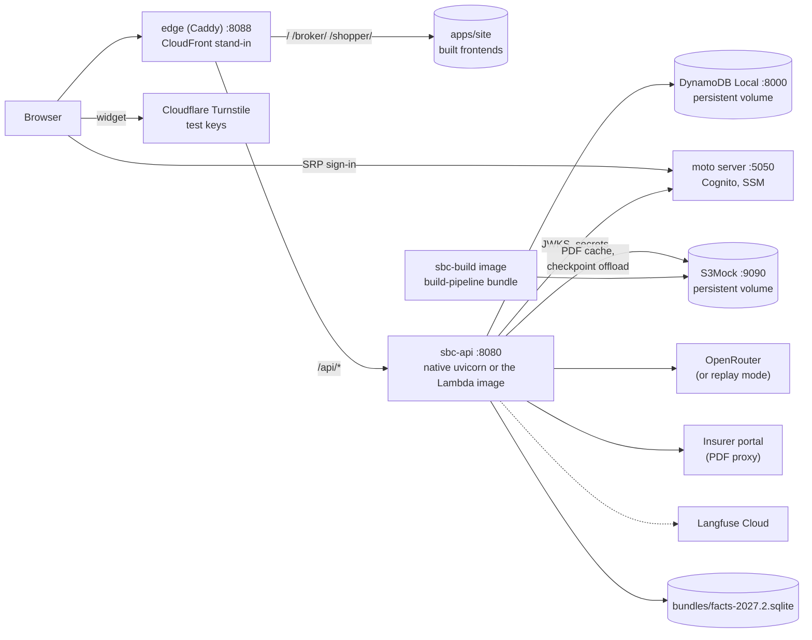

# Local track: the whole application on a Mac, end to end

Branch **`main_local`**, cut from `main_AWS` at `bc93183` on 2026-11-11. Status: **plan approved 2026-11-11**;
implementation in progress (see the roadmap checkboxes).

The goal: run every feature of both assistants on one Mac (Apple Silicon, Docker Desktop) the way it will run on
AWS, using local stand-ins for the AWS services, before the first AWS deploy. Anything that can only be proven in
a real AWS account is listed in [section 7](#7-what-local-cannot-prove) so it is not mistaken for tested.

## Contents

1. [Where things stand](#1-where-things-stand)
2. [Target: what "everything runs locally" means](#2-target-what-everything-runs-locally-means)
3. [Local architecture](#3-local-architecture)
4. [Feature matrix: AWS service, local stand-in, fidelity](#4-feature-matrix-aws-service-local-stand-in-fidelity)
5. [Roadmap](#5-roadmap)
6. [Code changes, by file](#6-code-changes-by-file)
7. [What local cannot prove](#7-what-local-cannot-prove)
8. [Branch and merge strategy](#8-branch-and-merge-strategy)
9. [Decisions needed](#9-decisions-needed)
10. [Risks](#10-risks)
11. [Definition of done](#11-definition-of-done)

---

## 1. Where things stand

`main_AWS` already runs partly on a laptop. What works today and what is stubbed:

| Area | Today with `APP_ENV=local` | Gap for a full local run |
|---|---|---|
| Facts bundle + search | `bundles/facts-2027.1.sqlite` (9,690 plans, bge-m3 embeddings) | No `plan_source` table, so the PDF proxy has nothing to serve; the `2027.2` rebuild is open (docs/aws/TODO.md §2.3) |
| Agent (classify, fast path, agent loop, verify, render) | Works with an OpenRouter key | **The broker key's $5 limit is spent** (2026-11-10) and there is no public key, so no live answer works |
| Broker sign-in | Skipped: `LocalAuthenticator` makes every request an admin | Cognito sign-in, groups, demo account, admin-only routes never exercised |
| Public sessions + Turnstile | Turnstile skipped; session secret per process | The session route's bot check and token flow never exercised |
| Stores (rate limits, daily cap, answer cache, kill switches, quarantine, sessions, audit) | In-process (`sbc_api/memory.py`) | The DynamoDB adapters run only in the compose stack, which uses a fixture bundle and an in-memory DynamoDB that loses everything on restart |
| Checkpoints (multi-turn, threads) | `InMemorySaver` | Lost on restart; `DynamoDBSaver` + S3 offload unexercised |
| PDF proxy cache | In-process | `S3PdfCache` unexercised |
| Secrets | `.env` | The SSM cold-start loader is skipped locally |
| Frontends | Three Vite dev servers, sign-in and Turnstile skipped | Never run as the built site behind one origin, as CloudFront serves it; `/landing/demo.json` missing |
| Observability | Plain logs; Langfuse only with keys | No way to find a turn by request ID; no traces |
| Offline build | CLIs run natively | The build image and `build-pipeline.sh` never ran against a bucket |
| Evals | Retrieval eval runs; generation eval needs credit | No eval through the HTTP API (WP13 item) |

Machine check (2026-11-11): uv 0.7.19, Docker 24.0.6 installed but **the daemon is not running**, Node **20.10
(end of life)**, poppler present, no Java (fine: DynamoDB Local runs in Docker), no AWS CLI, 16 GB RAM, 173 GB
free. The local `.env` still holds old Supabase variables that nothing reads.

## 2. Target: what "everything runs locally" means

One command brings up the stack; one URL serves the site; every flow below works in a browser and is covered by
an automated smoke test.

1. **Landing page** at `http://localhost:8088/` with the demo-broker login read from `/landing/demo.json`.
2. **Broker Assistant** at `/broker/`: a real sign-in (SRP, first-login new password, TOTP setup) against a
   local Cognito-compatible pool; plan search with filters; streamed answers; comparisons with CSV export;
   clarification buttons; earlier conversations; feedback; "Report a problem" with the request ID.
3. **Plan Shopper** at `/shopper/`: state choice, a real Turnstile widget (Cloudflare's test keys), a signed
   session token, up to 3 Individual plans, plain-language answers.
4. **Guards**, each provable by hitting it: per-user, per-session and per-IP rate limits, the demo account's
   limits, the global daily cap, the exact-answer cache, kill switches, quarantine, thread ownership, audit
   records, admin-only routes refusing non-admins and the demo account.
5. **Persistence across restarts**: threads, checkpoints, sessions, audit and caches survive `down`/`up`.
6. **SBC PDF proxy** for a preview-only plan: portal fetch, sha256 check, cache in the local bucket, cache hit on
   the second request.
7. **Secrets** loaded the AWS way: from the local Parameter Store at start-up, not from `.env`.
8. **Observability**: JSON logs, a lookup by request ID, and (if chosen) a Langfuse trace per turn.
9. **Offline build**: the build image runs `build-pipeline bundle` against the local bucket and publishes a
   bundle the API can load.
10. **Evals**: retrieval eval on the local bundle; ~30 golden items through the local HTTP API; the full gating
    run when credit allows.
11. **Both runtime shapes**: the API natively with hot reload (daily development), and the same container image
    Lambda runs (parity check before deploying).

## 3. Local architecture



| Service | Image / process | Port | Notes |
|---|---|---|---|
| `dynamodb` | `amazon/dynamodb-local:2.6.1` | 8000 | `-sharedDb -dbPath /data` on a named volume (today's compose uses `-inMemory`) |
| `aws` | `motoserver/moto:5.2.5` | 5050 | Cognito IdP and SSM, in memory. The bootstrap recreates them on every start after seeding moto's random generator, so the pool ID and the users' `sub`s are the same each time (checked 2026-11-11). Port 5000 is taken by macOS AirPlay Receiver |
| `s3` | `adobe/s3mock:4.11.0` | 9090 | The data bucket on a named volume (moto keeps S3 in memory only) |
| `bootstrap` | the API image, one-shot | — | Creates tables, bucket, SSM parameters, user pool, app client, groups, three users; writes the generated IDs to `.local/runtime.env` |
| `api` | native `uvicorn --reload`, or the API image | 8080 | Same settings either way, from `.local/runtime.env` |
| `edge` | `caddy:2.10.2-alpine` | 8088 | Serves `apps/site/`, proxies `/api/*` (only, as CloudFront does), sets CloudFront's cache and security headers |

Everything local lives under `infra/local/`, `scripts/local/` and `docs/local/`. Generated state goes in
`.local/` (git-ignored). The existing `infra/docker/compose.yaml` stays as the WP8 image test.

## 4. Feature matrix: AWS service, local stand-in, fidelity

| Feature | On AWS | Locally | Fidelity |
|---|---|---|---|
| API runtime | Lambda (arm64 image) + Lambda Web Adapter, Function URL | uvicorn natively, or the same image in Docker | Same app and image; no Lambda lifecycle, no cold-start freeze |
| Origin + routing | CloudFront: `/` S3, `/api/*` Function URL via OAC | Caddy on one origin with the same paths | Same paths and headers; no SigV4 signing (section 7) |
| Broker auth | Cognito user pool, SRP, TOTP, groups, JWKS | moto Cognito: pool, client, groups, SRP flow, JWKS endpoint | Tokens carry the real issuer format and pass the API's verifier unchanged except the JWKS URL. **moto doesn't check the SRP password proof or TOTP codes** |
| Public bot check | Turnstile, real widget | Turnstile test keys: always-pass and always-block pairs | Real widget and real `siteverify` call; no real bot scoring |
| Session tokens | HS256 with `SESSION_JWT_SECRET` from SSM | Same, secret seeded into local SSM | Same |
| Rate limits, daily cap, answer cache, kill switches, quarantine, sessions | DynamoDB `app` table | DynamoDB Local | Same adapters and key schema. **TTL is not enforced** by DynamoDB Local (expired items stay; the code already ignores them by timestamp, to be confirmed in L3) |
| Audit | DynamoDB `audit` table | DynamoDB Local | Same |
| Checkpoints | `DynamoDBSaver` + S3 offload of large items | DynamoDB Local + S3Mock | Same code path |
| PDF cache | S3 `pdf-cache/` with a 1-day lifecycle | S3Mock | Same; no lifecycle expiry |
| Secrets | SSM Parameter Store at cold start | moto SSM, loaded at start-up | Same loader (needs a small change, section 6) |
| Query-embedding cache | DynamoDB | DynamoDB Local | Same |
| LLM, embeddings, rerank | OpenRouter, ZDR, per-bot keys | OpenRouter, or optional replay mode | Same calls; replay mode only for credit-free UI and flow testing |
| Bundle | Baked into the image from S3 | `bundles/facts-2027.2.sqlite` mounted or baked | Same file |
| Offline build | ECS Fargate Spot task | The build image in Docker against S3Mock | Same script; no ECS scheduling or 1-hour credentials |
| Logs, metrics, alarms | CloudWatch JSON logs, metric filters, SNS | JSON logs to `.local/logs/`, `jq` lookup by request ID | Same log lines; no metric filters, alarms or emails |
| Tracing | Langfuse Cloud (optional) | Langfuse Cloud (section 9) | Same tracer and project type |
| Frontend hosting | S3 + CloudFront, hashed assets | `apps/site/` built with the same `VITE_*` settings, served by Caddy | Same build |
| Warmer | EventBridge → `/events` on the function directly | `curl -X POST :8080/events` in the smoke test | Same route |
| Budgets, IAM, OIDC deploy role, CDK | AWS account | Not emulated; covered by the CDK template tests | Section 7 |

## 5. Roadmap

Ten phases, done in order. Each ends with a commit to `main_local` and the doc audit
(every tracked `*.md`). 👤 marks steps that need you. Effort is a rough estimate of working sessions.

| Phase | What | Needs | Effort |
|---|---|---|---|
| **L0** | Prerequisites | 👤 Docker running, Node 22, OpenRouter credit | 30 min of yours |
| **L1** ✅ | Local profile, compose skeleton, one-command scripts | L0 | 0.5 |
| **L2** | Bundle `2027.2` built locally | L0 credit (cents) | 0.5 (mostly waiting) |
| **L3** ✅ | AWS stand-ins + bootstrap, API on them | L1 | 1 |
| **L4** ✅ | Real auth: Cognito (moto) and Turnstile test keys | L3 | 1 |
| **L5** ✅ | Frontends built and served behind the edge | L4 | 0.5 |
| **L6** ✅ | Observability: JSON logs, request-ID lookup, Langfuse | L3 | 0.5 |
| **L7** | Optional: model replay mode | L3 | 0.5 |
| **L8** | Offline build image against the local bucket | L3, L2 | 0.5 |
| **L9** | Verification: smoke test, HTTP eval, browser click-through | all | 1 |

### L0: prerequisites 👤

- [x] Start Docker Desktop; give it at least 4 GB of memory. (Running since 2026-11-11.)
- [ ] Node 22 (`brew install node@22`, or nvm). Node 20.10 is end of life and the AWS track wants 22 too.
- [x] **OpenRouter:** credit added and both variables set in `.env` (2026-11-11); L3 moves them into local SSM.
      **Open before AWS:** the two variables hold the same key. The deploy needs two keys with their own credit
      limits (each bot's hard cost cap, docs/aws/TODO.md §2.1).
- [ ] Optional: AWS CLI v2 (`brew install awscli`) to inspect local tables and buckets with `--endpoint-url`.
- [x] Clean the stale Supabase variables out of `.env` (nothing reads them).

**Done when:** `docker info` answers, `node -v` prints v22, `uv run sbc-llm-smoke` passes all four checks.

### L1: local profile and one-command scripts

- `infra/local/compose.yaml`: the services in section 3, named volumes, health checks, pinned image tags,
  and an `image` profile (API in Docker).
- `infra/local/Caddyfile`: routes and cache headers mirroring `infra/cdk/sbc_infra/constructs/web.py`.
- Low demo limits and a small global daily cap, so every guard is easy to trip by hand: `SBC_PORTFOLIO__*` in
  `infra/local/stack.env`, not `config/env/local.yaml` (plain local runs keep the portfolio limits off, and a unit
  test holds that).
- `infra/local/stack.env`: every non-secret local setting (endpoints, table and bucket names, dummy AWS
  credentials, the bundle path), committed; generated values go to `.local/runtime.env`.
- `scripts/local/`: `up.sh` (stand-ins, bootstrap, API, edge; `--image` for the container API), `down.sh`
  (`--wipe` drops the volumes), `api.sh` (native API with `--reload` against the stand-ins), `status.sh`,
  `logs.sh`.
- A `Makefile` with the same targets (`make up`, `make down`, `make smoke`, ...).
- `.gitignore`: `.local/`.

**Done when:** `scripts/local/up.sh` brings up DynamoDB Local, moto, S3Mock and Caddy and `status.sh` shows them healthy.

> **Status: done 2026-11-11.** `up.sh` starts the stand-ins and the edge and creates the tables; the native API
> (`api.sh`) and the API image (`up.sh --image`) both report `"stores": "dynamodb"` through the edge; tables and
> bucket objects survive `down`/`up`. Not in L1 as first written: a `Makefile` and `bootstrap.sh` (tables only
> until L3); S3 runs on S3Mock instead of moto, for persistence.

### L2: bundle `2027.2` locally

The corpus is on this machine (`data/`, 6.1 GB of PDFs), so the AWS TODO's rebuild runs here:

```bash
uv run sbc-build-bundle --version 2027.2 --release
uv run sbc-embed-bundle bundles/facts-2027.2.sqlite            # only new chunks hit OpenRouter
python -m evals.harness.retrieval --bundle bundles/facts-2027.2.sqlite --golden evals/golden/0.2.0 --setup full
```

**Done when:** about 1,383 preview-only plans with 0 missing; recall@5 ≈ 0.920 as on `2027.1`. This also closes
docs/aws/TODO.md §2.3 items 1–2 and the WP3 open check.

### L3: AWS stand-ins and the API on them

- `scripts/local/bootstrap.py` (idempotent, boto3 against the endpoints): `sbc-create-tables` definitions,
  the data bucket, SSM parameters under `/sbc/local/` (OpenRouter keys from `.env`, a generated session secret,
  the Turnstile test secret), and the Cognito resources (L4).
- The API loads secrets from local SSM at start-up (code change 1) and uses DynamoDB Local and S3Mock through
  boto3's `AWS_ENDPOINT_URL_<SERVICE>` variables. No other store code changes.
- Confirm how the stores behave when DynamoDB Local leaves expired items in place.

**Done when:** `/api/healthz?deep=1` shows `"stores": "dynamodb"`, `"secrets_loaded"` > 0 and both bots `ready`;
a streamed answer works; after `down` and `up` the thread is still listed and continues.

> **Status: done 2026-11-11, except the parts that need OpenRouter credit.**
> - `bootstrap.py` creates the tables and the bucket and mirrors the secrets into `/sbc/local/` (names printed,
>   never values; parameters `.env` no longer has are removed). The session secret is generated once into
>   `.local/secrets.env` (mode 600), so public sessions survive restarts. The Turnstile secret and the Cognito
>   resources come with L4.
> - The API logs `"secrets_loaded": 2` at start-up. The API image, which has no `.env`, shows the broker bot
>   `ready` from Parameter Store alone. `secrets_loaded` is in the start-up log line, not in deep health.
> - The existing DynamoDB integration tests (a clarification resumed by a second app instance) pass against the
>   stack's DynamoDB Local.
> - A kill switch set through `POST /api/admin/kill-switch` survives `down`/`up` and still blocks the turn; a
>   thread written by the native API is listed by the API image.
> - Before credit was added, a turn ran end to end and ended in the safe fallback message
>   (`HTTP 403: Key limit exceeded`, logged in the `turn` line).
> - **With credit (2026-11-11):** both bots `ready` (`secrets_loaded` 3); `sbc-llm-smoke` passes all four checks.
>   "What is the deductible on BTCU8?" through the edge: fast path, 3 model calls, $0.0068, about 8 s, the SBC's
>   wording exactly. After `down`/`up`, the follow-up "And what is its out-of-pocket limit?" on the same thread
>   resolved BTCU8 from the restored checkpoint: $0.0111, the SBC's wording exactly. Total spent on these
>   checks: about $0.02.
> - **Expired items:** every app store (answer and embedding caches, threads, feedback) checks the expiry time
>   when it reads, and rate-limit counters are keyed by time window, so DynamoDB Local keeping expired items
>   changes nothing for them. Only checkpoints differ: an expired thread stays resumable by its ID locally,
>   though the thread list hides it. Noted in section 7.

### L4: real authentication locally

- Bootstrap creates the user pool (SRP allowed, TOTP optional), the SPA client, the `broker` and `admin`
  groups, and three users: `admin` (admin), `broker` (broker), `demo-broker` (the demo account, its `sub`
  written into `SBC_PORTFOLIO__DEMO_USER_IDS`). Passwords are generated once into `.local/users.env`.
- API: with Cognito configured, `APP_ENV=local` uses `BearerAuthenticator` like dev and prd; the
  developer bypass stays only when it isn't (code changes 2–3).
- Turnstile with Cloudflare's always-pass test keys by default; `scripts/local/bootstrap.sh --turnstile block`
  switches to the always-fail secret to check refusal.
- Broker app: `VITE_COGNITO_ENDPOINT` points `amazon-cognito-identity-js` at moto (code change 4).

**Done when:** sign-in works for each user; a broker token is refused on public routes and vice versa; the admin
routes refuse the broker and the demo account; a Turnstile session opens with the pass keys and is refused with the
block keys.

> **Status: done 2026-11-11, with no model calls (no OpenRouter cost).**
> - The bootstrap mirrors the CDK pool (password policy, optional TOTP, a public SPA client, groups) and the AWS
>   users (`admin`, `broker`, `demo-broker`). It seeds moto first, so after a moto restart the pool ID, client ID
>   and `sub`s come out identical (checked twice). `scripts/local/token.sh <user>` prints an access token.
> - Through the edge, natively and in the API image: no token or a tampered one → 401; a token in
>   `Authorization` → 401 (dropped, as CloudFront does); a broker token on the public bot → 401; a public session
>   on the broker bot → 401; the admin kill switch → 403 for `broker` and `demo-broker`, 204 for `admin`.
> - Turnstile against Cloudflare's real `siteverify` with its test secrets: pass → a session token; block → 403.
> - The demo account's limit: with the broker kill switch on (turns refused before any model call, but still
>   counted), the sixth demo turn in a minute gets the `limit` event; an ordinary broker isn't limited.
> - **Spike outcome (risk in section 10):** moto can't finish an SRP sign-in. After the first step,
>   `amazon-cognito-identity-js` sends the user's `sub` back as `USERNAME`, and moto only finds users by name or
>   alias. So with `VITE_COGNITO_ENDPOINT` set (local only), the broker app signs in with `USER_PASSWORD_AUTH`;
>   on AWS it keeps SRP. Through the app's own library against moto: `broker` and `admin` sign in and call the
>   API; a wrong password is refused (moto checks it in this flow, unlike its SRP).
> - **Dropped:** a test user with a temporary password. moto's `NEW_PASSWORD_REQUIRED` challenge leaves out the
>   `userAttributes` the library parses, so the first-sign-in step can only be checked on AWS (section 7).
> - The browser sign-in itself is checked in L5, when the apps are built with the local `VITE_*` values. Until
>   then the site at :8088 is a build without them, and its broker app can't sign in.

### L5: frontends behind the edge

- `scripts/local/web.sh`: `npm ci` and `npm run build` with the local `VITE_*` values, `assemble`, and a
  generated `apps/site/landing/demo.json` for the demo user, served by Caddy at `:8088`.
- Keep the Vite dev servers for UI work (`scripts/local/web.sh --dev`), now pointed at the stand-ins as well.

**Done when:** at `http://localhost:8088` the landing demo login, a broker sign-in, plan search, a streamed answer,
CSV export, a Shopper session and answer all work, at desktop and phone widths.

> **Status: done 2026-11-11, except CSV export and the clarification buttons, which move to L9.** Model cost:
> $0.0137 (two fast-path answers).
> - `scripts/local/web.sh` builds with the local `VITE_*` values (pool and client IDs, `VITE_COGNITO_ENDPOINT`,
>   Cloudflare's test site key) in about 5 s and writes `apps/site/landing/demo.json` for `demo-broker`, as
>   `rotate-demo-password.sh` does on AWS. `--dev` runs the three Vite dev servers with the same values.
> - **Fixed on the way:** the edge mounted `apps/site`, which the build deletes and recreates, so after a rebuild
>   the container kept serving the deleted folder (404s). It now mounts `apps/` and serves `apps/site` from it.
> - In the browser pane at :8088, no console errors: the landing page shows the demo login from `demo.json`; the
>   broker app signs in (`broker`, through the Cognito stand-in) and lists 9,690 plans; "What is the deductible on
>   BTCU8?" streams a verified answer ($0.0073; the SBC's wording exactly), with sources, details and the request
>   ID; feedback is stored (204); the Conversations tab lists the thread. The Plan Shopper's Turnstile test widget
>   passes, the session opens for Ohio with its 70 Individual plans, and "What does a primary care visit cost?" on
>   01M7 answers ($0.0064; every value matches the SBC, including "HMO" from its header).
> - Phone width (375 px): landing, Plan Shopper and the broker sign-in fit with no horizontal scroll.
> - **The answer cache missed** for a question asked earlier: its key includes the configuration hash, and L4
>   added the demo user's ID to the configuration. That is by design; repeats are cached for 24 hours now.
> - **Moved to L9:** CSV export and the clarification buttons need agent turns ($0.02–0.04 each), so they are
>   checked with the L7 replay mode instead of new paid calls (they have unit tests in `apps/chat-ui` meanwhile).

### L6: observability

- The API writes its JSON lines to `.local/logs/api.jsonl` as well as the console;
  `scripts/local/find-request.sh <request-id>` prints that request's lines.
- Langfuse Cloud (section 9): a Hobby project's keys go into local SSM (`LANGFUSE_PUBLIC_KEY`,
  `LANGFUSE_SECRET_KEY`), and deep health shows `"tracing": "langfuse"`.
- The per-answer details footer and "Report a problem" link show the request ID that the lookup finds.

**Done when:** a deliberate error is found by its request ID; with Langfuse on, a turn's trace shows its model and
tool calls and cost.

> **Status: done 2026-11-11, except the Langfuse trace, which waits for your Langfuse Cloud keys 👤.** No model cost.
> - `LOG_FILE` (code change 6): the API writes the same JSON lines to `.local/logs/api.jsonl`; `api.sh` sets it
>   and runs uvicorn with `--no-access-log`, as the image does, so the file holds JSON only.
>   `scripts/local/find-request.sh <id>` prints one request's lines from that file and from the API container.
> - **Found and fixed (affects AWS too):** a deliberate error (DynamoDB Local stopped mid-request; the turn fails
>   closed) gave a bare 500 with no `x-request-id`, and the only log was uvicorn's plain-text traceback without
>   the request ID. And on Lambda an HTTP 500 is a successful invocation, so the `lambda-errors` alarm would never
>   fire. Now the request-ID middleware catches it: a JSON `ERROR` line (`unhandled_error`, `request_id`, route,
>   traceback), and a 500 with the ID in the header and body (the apps already show the header's ID under
>   "Report a problem"). A new CloudWatch alarm, `ApiErrors` (`{ $.level = "ERROR" }`, 9 of the 10 free),
>   covers it and failed or timed-out turns. Re-run locally: `find-request.sh` shows both lines for the ID.
> - **Langfuse 👤:** create a Langfuse Cloud Hobby project and put `LANGFUSE_PUBLIC_KEY` and
>   `LANGFUSE_SECRET_KEY` in `.env` (and `LANGFUSE_HOST=https://us.cloud.langfuse.com` for a US-region project;
>   the default is the EU region). Then `scripts/local/bootstrap.sh`, restart the API, and deep health shows
>   `"tracing": "langfuse"`. One cached-miss turn (about $0.007) checks the trace.

### L7 (optional): model replay mode

A `ChatModel` that records each OpenRouter exchange (redacted, keyed by a hash of the request) and replays it, set
by `SBC_LLM_MODE=live|record|replay`. It lets the UI, guards and smoke test run with no credit, and is the
"recorded model responses" item in TODO.md (CI replay of the generation eval). Never on outside `APP_ENV=local`.

**Done when:** the smoke test passes in `replay` with OpenRouter unreachable.

### L8: offline build against the local bucket

- `s3_sync.py` honors `AWS_ENDPOINT_URL_S3`; seed the bucket's `data/` from the local corpus (Markdown only for
  the `bundle` mode).
- Run the build image (`infra/docker/build.Dockerfile`, native arch) with `build-pipeline bundle` and
  `BUNDLE_VERSION=2027.2-local`; point the API at the published bundle and restart.

**Done when:** the bundle lands in `s3://sbc-local-data/bundles/2027.2-local/` with its eval report, and the API
serves from it. This is the WP8 open check, minus ECS.

### L9: verification

- `scripts/local/smoke.sh`: every route and guard in section 2 as `curl` checks with pass/fail output, against
  the edge (`:8088`), not the API port. It signs in through moto to get tokens.
- `evals/harness/http.py`: the WP13 HTTP adapter (SSE events → `Reply`, reusing `generation.py`'s scoring) and a
  run of about 30 golden 0.2.0 items through the local API.
- A pytest integration suite under `tests/integration/local/`, skipped unless the stack is up.
- A browser click-through: landing → Shopper question → broker sign-in → comparison → PDF citation for a
  preview-only plan → feedback → a second turn after restart.
- Measure warm fast-path latency locally (target ≤ 4 s p50) for the runbook.

**Done when:** section 11 holds.

## 6. Code changes, by file

All changes are switched by configuration and keep today's behavior when the new settings are absent, so they can
go to `main_AWS` unchanged (section 8).

| # | File | Change |
|---|---|---|
| 1 ✅ | `packages/api/src/sbc_api/deps.py` | `load_secrets_into_environment`: load from SSM when `SSM_PREFIX` is set, in any environment (it skipped `local`). Tests in `tests/unit/aws/test_secrets_schema.py` |
| 2 ✅ | `packages/api/src/sbc_api/deps.py` | `_authenticator`: `BearerAuthenticator` when Cognito is configured; `LocalAuthenticator` only for `local` without it |
| 3 ✅ | `packages/core/src/sbc_core/config.py`, `sbc_api/auth/cognito.py` | Optional `COGNITO_JWKS_URL` overriding the derived JWKS URL (moto's tokens already use the real issuer format) |
| 4 ✅ | `apps/broker/src/auth.ts` | Optional `VITE_COGNITO_ENDPOINT` passed to `CognitoUserPool`; with it set, `USER_PASSWORD_AUTH` instead of SRP (moto can't finish SRP) |
| 5 | `infra/docker/s3_sync.py` | Honor `AWS_ENDPOINT_URL_S3` (check whether boto3 already does; then only a test) |
| 6 ✅ | `packages/api/src/sbc_api/logging.py` | Optional `LOG_FILE` for a JSON-lines copy of the log |
| 6a ✅ | `packages/api/src/sbc_api/app.py`, `infra/cdk/sbc_infra/constructs/ops.py` | Not planned; found in L6: unhandled errors keep their request ID (JSON `ERROR` line, header, body), and an `ApiErrors` alarm on `ERROR` lines |
| 7 | `packages/core/src/sbc_core/llm.py` or a new module | L7 replay mode (only if chosen) |
| 8 | `evals/harness/http.py` | The HTTP eval adapter (WP13) |
| — | New: `infra/local/`, `scripts/local/`, `docs/local/`, `Makefile` | The stack, scripts and runbook |

Each change gets unit tests; CI (`ruff`, `mypy`, `lint-imports`, `pytest tests/unit`, frontend checks) stays
green on every commit.

## 7. What local cannot prove

These stay on the AWS first-deploy checklist (docs/aws/TODO.md §2.4 and §4):

- CloudFront origin access control signing to the Function URL, and the `X-Sbc-Authorization` path through it.
- Lambda cold start, response streaming through the Function URL and the Lambda Web Adapter.
- Cognito's SRP sign-in (locally the apps use `USER_PASSWORD_AUTH`, because moto can't finish SRP), the
  first-sign-in "choose a new password" step (moto's challenge lacks `userAttributes`), TOTP verification (moto
  accepts any code), and the demo account's inability to change its password.
- DynamoDB TTL deletion (locally an expired thread's checkpoints stay resumable by ID), S3 lifecycle expiry, IAM
  permissions on every call.
- CloudWatch metric filters, alarms, SNS emails, Budgets, Cost Anomaly Detection.
- ECS Fargate Spot scheduling and the 1-hour build credentials; the arm64 image build (local builds are native
  arm64 on Apple Silicon, which helps).
- The OIDC deploy role and the GitHub deploy workflow.

## 8. Branch and merge strategy

- `main_local` is cut from `main_AWS` (which has the API, auth, guards and frontends that `main` lacks).
- Commits go directly to `main_local`, one per phase, with the doc audit in the same commit, the way `main_AWS`
  works.
- Every code change is configuration-switched, and local-only files sit in their own folders, so `main_local` can
  merge into `main_AWS` before the first deploy with no conflicts in behavior. The local stack then stays as the
  pre-deploy check.
- If `main_AWS` moves meanwhile, merge it into `main_local` (no rebase of pushed history).

## 9. Decisions

Decided 2026-11-11 (Syamsruthin Kaliki):

1. **Langfuse: Langfuse Cloud Hobby** (free; redacted traces leave the machine). Its keys go into local SSM; no
   self-hosted Langfuse profile.
2. **Replay mode (L7): build it.** It also covers the TODO for keyless CI replay of the generation eval.
3. **Commits: one per phase**, straight to `main_local`, pushed to `origin/main_local`.

4. **OpenRouter credit: spend as little as possible** (2026-11-11). Free checks first (tests with scripted
   models, BM25-only evals); at most one paid turn per thing to prove, with its cost recorded; ask before anything
   larger (the full gating run is about $5). Measured: $0.007–0.011 per fast-path turn. The L7 replay mode then
   carries the repeated UI and smoke runs.

## 10. Risks

| Risk | Mitigation |
|---|---|
| moto's Cognito SRP flow differs from what `amazon-cognito-identity-js` expects | **Happened (L4 spike):** the fallback is in place, `USER_PASSWORD_AUTH` locally behind `VITE_COGNITO_ENDPOINT`; SRP is checked on AWS |
| DynamoDB Local behaves differently (TTL, limits) | Known gaps listed; the CDK template tests and the first deploy cover the rest |
| No OpenRouter credit | L7 replay mode; L1, L3–L6 and L8 work without answers |
| S3Mock differs from S3 | Checked in L1: path-style addressing and `ServerSideEncryption=AES256` work; the first deploy covers the rest |
| Docker memory on a 16 GB Mac | Stand-ins need under 1.5 GB; Langfuse is the cloud service |
| Port clashes (5000 AirPlay, 8000, 8080) | Ports in one env file; `status.sh` checks them first |
| Insurer portal changes or rate-limits the PDF proxy | One plan in the smoke test, cached after the first fetch |
| `main_AWS` and `main_local` diverge | Config-switched changes only; merge back before the first deploy |

## 11. Definition of done

- `make up` (or `scripts/local/up.sh`) from a clean checkout plus `.env` brings the stack up in under 3 minutes;
  `make down` and `make up` keep all state; `make down --wipe` resets it.
- `make smoke` passes every check in section 2, through the edge, in both API modes (native and image).
- The browser click-through in L9 works at desktop and phone widths.
- The HTTP eval on ~30 golden items has no hard-gate failures.
- `docs/local/RUNBOOK.md` explains setup, daily use, every script, the users, resetting, and troubleshooting; the
  README, `apps/README.md`, `docs/aws/RUNBOOK.md` §1, `docs/aws/TODO.md` and `.env.example` point to it.
- CI is green on `main_local`.
